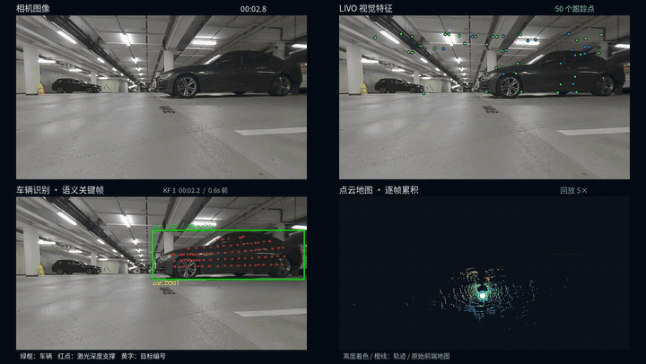
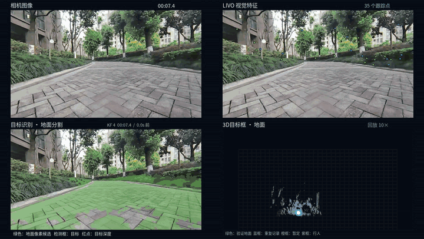
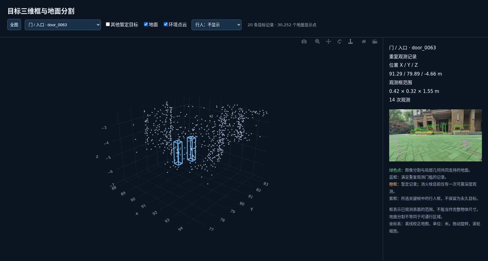
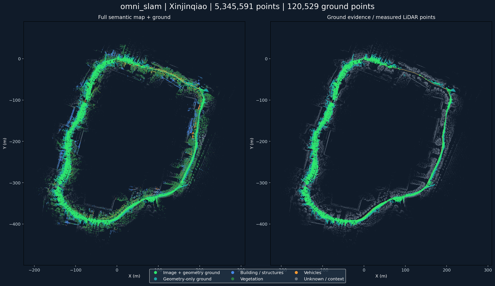
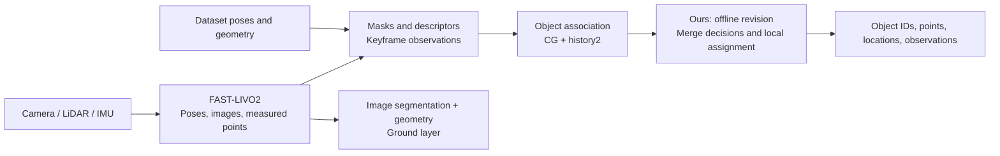

# OmniSLAM

**English** | [简体中文](README.zh-CN.md)

**[Paper · arXiv:2611.30184](https://arxiv.org/abs/2611.30184)**

OmniSLAM is an object-centric semantic mapping project built on ROS 2 Humble. It combines LiDAR / visual-inertial odometry, cross-frame object association, and map queries. Each object stores a 3D point set, location, and image observations, accessible by category or ID.

The map revision module uses multi-view masks to decide whether existing objects should merge, then assigns new measured points through local geometric competition. ROS nodes support robot integration; the revision module has a separate offline evaluation pipeline.

[Demos](#demos) · [Quick start](#quick-start) · [Results](#paper-and-results) · [Documentation](#documentation-and-layout)

## Demos

### Garage mapping

Replay of `rosbag2245`: camera images, LIVO visual keypoints, vehicle detections, and accumulated point clouds.



*About 20 seconds, approximately 30× faster than acquisition time. The bottom-right point cloud is colored by height.*


Vehicle object map from an earlier garage experiment. Colored points distinguish predicted objects, gray points show the environment, and the palette repeats. `Ours candidate` refers to that experiment's method version; the current revision method's four-way comparison is in the [paper supplement](docs/paper/README.md).

### Outdoor objects and ground segmentation

Image detections and ground candidates are projected onto measured points to produce 3D observation boxes and a ground layer.



*About 21 seconds, approximately 80× faster than acquisition time. Both GIFs come from the November 6, 2026 LIVO semantic integration experiments. Playback speed does not indicate processing throughput.*

<details>
<summary>Object query example</summary>



Select an object to inspect its location, observation count, and source images. The 3D box encloses the observed surface.

</details>

### Xinjinqiao global semantic map

The map contains 5,345,591 points, including 120,529 ground points. The left panel shows the global semantic map; the right panel shows the ground layer. Categories include buildings / structures, vehicles, vegetation, and ground.



*Offline reconstruction. Ground points supported by both images and geometry are distinguished from those supported by geometry alone. The layer has not been evaluated for navigation traversability. [Media sources and GIF export settings](docs/assets/readme/README.md).*

## Features

- **Odometry and relocalization:** FAST-LIO mapping, map saving, and ICP relocalization; FAST-LIVO2 adds visual observations.
- **Object maps:** mask projection, cross-frame association, 3D observation boxes, and location / image queries by category or ID.
- **Map revision:** multi-view merge decisions, historical point relabeling, and new-point assignment, with a CPU demo and offline evaluation.
- **Ground extraction:** image segmentation combined with local gravity-aligned geometry.

FAST-LIO is the default odometry backend. LIVO loop closure currently corrects offline maps; the paper's revision module also runs offline. The S100 setup runs LIVO onboard and semantic inference on a companion computer. BPU deployment and real-time semantic performance evaluation remain pending.

### Architecture



The current KITTI-360 experiments use SAM3, SigLIP, and SegFormer. The ROS semantic node uses Mask R-CNN, with optional SegFormer ground segmentation. See the [research guide](docs/research/README.md) for inputs and dependencies.

## Quick start

### 1. Object revision core

Requires Python 3.10+ and `g++`. This CPU demo needs no ROS installation, model weights, or dataset.

```bash
git clone git@github.com:YanYaoyuan/omni_slam.git
cd omni_slam
python3 -m venv .venv
source .venv/bin/activate
python -m pip install -r requirements/research-core.txt
python -m pip install -e ./omni_semantic_map
python examples/revision_core_demo.py --output build/demo/revision_core.json
bash scripts/test_research_core.sh
```

The demo runs multi-view merge decisions and local point assignment on a synthetic object graph. Dataset evaluation requires separate data and model preparation; see the [reproduction guide](docs/research/README.md).

### 2. Build LIVO and semantic messages (ROS 2 Humble)

Reference environment: Ubuntu 22.04 / ROS 2 Humble. Dependencies include PCL, Eigen, OpenCV, OpenMP, cv_bridge, rosidl, and colcon. Pinned Sophus and Vikit sources are included in `FAST_LIVO2/third_party/`.

```bash
source /opt/ros/humble/setup.bash
rosdep install --from-paths omni_slam_interfaces FAST_LIVO2 omni_semantic_map \
  --ignore-src --rosdistro humble -y
colcon --log-base log/livo_humble build \
  --base-paths omni_slam_interfaces FAST_LIVO2 omni_semantic_map \
  --packages-select omni_slam_interfaces fast_livo omni_semantic_map \
  --build-base build/livo_humble --install-base install/livo_humble \
  --executor sequential \
  --cmake-args -DCMAKE_BUILD_TYPE=Release -DFAST_LIVO_USE_LIVOX=OFF
source install/livo_humble/setup.bash
ros2 interface show omni_slam_interfaces/msg/LivoSemanticFrame
```

Configure sensor topics, camera calibration, extrinsics, and time units for your hardware. VBot H.265 recordings must first be decoded into rectified images with their original timestamps. See the [FAST-LIVO2 port documentation](FAST_LIVO2/README.md).

### 3. Robot manager and semantic nodes

The manager depends on the sibling projects `omni_tf_manager` and `omni_robot_interfaces`. Build and source their overlays before launching it.

- [S100 / companion setup, calibration, launch, and recording](docs/deployment/s100_livo_semantic_trial.md)
- [LIO manager, VBot mapping, and relocalization](docs/deployment/lio_manager_quickstart.md)
- [Manager interfaces and backend selection](omni_slam_manager/README.md)
- [Object queries, 3D boxes, and observation reprojection](omni_semantic_map/README.md)
- [Orin deployment](DEPLOY_ORIN.md)

In the inspection system, Mission starts the SLAM Manager and TF Manager. Use `omni_slam_ctl` for standalone debugging; do not start a second manager while one is running.

## Documentation and layout

| Directory | Contents |
| --- | --- |
| `FAST_LIO/` | LIO, loop closure, and relocalization interfaces |
| `FAST_LIVO2/` | Humble port, configuration, recording conversion, and offline map tools |
| `omni_slam_interfaces/` | Manager interfaces, keyframe messages, and atomic semantic-frame messages |
| `omni_slam_manager/` | Backend process management, map storage, and status |
| `omni_semantic_map/` | Online semantic nodes, offline object algorithms, evaluation adapters, and tests |
| `examples/` | Small demos without dataset dependencies |
| `scripts/benchmarks/` | Data preparation, mapping, ablations, and scoring |
| `docs/research/` | Method, protocols, and reproduction requirements |
| `docs/benchmarks/`, `docs/experiments/` | Dated experiment records |
| `docs/paper/visibility_revision/latex/` | Paper, supplement, figures, tables, and build entry point |
| `docs/deployment/`, `scripts/` | Deployment, build, recording, and packaging tools |

Most detailed guides are currently in Chinese; commands and configuration names match both README versions.

## Paper and results

**OmniSLAM: Evidence-Authorized Revision of Persistent Object Maps**

Haoxiang Jie<sup>*,†</sup>, Yaoyuan Yan<sup>*</sup>, Zhiyou Heng, Liang Li, Zhaosong Li, Lifeng Liu

<sup>*</sup> Equal contribution, co-first authors. <sup>†</sup> Corresponding author: Haoxiang Jie ([jiehaoxiang@bgyfw.com](mailto:jiehaoxiang@bgyfw.com)).

[arXiv preprint](https://arxiv.org/abs/2611.30184) · [Paper PDF](https://arxiv.org/pdf/2611.30184). LaTeX sources for the paper and supplement are included in the repository.

[Paper sources and build](docs/paper/README.md) · [Figure index](docs/paper/visibility_revision/latex/FIGURES.md) · [Reference audit](docs/paper/visibility_revision/latex/REFERENCE_AUDIT.md) · [Four-window results](docs/research/results/reviewer_extension_20261117.json)

Building / car instance AP50:90 on KITTI-360, reported as percentages:

| Method | Mean over two windows: 0009 / 0010 | Mean over four windows: 0003–0006 |
| --- | ---: | ---: |
| Object-map baseline | 17.259 | 20.263 |
| Unconditional revision | 17.050 | 23.251 |
| **Ours** | **18.762** | **23.171** |
| Ours minus baseline | +1.503 | +2.908 |

The two groups are evaluated separately with a local adapter; these are not official test-server results. The four spatial holdouts come from sequences used during development. Gains mainly come from buildings. Unconditional revision has a slightly higher four-window mean, and Ours falls below the baseline in 0004. The additional seed-frame stability check gives no independent AP gain in the ablations.

Robot recordings demonstrate mapping and system integration; independent object annotations are not available. Replica, SceneNN, and earlier method results are listed in the [research records](docs/research/README.md#结果与来源).

## Data, models, and reproduction

The repository contains code, configurations, tests, paper sources, and preview media. Datasets, ROS recordings, model weights, full point clouds, and prediction caches must be prepared separately.

Evaluation scripts read experiment protocols, caches, and file hashes. Some paths refer to the original experiment environment. See the [reproduction requirements](docs/research/README.md#复现层级) for inputs and adaptation steps.

## Tests and contributing

- CPU core tests: `bash scripts/test_research_core.sh`.
- Full semantic research tests: `PYTHONPATH=omni_semantic_map:scripts/benchmarks python3 -m pytest -q omni_semantic_map/test`. Optional dependencies and dataset tests are described in the research guide.
- ROS / Manager tests and source checks: [contributing guide](CONTRIBUTING.md).
- Completed builds and tests: [validation record](docs/research/VALIDATION.md).

Modules retain their respective licenses and copyright notices. See [third-party sources](THIRD_PARTY.md).
