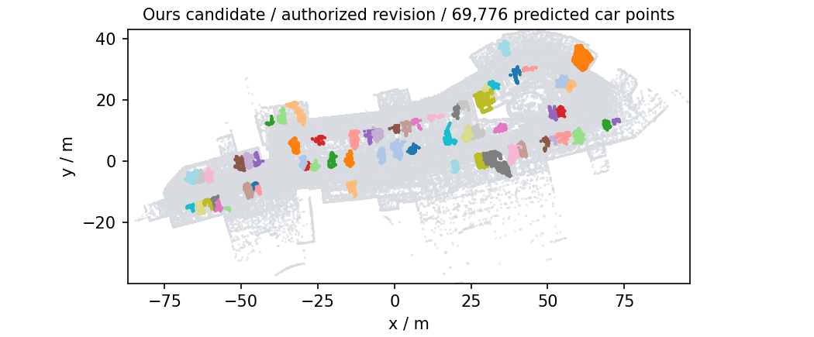
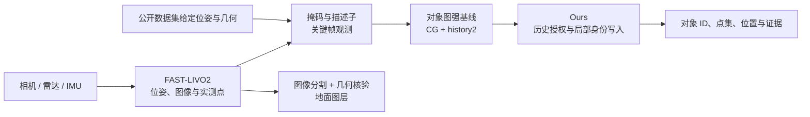

# omni_slam

ROS 2 Humble 下的激光 / 视觉惯性建图、重定位与对象级语义地图研究工程。项目主线是让机器人保留可查询、可追溯的对象地图：定位提供位姿和实测几何，视觉模型提供掩码与语义，对象关联维护身份，证据驱动的修订模块决定何时修改历史归属与写入新增表面。

[论文与最新结果](#论文与实验结果) · [实验展示](#实验展示) · [系统结构](#系统结构) · [快速开始](#快速开始)

**更新（2026-11-19）**：已完成主稿与补充材料的全文修订，合入四个 KITTI-360 空间留出窗口结果，并核对 24 条参考文献。[论文入口](docs/paper/README.md) · [文献核对记录](docs/paper/visibility_revision/latex/REFERENCE_AUDIT.md)

## 实验展示

### 车库 · 从视觉观测到对象地图

相机图像、LIVO 视觉关键点、车辆识别与逐帧点云累积，同屏展示真实 **rosbag2245** 回放。


*约 20 秒循环；原汇报视频再加速 6×，相对采集时间约 30×。右下地图按高度着色，车辆对象地图见下图。*



**车辆对象地图｜Ours candidate。** 彩色点表示预测车辆对象，灰色点为环境；颜色用于区分对象身份，调色板会循环。此图来自论文中的同一份封存结果，展示车辆在全局地图中的位置与几何分布；真实车库尚无独立对象标注。

### 室外 · 三维目标框与地面分割

图像目标检测、地面候选分割、实测深度支持和三维地图联动展示。


*约 21 秒循环；原汇报视频再加速 8×，相对采集时间约 80×。GIF 是实验回放，不代表算法处理帧率。两段视频均来自 2026-11-06 的 LIVO 语义集成实验，当前论文 Ours 的结果单独标注。*

<details>
<summary><strong>展开查看：对象三维框、位置查询与图像证据</strong></summary>


选择对象后查看三维观测框、位置、观测次数与证据图。框表示已观测表面的范围，不等于完整物体尺寸。

</details>

### 新金桥 · 全局语义地图与地面图层

**5,345,591 个地图点 · 120,529 个地面点。** 左图展示完整语义地图，右图展示地面证据与实测雷达点；包含建筑 / 结构、车辆、植被与地面图层。


*离线全局结果；图像与几何共同支持的地面、仅几何支持的地面分别着色。地面图层不等同于已验证的导航可通行区域。点击图片可查看大图。[素材来源与 GIF 生成方式](docs/assets/readme/README.md)。*

## 当前能力

| 路径 | 已有实现 | 当前边界 |
| --- | --- | --- |
| LIO 与重定位 | FAST-LIO、地图保存、先验地图重定位、管理器与 TF 接口 | 现有部署默认后端 |
| 视觉辅助定位 | FAST-LIVO2 原生 ROS 2 Humble 移植、VBot 输入、关键帧与语义消息 | LIVO 在线回环后端尚未接通，离线修正单列 |
| 对象语义试跑 | 目标掩码、三维观测框、跨帧记录、位置与证据图查询 | 观测框不是完整物体尺寸，尚无 S100 语义实时性能结论 |
| 地面图层 | 图像地面候选与局部重力几何核验 | 不是已验证的可通行性 / 导航代价地图 |
| 论文 Ours | 历史修改授权、局部对象身份与新增实测点写入 | 离线 benchmark 和车库集成，未自动替换在线关联 |

### 系统结构



室内共享前端实验使用 SAM2.1 / SigLIP，当前室外论文实验使用 SAM3 / SigLIP。DINO、注意力和 VGGT 保留为研究分支，不混入当前主结果。机器人与公开数据集的输入、定位和评价范围分别记录。

## 快速开始

### 1. 只运行对象修订核心（无需 ROS、GPU、模型或数据集）

适用 Python 3.10+，需 `g++`：

```bash
git clone git@github.com:YanYaoyuan/omni_slam.git
cd omni_slam
python3 -m venv .venv
source .venv/bin/activate
python -m pip install -r requirements/research-core.txt
python -m pip install -e ./omni_semantic_map
python examples/revision_core_demo.py --output build/demo/revision_core.json
bash scripts/test_research_core.sh
```

该演示调用论文实际使用的身份授权与图传播内核，展示支持、冲突和不确定时的决策。合成演示验证安装与机制，不代表公开数据集评分。[研究与复现说明](docs/research/README.md)。

### 2. 构建 LIVO 与语义消息（ROS 2 Humble）

参考环境为 Ubuntu 22.04 / ROS 2 Humble。依赖包括 PCL、Eigen、OpenCV、OpenMP、cv_bridge、rosidl 和 colcon。Sophus 与 Vikit 的固定版本已包含在 `FAST_LIVO2/third_party/`。

```bash
source /opt/ros/humble/setup.bash
rosdep install --from-paths omni_slam_interfaces FAST_LIVO2 omni_semantic_map \
  --ignore-src --rosdistro humble -y
colcon --log-base log/livo_humble build \
  --base-paths omni_slam_interfaces FAST_LIVO2 omni_semantic_map \
  --packages-select omni_slam_interfaces fast_livo omni_semantic_map \
  --build-base build/livo_humble --install-base install/livo_humble \
  --executor sequential \
  --cmake-args -DCMAKE_BUILD_TYPE=Release -DFAST_LIVO_USE_LIVOX=OFF
source install/livo_humble/setup.bash
ros2 interface show omni_slam_interfaces/msg/LivoSemanticFrame
```

传感器话题、相机内外参和时间单位必须按实际设备配置。VBot H.265 录包需要先解码为带原始时间戳的校正图像，不能直接当作 LIVO 图像输入。[FAST-LIVO2 移植说明](FAST_LIVO2/README.md)。

### 3. 接入机器人管理器与语义试跑

管理器还依赖相邻项目 `omni_tf_manager` 与 `omni_robot_interfaces`，需先构建并加载其 overlay。S100 当前试跑方案为**板端 LIVO、电脑端语义推理**，不是已经完成 BPU 模型部署。

- [S100 / 电脑分工、标定检查、启动和录包](docs/deployment/s100_livo_semantic_trial.md)
- [现有 LIO 管理器、VBot 建图与重定位](docs/deployment/lio_manager_quickstart.md)
- [Manager 接口与后端选择](omni_slam_manager/README.md)
- [对象查询、三维框与证据重投影](omni_semantic_map/README.md)
- [Orin 部署](DEPLOY_ORIN.md)

生产巡检系统由 Mission 启动唯一 SLAM / TF 控制面。`omni_slam_ctl` 是独立诊断入口，不与既有 Manager 并行启动第二套控制面。

## 仓库结构

| 目录 | 用途 |
| --- | --- |
| `FAST_LIO/` | 既有 LIO、回环与重定位相关接口 |
| `FAST_LIVO2/` | 原生 Humble 移植、配置、录包转换与离线地图工具 |
| `omni_slam_interfaces/` | 管理接口、关键帧与原子语义帧消息 |
| `omni_slam_manager/` | 后端进程管理、地图资产和状态 |
| `omni_semantic_map/` | 在线语义消费者、离线对象算法、评测适配与测试 |
| `examples/` | 无数据集的小型机制演示 |
| `scripts/benchmarks/` | 有版本与输入封存约束的实验执行记录 |
| `docs/research/` | 当前方法、协议和可复现范围 |
| `docs/benchmarks/`、`docs/experiments/` | 历史实验文字记录，日期代表当时状态 |
| `docs/paper/visibility_revision/latex/` | 当前论文、补充材料、固定图表及编译入口 |
| `docs/deployment/`、`scripts/` | 部署、构建、录包与打包工具 |

## 论文与实验结果

**OmniSLAM: Evidence-Authorized Revision of Persistent Object Maps**

Haoxiang Jie<sup>*,†</sup>, Yaoyuan Yan<sup>*</sup>, Zhiyou Heng, Liang Li, Zhaosong Li, Lifeng Liu

<sup>*</sup> Haoxiang Jie 与 Yaoyuan Yan 共同贡献、共同第一作者。<sup>†</sup> 通讯作者：Haoxiang Jie（[jiehaoxiang@bgyfw.com](mailto:jiehaoxiang@bgyfw.com)）。

当前为研究稿，尚未指定投稿会议。主稿与补充材料连续分页，保留 **23 幅实验与架构图**，共有 **24 条参考文献**。四窗口扩展已合入正文及附录，完整 LaTeX 源码可独立编译。

[论文与编译入口](docs/paper/README.md) · [图表索引](docs/paper/visibility_revision/latex/FIGURES.md) · [文献核对记录](docs/paper/visibility_revision/latex/REFERENCE_AUDIT.md) · [四窗口完整结果](docs/research/results/reviewer_extension_20261117.json)

| 实验 | 对比 | 指标与结果 | 解释 |
| --- | --- | --- | --- |
| Replica，8 个已查看开发场景 | 共享前端 CG 核心 vs OVO 核心 | PQ 40.85 vs 33.56 | 三帧控制后 OVO 为 38.59，不是完整原版系统比较 |
| SceneNN，4 场景，历史 V1 | 基线 / V1 / SOR | PQ 32.376 / 33.218 / 33.268 | V1 是固定身份几何修订，区别于当前 Ours |
| KITTI-360，0009 / 0010 新窗口 | 强基线 vs 当前 Ours | AP 17.259 vs 18.762，+1.503 | building/car，本地适配 AP50:90，不是官方榜单成绩 |
| KITTI-360，4 个空间留出窗口 | 强基线 / Ours / 无条件修订 | AP 20.263 / 23.171 / 23.251 | 均值上涨 +2.908，但并非所有窗口、所有控制均胜出 |
| 真实 ROSBAG | 车库、室外、新金桥 | 图像、对象框、全局语义图与地面图层 | 没有独立对象 GT，不从点数推断语义准确率 |

PQ / AP 均以百分制显示，不跨协议合并均值。当前 Ours 的类别收益主要来自建筑；额外认证相对最近种子未显示独立 AP 增量。数据来源、算法版本和控制组见[研究索引](docs/research/README.md)。

## 数据、模型与复现范围

Git 保存源码、测试、配置示例、轻量实验说明、当前论文图表，以及 `docs/assets/readme/` 中精选的图片和加速 GIF。原始 ROSBAG、公开数据集、模型权重、点云、预测缓存、生成报告、完整视频、PPT 与本机虚拟环境保留在仓库外或被忽略的本地目录中。

`build/benchmarks/` 中的实验封存文件记录源码、模型与输入哈希。历史脚本包含当时的绝对路径和依赖缓存，供追溯使用，不承诺全新克隆后直接重放全部跑分。不要修改冻结源码或伪造缺失的 seal 来绕过实验输入检查。[外部输入与复现层级](docs/research/README.md#复现层级)。

## 测试与贡献

- 核心 CPU 回归：`bash scripts/test_research_core.sh`
- 完整语义研究测试：`PYTHONPATH=omni_semantic_map:scripts/benchmarks python3 -m pytest -q omni_semantic_map/test`，可选依赖与数据集测试见研究说明。
- ROS / Manager 测试和源码发布检查见 [开发指南](CONTRIBUTING.md)。
- 本次源码整理的实际检查结果见 [验证记录](docs/research/VALIDATION.md)。

不同模块保留各自上游许可与版权声明，见 [第三方来源](THIRD_PARTY.md)。本仓库没有以单一新许可重新授权全部依赖。
