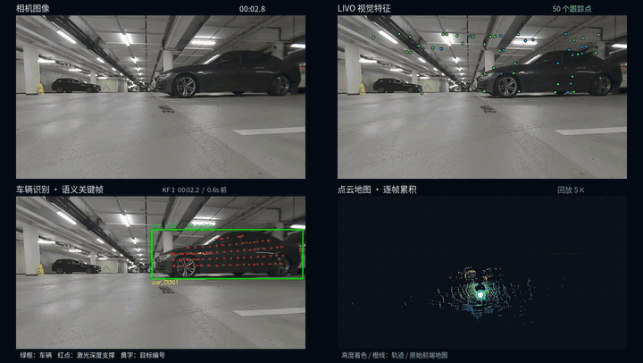
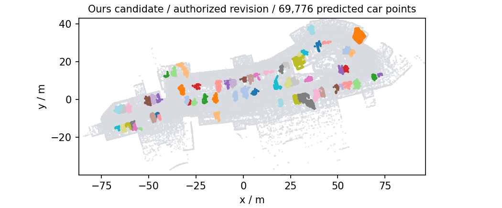
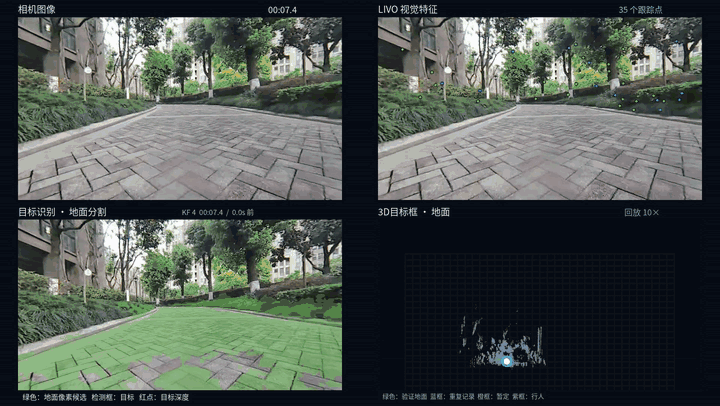
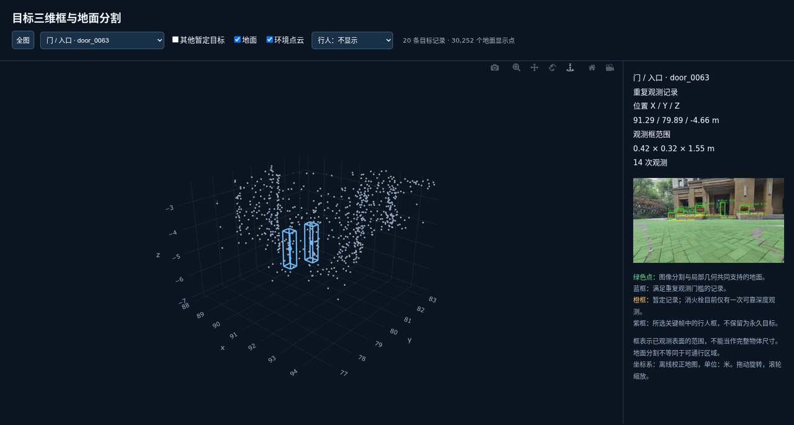
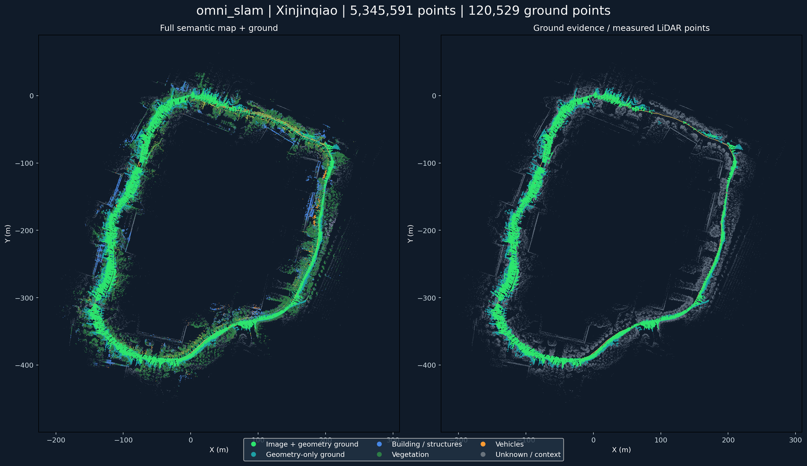
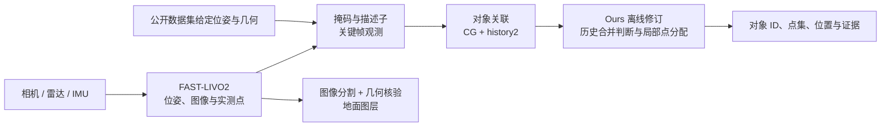

# OmniSLAM

[English](README.md) | **简体中文**

**[论文 · arXiv:2611.30184](https://arxiv.org/abs/2611.30184)**

OmniSLAM 是一个基于 ROS 2 Humble 的对象级语义建图项目，集成激光 / 视觉惯性定位、跨帧对象关联和地图查询。地图中的每个对象保存三维点集、位置和图像观测，可按类别或 ID 查询。

对象地图修订模块利用多帧掩码判断历史对象是否应合并，再根据局部几何将新增实测点分配给对象。定位与在线语义节点用于机器人接入，修订模块提供独立的离线评测入口。

[实验展示](#实验展示) · [快速开始](#快速开始) · [实验结果](#论文与实验结果) · [文档](#文档与目录)

## 实验展示

### 车库建图

`rosbag2245` 回放：相机图像、LIVO 视觉关键点、车辆识别和点云累积。



*约 20 秒，相对采集时间加速约 30×；右下点云按高度着色。*



早期车库实验的车辆对象地图。彩色点区分预测对象，灰色点表示环境，调色板循环使用。图中的 `Ours candidate` 为该次实验版本；当前修订方法的四组对照见[论文补充材料](docs/paper/README.md)。

### 室外目标与地面分割

图像中的目标和地面候选投影到实测点云，生成三维观测框与地面图层。



*约 21 秒，相对采集时间加速约 80×。两段 GIF 来自 2026-11-06 的 LIVO 语义集成实验，播放速度不表示处理帧率。*

<details>
<summary>对象查询示例</summary>



选择对象可查看位置、观测次数与原始图像。三维框包围已观测表面。

</details>

### 新金桥全局语义地图

地图包含 5,345,591 个点，其中地面点 120,529 个。左侧为全局语义地图，右侧为地面图层；类别包括建筑 / 结构、车辆、植被和地面。



*离线建图结果。地面按图像与几何共同支持、仅几何支持分别着色，尚未用于导航可通行性评测。[图片来源与 GIF 制作参数](docs/assets/readme/README.md)。*

## 功能

- **定位与重定位**：FAST-LIO 建图、地图保存与 ICP 重定位；FAST-LIVO2 提供视觉辅助定位。
- **对象地图**：掩码投影、跨帧关联、三维观测框，以及按类别 / ID 查询位置与图像。
- **地图修订**：多视角合并判断、历史点标签修改和新增点分配，提供 CPU 核心演示与离线评测。
- **地面提取**：结合图像分割和局部重力几何生成地面图层。

默认定位后端为 FAST-LIO。LIVO 回环目前仅修正离线地图，论文修订模块也通过离线入口运行。S100 采用板端 LIVO、电脑端语义推理，尚未完成 BPU 部署或语义实时性能评测。

### 系统结构



当前 KITTI-360 实验使用 SAM3、SigLIP 和 SegFormer；ROS 语义节点使用 Mask R-CNN，地面分割可选 SegFormer。各入口的输入与依赖见[研究说明](docs/research/README.md)。

## 快速开始

### 1. 对象修订核心

依赖 Python 3.10+ 和 `g++`。此演示在 CPU 上运行，无需 ROS、模型权重或数据集。

```bash
git clone git@github.com:YanYaoyuan/omni_slam.git
cd omni_slam
python3 -m venv .venv
source .venv/bin/activate
python -m pip install -r requirements/research-core.txt
python -m pip install -e ./omni_semantic_map
python examples/revision_core_demo.py --output build/demo/revision_core.json
bash scripts/test_research_core.sh
```

演示使用合成对象图，运行多帧合并判断和局部点分配。数据集评测需要另行准备数据与模型，见[复现说明](docs/research/README.md)。

### 2. 构建 LIVO 与语义消息（ROS 2 Humble）

参考环境为 Ubuntu 22.04 / ROS 2 Humble。依赖包括 PCL、Eigen、OpenCV、OpenMP、cv_bridge、rosidl 和 colcon。Sophus 与 Vikit 的固定版本已包含在 `FAST_LIVO2/third_party/`。

```bash
source /opt/ros/humble/setup.bash
rosdep install --from-paths omni_slam_interfaces FAST_LIVO2 omni_semantic_map \
  --ignore-src --rosdistro humble -y
colcon --log-base log/livo_humble build \
  --base-paths omni_slam_interfaces FAST_LIVO2 omni_semantic_map \
  --packages-select omni_slam_interfaces fast_livo omni_semantic_map \
  --build-base build/livo_humble --install-base install/livo_humble \
  --executor sequential \
  --cmake-args -DCMAKE_BUILD_TYPE=Release -DFAST_LIVO_USE_LIVOX=OFF
source install/livo_humble/setup.bash
ros2 interface show omni_slam_interfaces/msg/LivoSemanticFrame
```

传感器话题、相机内外参和时间单位必须按实际设备配置。VBot H.265 录包需要先解码为带原始时间戳的校正图像，不能直接当作 LIVO 图像输入。[FAST-LIVO2 移植说明](FAST_LIVO2/README.md)。

### 3. 接入机器人管理器与语义试跑

管理器依赖相邻项目 `omni_tf_manager` 与 `omni_robot_interfaces`，启动前需构建并加载其 overlay。

- [S100 / 电脑分工、标定检查、启动和录包](docs/deployment/s100_livo_semantic_trial.md)
- [现有 LIO 管理器、VBot 建图与重定位](docs/deployment/lio_manager_quickstart.md)
- [Manager 接口与后端选择](omni_slam_manager/README.md)
- [对象查询、三维框与证据重投影](omni_semantic_map/README.md)
- [Orin 部署](DEPLOY_ORIN.md)

巡检系统由 Mission 启动 SLAM Manager 与 TF Manager。独立调试可用 `omni_slam_ctl`；已有 Manager 运行时，不要重复启动。

## 文档与目录

| 目录 | 用途 |
| --- | --- |
| `FAST_LIO/` | 既有 LIO、回环与重定位相关接口 |
| `FAST_LIVO2/` | 原生 Humble 移植、配置、录包转换与离线地图工具 |
| `omni_slam_interfaces/` | 管理接口、关键帧与原子语义帧消息 |
| `omni_slam_manager/` | 后端进程管理、地图资产和状态 |
| `omni_semantic_map/` | 在线语义消费者、离线对象算法、评测适配与测试 |
| `examples/` | 无数据集的小型机制演示 |
| `scripts/benchmarks/` | 数据准备、建图、消融和评分脚本 |
| `docs/research/` | 当前方法、协议和可复现范围 |
| `docs/benchmarks/`、`docs/experiments/` | 历史实验文字记录，日期代表当时状态 |
| `docs/paper/visibility_revision/latex/` | 当前论文、补充材料、固定图表及编译入口 |
| `docs/deployment/`、`scripts/` | 部署、构建、录包与打包工具 |

## 论文与实验结果

**OmniSLAM: Evidence-Authorized Revision of Persistent Object Maps**

Haoxiang Jie<sup>*,†</sup>, Yaoyuan Yan<sup>*</sup>, Zhiyou Heng, Liang Li, Zhaosong Li, Lifeng Liu

<sup>*</sup> Haoxiang Jie 与 Yaoyuan Yan 共同贡献、共同第一作者。<sup>†</sup> 通讯作者：Haoxiang Jie（[jiehaoxiang@bgyfw.com](mailto:jiehaoxiang@bgyfw.com)）。

[arXiv 预印本](https://arxiv.org/abs/2611.30184) · [论文 PDF](https://arxiv.org/pdf/2611.30184)。仓库提供正文与补充材料的 LaTeX 源码。

[论文与编译入口](docs/paper/README.md) · [图表索引](docs/paper/visibility_revision/latex/FIGURES.md) · [文献核对记录](docs/paper/visibility_revision/latex/REFERENCE_AUDIT.md) · [四窗口完整结果](docs/research/results/reviewer_extension_20261117.json)

KITTI-360 上的建筑 / 车辆实例 AP50:90（百分制）：

| 方法 | 0009 / 0010 两窗口均值 | 0003–0006 四窗口均值 |
| --- | ---: | ---: |
| 对象图基线 | 17.259 | 20.263 |
| 无条件修订 | 17.050 | 23.251 |
| **Ours** | **18.762** | **23.171** |
| Ours 相对基线 | +1.503 | +2.908 |

两组窗口独立统计，使用本地评测适配器，未提交官方测试服务器。四窗口来自开发阶段已使用的序列。收益主要来自建筑；四窗口中无条件修订的均值略高，0004 上 Ours 低于基线。消融中，额外种子帧稳定性检查未带来独立 AP 增益。

真实录包用于检查地图与系统接入，尚无独立对象标注。Replica、SceneNN 及早期方法的结果见[研究记录](docs/research/README.md#结果与来源)。

## 数据、模型与复现范围

仓库包含代码、配置、测试、论文源码和展示素材。数据集、ROSBAG、模型权重、完整点云和预测缓存需单独准备。

现有评测脚本读取实验协议、缓存与文件哈希，部分路径对应原实验环境。复现实验所需输入和适配步骤见[研究说明](docs/research/README.md#复现层级)。

## 测试与贡献

- 核心 CPU 回归：`bash scripts/test_research_core.sh`
- 完整语义研究测试：`PYTHONPATH=omni_semantic_map:scripts/benchmarks python3 -m pytest -q omni_semantic_map/test`，可选依赖与数据集测试见研究说明。
- ROS / Manager 测试和源码发布检查见 [开发指南](CONTRIBUTING.md)。
- 已完成的构建与测试见 [验证记录](docs/research/VALIDATION.md)。

各模块沿用其许可证与版权声明，见[第三方来源](THIRD_PARTY.md)。
