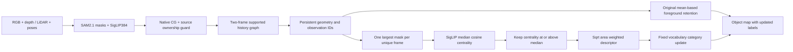

# omni_slam：固定对象的跨帧类别优化

后续已完成新场景验证，见[固定候选的新场景结果](category_holdout_2026-11-11.md)：类别改善与面积加权持平，未在新场景上调整参数。

2026-11-11。完成 11 个公共场景的 6 组预先冻结对照，以及看过结果后单独冻结的 3 组消融。共比较 9 种读出；原强基线、历史图、DINO 关联实验和训练计划均保留。

## 本轮结果与选定候选

**类别正确对象增加 8 个，原先正确类别未损失；地图几何和对象保留集合不变。** 开发候选使用 SigLIP 跨帧一致性筛选＋面积平方根加权，不需要新增 DINO 推理。它是在已经查看过的开发场景上选出的候选，尚不是独立测试结论。

| 数据集 | 原类别 PQ×100 | 新类别 PQ×100 | 提升 | 类别正确 / 固定匹配对象 | 实例 PQ×100 |
|---|---:|---:|---:|---|---:|
| Replica 8 | 30.6823 | **32.1679** | **+1.4855** | **101 → 106 / 145** | 42.8842，不变 |
| SceneNN 3 | 7.2868 | **9.0069** | **+1.7201** | **10 → 13 / 31** | 19.9377，不变 |

分数为固定观测域上的类别感知实例 PQ，不是官方逐类别宏平均 panoptic PQ。固定对象匹配集合与分母，避免通过删除难对象提高条件准确率。Replica 3 胜 5 平，SceneNN 2 胜 1 平；本轮候选没有场景下降，但样本少且均已查看，不宣称显著泛化。

## 算法与当前架构

1. 继续使用 SAM2.1 Hiera L + SigLIP384 学习前端 + 原生 ConceptGraphs + 来源消费保护 + 两次查询帧支持历史图，保留对象身份和实测几何。
2. 每个对象每帧只取原始掩码面积最大的一个观测，平局用固定观测 ID。对 SigLIP 描述子归一化，计算两两余弦，去掉自匹配后取中位数作为一致性分数。
3. 保留一致性不小于其中位数的观测，包含全部平局；用原掩码面积平方根加权原 SigLIP 描述子，再归一化并对原词表读出。少于三帧或一致性特征缺失时退回面积平方根加权。
4. 类别更新与对象是否存在分开。新类别不直接删除已经保留的对象。本轮保留策略仍沿用原均值的前景决定，因此也保留了其既有漏检和误保留，不能宣称对象存在性已经解决。

该机制是当前可复现的工程改进；中位数筛选、面积权重本身不能被包装成已有充分证据的独立论文创新。

## 消融支持什么，不支持什么

- 首轮质量权重为 sqrt(area) × exclusive_area/area，再比较 SigLIP 或 DINO 的一致性筛选。exclusive_area 仅反映同帧掩码争用，不是直接测得的遮挡率。
- 第二轮去掉独占比例，使用均匀、面积平方根、面积三种权重。平方根版本在本轮指标上复现原质量＋SigLIP 结果，因此选用更简单的版本；没有证据证明独占比例带来额外收益。
- DINO 版本在 Replica 只有 104 个类别正确对象，SigLIP 为 106；SceneNN 均为 13。本轮不把 DINO 写成收益来源。
- 分数中位数在 Replica 类别 PQ 略高，但修正 6 个同时损失 1 个；SceneNN 只修正 2 个。面积一致性版本也出现 1 个类别退步。候选选择依据包含稳定性，不能只报告单一最高分。

| 数据集 | 方法 | 固定对象类别 PQ×100 | 相对均值 | 类别正确 / 匹配 | 修正 / 退步 | 若按新类别重新过滤：实例 PQ×100 |
|---|---|---:|---:|---:|---:|---:|
| Replica | mean | 30.6823 | +0.0000 | 101/145 | 0/0 | 42.8842 |
| Replica | area | 31.2802 | +0.5979 | 103/145 | 2/0 | 42.7038 |
| Replica | exclusive_quality | 30.6823 | +0.0000 | 101/145 | 0/0 | 42.8392 |
| Replica | quality_siglip | 32.1679 | +1.4855 | 106/145 | 5/0 | 42.5407 |
| Replica | quality_dino | 31.6303 | +0.9480 | 104/145 | 3/0 | 42.7766 |
| Replica | score_median | 32.2770 | +1.5947 | 106/145 | 6/1 | 42.4134 |
| Replica | consensus_uniform | 32.1679 | +1.4855 | 106/145 | 5/0 | 42.5680 |
| Replica | consensus_sqrt_area | 32.1679 | +1.4855 | 106/145 | 5/0 | 42.5407 |
| Replica | consensus_area | 32.1936 | +1.5113 | 106/145 | 6/1 | 42.1401 |
| SceneNN | mean | 7.2868 | +0.0000 | 10/31 | 0/0 | 19.9377 |
| SceneNN | area | 9.0069 | +1.7201 | 13/31 | 3/0 | 19.8444 |
| SceneNN | exclusive_quality | 9.0069 | +1.7201 | 13/31 | 3/0 | 19.8444 |
| SceneNN | quality_siglip | 9.0069 | +1.7201 | 13/31 | 3/0 | 19.9440 |
| SceneNN | quality_dino | 9.0069 | +1.7201 | 13/31 | 3/0 | 19.9986 |
| SceneNN | score_median | 8.6345 | +1.3477 | 12/31 | 2/0 | 19.5224 |
| SceneNN | consensus_uniform | 8.6345 | +1.3477 | 12/31 | 2/0 | 19.8032 |
| SceneNN | consensus_sqrt_area | 9.0069 | +1.7201 | 13/31 | 3/0 | 19.9440 |
| SceneNN | consensus_area | 9.0069 | +1.7201 | 13/31 | 3/0 | 19.8143 |

重新按类别过滤时，选定候选在 Replica 实例 PQ 从 42.8842 降到 42.5407。因此本轮导出采用**类别更新不触发对象删除**。这项解耦是预先声明的主评价方式，不是看到下降后更换分母；重新过滤的结果作为次评价完整保留。

## 修正了哪些对象

| 场景 | GT ID | 地图对象 ID | 类别变化 | 结果 |
|---|---:|---:|---|---|
| replica_office_0 | 29 | 62 | box → tissue-paper | 修正 |
| replica_office_1 | 2 | 13 | bottle → tissue-paper | 修正 |
| replica_office_1 | 41 | 5 | pillow → chair | 修正 |
| replica_room_0 | 33 | 33 | pillow → cushion | 修正 |
| replica_room_0 | 72 | 17 | pillow → cushion | 修正 |
| scenenn_014 | 725159 | 74 | pillow → nightstand | 修正 |
| scenenn_021 | 276 | 18 | shelf → cabinet | 修正 |
| scenenn_021 | 286 | 6 | pillow → bed | 修正 |

SceneNN021 的床（GT286、地图对象6）从 pillow 修正为 bed。该对象有 74 个不同帧观测，其中 38 帧的单帧最高类别原本就是 bed；这次是利用已有正确证据，而非新增标注或更换图像模型。面积加权本身也能修正这张床，因此不能单独以此例证明一致性筛选的必要性。

下图事后选择床、椅子、床头柜三个例子。左图为候选权重最高的缓存掩码，中图为被排除观测中面积最大的掩码，右图显示全部不同帧上的“新类别减旧类别”文本相似度。红色半透明区域是原缓存预测掩码；绿点为入选证据，灰点为排除证据。例子未参与规则设计或推理选帧。

## 所有场景

| 场景 | 原类别 PQ×100 | 候选类别 PQ×100 | 变化 | 类别正确数 / 固定匹配 |
|---|---:|---:|---:|---|
| replica_office_0 | 23.3736 | 25.6782 | +2.3045 | 8 → 9 / 11 |
| replica_office_1 | 22.3689 | 28.4468 | +6.0779 | 6 → 8 / 14 |
| replica_office_2 | 25.6630 | 25.6630 | +0.0000 | 12 → 12 / 15 |
| replica_office_3 | 27.3059 | 27.3059 | +0.0000 | 16 → 16 / 19 |
| replica_office_4 | 43.3579 | 43.3579 | +0.0000 | 14 → 14 / 14 |
| replica_room_0 | 30.0018 | 33.5038 | +3.5020 | 15 → 17 / 29 |
| replica_room_1 | 40.1486 | 40.1486 | +0.0000 | 16 → 16 / 19 |
| replica_room_2 | 33.2388 | 33.2388 | +0.0000 | 14 → 14 / 24 |
| scenenn_014 | 4.6463 | 5.7634 | +1.1171 | 4 → 5 / 13 |
| scenenn_015 | 7.9588 | 7.9588 | +0.0000 | 2 → 2 / 4 |
| scenenn_021 | 9.2553 | 13.2984 | +4.0431 | 4 → 6 / 14 |

## 仍然存在的表示与词表限制

原均值的 Replica 44 个类别错误中，17 个存在一个共同竞争类别，在每个观测里都高于 GT 文本向量；任何非负帧权重都不能纠正这类错误。24 个错误对象至少有一帧的最高类别正确，说明证据选择确有改进空间，但该统计不是可实现方法上界或实际增益。

SceneNN 原有 21 个类别错误，其中 10 个 GT 类别无法由当前固定映射词表表达，3 个另有共同竞争类别阻挡，7 个存在单帧正确机会。词表未覆盖和表示错误需单独处理，不能继续靠调权重解决。SceneNN 类别评测沿用前轮固定 NYU 名称映射和跨版本 GT 域，不更改词表来追求当前分数。

## 交付、验证与下一步

- 模块：`omni_semantic_map/omni_semantic_map/consensus_category.py`。独立返回类别及证据权重，不返回删除对象的决定。
- 全部 837 个最终区域通过与消融实验的类别、分数和权重一致性校验；原前景地图共 414 个对象，11 个场景已导出新标签、原几何引用和实测 AABB。AABB 不是补全物体范围或训练得到的三维检测框。
- 导出目录：`build/benchmarks/evidence_retention_20261111/consensus_category_candidate_v1/`，每场景含 `classification.json`、`object_map.json`。类别候选尚未激活到 ROS 在线节点。
- 10 项相关测试通过。两轮共同方法的全数据集汇总完全一致；原均值类别和分数复现、固定匹配检查、缓存及输出哈希验证均通过。没有新增训练或 GPU 抢占。
- 下一阶段先固定该候选及原均值作双基线，用新增独立场景检查是否保持类别收益；再把只更新类别、不删除对象的接口接入 LIVO 关键帧链路。对共同竞争类别阻挡的样本，另立完整对象图像上下文/表示试验；词表扩展独立计分。既定训练和 SAM3 计划保持独立。

本轮全部场景此前已经查看，候选选择属于开发过程；不能把开发集零退步写成真实机器人零风险或论文泛化保证。

[完整结果](../reports/evidence_retention_2026-11-11/category_evidence_v2/summary.json) · [全部候选类别变化](../reports/evidence_retention_2026-11-11/category_evidence_v2/category_changes.json) · [冻结协议](../reports/evidence_retention_2026-11-11/category_evidence_v2/protocol.json) · [上一轮 DINO 关联对照](public_dino_scope_2026-11-11.md)
