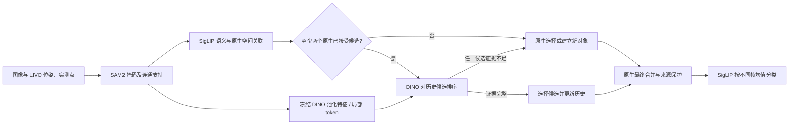

# omni_slam：DINO 实际关联对照与历史碎片诊断

2026-11-11。完整 rosbag2245 缓存重放，330 个语义关键帧。三组运行全部完成；本轮首次把 DINO 用于实际因果关联决策，不再仅比较特征相似度。

**结论：DINO 接入已跑通，但这版“多候选重排”没有显示出明确的对象身份改善。四个车辆改选案例的图像均支持“同车的不同历史分支”；重排改变接入分支，没有恢复全部历史。下一步应检验有证据约束的历史片段合并与可修正关联。**

[全部 8 个改选案例图册](../reports/evidence_retention_2026-11-11/dino_association_v1/gallery.html) · [机器统计](../reports/evidence_retention_2026-11-11/dino_association_v1/summary.json) · [图像审查、历史成员及校验记录](../reports/evidence_retention_2026-11-11/dino_association_v1/review.json)

## 固定什么，改变什么

本轮底座是此前的 **LIVO 实测支持点 + SAM2.1 Hiera L + SigLIP384 + 原生 ConceptGraphs + 来源消费保护 + 按不同帧均值读出**。针对稀疏 LiDAR 使用每掩码最大连通支持、关闭密度 DBSCAN、20cm 重叠匹配距离；点云下采样仍为 2.5cm。这是工程开发候选，不是已在公共基准验证的新默认方案。

DINOv2-small 使用冻结权重和已完成的 330 帧特征缓存。支持点投影到图像 patch，生成支持加权池化描述子与每观测最多 24 个局部三维锚点。没有训练；SigLIP 类别读出不变。



三组只改变**因果阶段的歧义候选排序**：

| 组别 | 多候选时的处理 |
|---|---|
| 固定工程底座 | 保持原生 SigLIP 与空间综合得分排序 |
| + DINO 池化 | 对每个候选取其历史观测与当前观测的最大 DINO 余弦，按此排序 |
| + DINO 局部 | 外观互近邻 token 需在世界坐标 40cm 内；至少 3 对才有分数，再对历史观测取最大值 |

只在原生接受阈值已经通过的候选中重排，不引入新边，不改变新建对象阈值。任一候选 DINO 证据不足，整次决策回退原生；所有历史证据均早于当前帧。最终原生合并仍使用原逻辑，因此本轮不覆盖 DINO 驱动的历史合并或分裂。

协议在运行前保存并记录源码、特征清单和原底座哈希；没有根据结果扫阈值。基线分支也计算诊断分数，但从不使用 DINO 改选。

## 整包结果

| 指标 | 固定底座 | + DINO 池化 | + DINO 局部 |
|---|---:|---:|---:|
| 多候选决策次数 | 41 | 41 | 41 |
| DINO 改选次数 | 0 | 7 | 1 |
| 局部证据不足而回退 | 不适用 | 0 | 37 |
| 最终全部区域数 | 109 | 110 | 109 |
| 最终保留前景预测数 | 41 | 41 | 41 |
| 与底座完全相同的前景成员组 | 41 | 37 | 41 |
| 基线最终保留前景对应的查询中，发生改选的次数 | 0 / 33 | 4 / 33 | 0 / 33 |
| 第 327 帧返回黑车的因果归属 | alias 6 | alias 6 | alias 6 |

“前景”来自固定类别读出，不是人工真值；33 次查询以基线最终前景成员作事后诊断参照，不用于算法输入。三组各自重放产生候选历史，41 次总数相同不表示所有候选集合都相同。

额外核对：**局部 DINO 的全部 41 个前景对象，不仅成员相同，对应点云数组也与基线精确一致。** 它只改选了一次背景墙面。局部规则的覆盖率为 4/41，前景诊断子集为 3/33；当前稀疏支持、锚点数量及“所有候选都具备证据”的条件限制了可作用范围。不能由此断言 DINO 模型无效，也不能宣称已有前景地图增益。

## 所有改选案例，不挑选展示

观测和 alias 以下均使用从 1 开始的显示编号；原始 JSON 的 `observation_id` 从 0 开始。候选证据图展示该候选中实际 DINO 得分最高的历史成员，不一定是原生 SigLIP 得分最高成员。图像判断由助手完成，未经独立人工实例标注。

| 变体 / 当前观测 | 原生候选 → DINO 候选 | 图像审查结论 |
|---|---|---|
| 池化 / 630 | 617 → 588 | 白色 SUV，两条历史均看起来属于同车；改选分支 |
| 池化 / 1114 | 378 → 1113 | 地面，改为较近时刻观测；无实例边界真值 |
| 池化 / 1207 | 1165 → 1202 | 白色小车，两条历史均看起来属于同车；最终历史成员减少 |
| 池化 / 1350 | 1317 → 1320 | 窄墙片与大墙区域的分区歧义 |
| 池化 / 1743 | 1709 → 1730 | 同一可见墙片与较大墙区域的分区选择 |
| 池化 / 2397 | 2364 → 2386 | 立柱、入口、邻车位置支持两条历史均为同车 |
| 池化 / 2843 | 2826 → 2836 | 车身及邻车位置支持两条历史均为同车，遮挡程度不同 |
| 局部 / 1743 | 1709 → 1730 | 与池化相同的墙面改选，没有改变前景输出 |


### 为什么还不能说“解决了碎片化”

检查四个车辆案例的最终成员，而不只看显示 ID：

| 查询 | 底座最终成员 | 池化 DINO 最终成员 |
|---|---|---|
| 630 | 617, 630, 640, 655 | 588, 630, 640, 655 |
| 1207 | 1165, 1176, 1207, 1215, 1222 | 1202, 1207, 1215, 1222 |
| 2397 | 2364, 2397, 2407, 2422, 2433, 2437, 2439 | 2386, 2397, 2407, 2422, 2433, 2437, 2439 |
| 2843 | 2826, 2843, 2848, 2856, 2861 | 2836, 2843, 2848, 2856, 2861 |

候选分支在查询前已经各自存在。最终查询所在对象只保留其中一条历史；另一条候选历史没有合入该对象，在对应最终输出中也没有保留为单独区域。尤其观测 1207 的历史从 5 个成员变成 4 个。**这是历史证据未被恢复的直接记录，而不是“最终还存在两个重复对象”的计数证据。** 当前缺少独立身份真值，不能把成员数的增减直接转换成准确率。

## 收敛后的下一步

保留固定工程底座作为本轮对照；DINO 两个重排分支留作消融，不提升为默认。下一阶段集中验证一个假设：**DINO 的实例外观证据能否帮助恢复同一对象的历史片段，同时避免同类不同对象误合并。** 这是待验证的方法方向，不是已确立的新颖性结论。

1. **先固定身份评测清单。** 将全部 41 次歧义决策及候选历史导出为待标注集合，覆盖同物片段、异物近邻和不确定案例；评价身份合并准确率、历史观测覆盖及碎片数。案例图册已完成，但独立标签尚未完成。开发包用于诊断，新的场景留作独立测试。
2. **从单次重排转向可修正的对象历史图。** 保留观测节点与支持点来源；对象间候选边综合 DINO 外观、实测支持和时间证据。证据不足保留独立片段，多次一致后再提交合并；矛盾观测保留撤销依据。不能只因 DINO 高分直接合并同类车辆。
3. **先对照几何历史合并，再检验 DINO 的额外贡献。** 同一候选集合比较原底座、几何历史合并、加入 DINO 的历史合并；分别报告错误合并和恢复历史的变化，避免把“新增了历史合并机制”的收益都归给 DINO。之后再上公共对象语义建图基准和未参与开发的场景。

局部 token 目前覆盖不足，应先记录失败来源及可见支持，再决定是否增加锚点或改变对应机制。跨访问几何偏差仍独立保留为问题；本轮没有修改 LIVO 轨迹，也没有用对象表面距离冒充定位真值。

## 验证与复现

- 三组完整重放均退出成功；原基线最终分类和几何精确复现此前冻结工程候选。
- 新增 4 项测试覆盖原生候选资格、不确定回退、稳定平分处理、局部互近邻/空间门限/最少支持以及刚体坐标变换不变性，全部通过。
- 源码、协议、特征清单、运行摘要与全部 8 张改选图片的哈希校验通过；局部 DINO 的 41 个前景点云逐数组精确核对通过。
- 本轮使用缓存 CPU 重放；不是端到端在线速度测试或 S100 部署验证。没有新增 PQ、IDF1、ID-switch 或独立基准涨点结论。

运行目录：`build/benchmarks/evidence_retention_20261111/dino_association_v1/`。协议在 `protocol.json`；每组的 `association.json` 保留因果决策、历史成员和返回对象标签；`cache_supportcc/both/` 保留分类、点云与诊断。

```bash
# 仅用于新工作副本的首次运行；已有实验目录不会覆盖。
PYTHONPATH=omni_semantic_map python3 -m pytest -q omni_semantic_map/test/test_evidence_rerank.py
PYTHONPATH=omni_semantic_map python3 scripts/benchmarks/run_livo_dino_association.py --freeze
OPENBLAS_NUM_THREADS=2 build/benchmarks/expanded_semantic_20261109/cg_venv/bin/python scripts/benchmarks/run_livo_dino_association.py --variant baseline
OPENBLAS_NUM_THREADS=2 build/benchmarks/expanded_semantic_20261109/cg_venv/bin/python scripts/benchmarks/run_livo_dino_association.py --variant dino_pooled
OPENBLAS_NUM_THREADS=2 build/benchmarks/expanded_semantic_20261109/cg_venv/bin/python scripts/benchmarks/run_livo_dino_association.py --variant dino_local
build/benchmarks/ovo_full_20261110/venv311/bin/python scripts/benchmarks/audit_livo_dino_decisions.py
python3 scripts/benchmarks/finalize_livo_dino_audit.py
```

前序：[尺度控制实验](livo_scale_2026-11-11.md) · [身份、几何及 DINO 六组配对诊断](livo_identity_geometry_2026-11-11.md)。这些开发记录的“尚未接入 DINO”描述指当时状态；实际关联实验结果以本报告为准。
