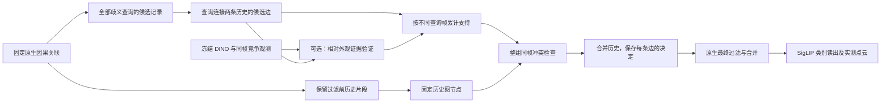

# omni_slam：对象历史合并的首轮完整实验

2026-11-11。固定 rosbag2245 的 330 帧输入、原生因果关联和 SigLIP 类别读出，完成基线精确复现及四组离线历史图对照。

**有可复现的历史恢复进展：要求两个不同查询帧支持的原生候选合并，保回了 12 条此前被过滤的观测，前景观测从 205 增至 217，原有最终观测全部保留。DINO 版本保回 11 条，尚未显示额外收益。** 这些是开发包的历史覆盖统计，不是实例准确率或公共 benchmark 涨点。

[全部 25 条候选边图册](../reports/evidence_retention_2026-11-11/history_graph_v1/gallery.html) · [机器结果](../reports/evidence_retention_2026-11-11/history_graph_v1/summary.json) · [审查与完整性校验](../reports/evidence_retention_2026-11-11/history_graph_v1/review.json) · [独立身份标注模板](../reports/evidence_retention_2026-11-11/history_graph_v1/annotation_template.json)

## 本轮解决的问题

上一轮 DINO 重排只决定“新观测接入哪条历史”，没有合回另一个候选的历史。原生最终过滤要求至少 3 次检测；一些只有 1–2 次观测的片段在合并前就被过滤了。

本轮保留全部 **504 个过滤前历史节点**。候选来自此前完整保存的 **41 次原生歧义决策**，形成 57 条查询提议、25 条去重历史边。没有根据类别、DINO 分数或图片好坏挑选候选。历史合并发生在最终过滤之前，点云仍用原生 CG 合并核，随后执行原来的去噪、过滤、来源消费保护和 SigLIP 按不同帧均值分类。

原底座完整保留：LIVO 位姿和实测点 → SAM2.1 掩码与连通支持 → SigLIP384 / 原生 ConceptGraphs → 来源保护 → 类别读出。稀疏点云控制仍为关闭 DBSCAN、20cm 重叠距离、2.5cm 下采样。



这是**离线对象历史图原型**：图节点使用完整重放后的原生历史片段，并未部署为 ROS 在线修正。边记录可以禁用后重新构图；没有实现在线自动撤销或拆分原生已合并的对象。

## 对照设计

“原生候选”同时依赖几何与 SigLIP，**不能称作纯几何基线**。所有候选在当时都通过原生关联阈值，DINO 只决定是否给已有候选投支持票，不增加新的候选边。

- **一次 / 两次支持**：一条历史边分别需至少 1 / 2 个不同查询帧支持，同一帧的重复提议只算一次。相邻帧仍可能高度相关，不能称为独立视角证据。
- **DINO 支持票**：当前查询与原生历史、另一条候选历史的最大池化 DINO 相似度，均须高于它与同帧其他有效观测的最大相似度。缺失有效竞争者或历史描述子则不投票。这是预先声明的相对规则，无事后阈值搜索；同帧其他掩码只是操作性竞争者，不是已标注异物。
- **冲突控制**：两个待合并连通分量只要共享任一帧，拒绝新合并，包括间接传递产生的冲突。该保守规则也可能拒绝同物被拆成多个掩码的情况。
- **共同顺序**：四组均按原生支持帧数降序、节点编号排序处理边。DINO 改变投票资格，不单独改变排序。

后续原生最终合并保持不变，不保证遵守新增图层的同帧规则，因此分别检查图层和最终输出的冲突统计。

## 全量结果

| 指标 | 原底座 | 原生一次支持 | DINO 一次支持 | 原生两次支持 | DINO 两次支持 |
|---|---:|---:|---:|---:|---:|
| 新图层执行的合并边 | 0 | 20 | 19 | 12 | 11 |
| 最终全部区域 | 109 | 107 | 106 | 108 | 108 |
| 最终前景预测 | 41 | 39 | 39 | 40 | 40 |
| 最终保留观测 | 557 | 576 | 573 | 569 | 568 |
| 恢复此前未保留观测 | 0 | 19 | 16 | **12** | 11 |
| 前景保留观测 | 205 | 220 | 220 | **217** | 216 |
| 原有最终观测丢失 | 0 | 0 | 0 | 0 | 0 |
| 最终前景同帧额外成员 | 0 | 0 | 0 | 0 | 0 |


原生两次支持的前景历史覆盖增加 **12/205 ≈ 5.9%**。这是保留观测数量的相对增加，不是识别精度提升 5.9 个百分点。新增观测全部进入预测为车辆的对象；类别仍由原 SigLIP 读出决定。

一次支持组中，加入 DINO 后，前景成员、类别结果及点云在重新对应评测编号后与原生一次支持组精确一致。区别来自背景地面边。两次支持组中，DINO 则使一条车辆历史边少了一票，少保回一条观测。

图层的同帧约束在原生一次支持组拦下 5 条边；DINO 拒绝的候选中有多条已与此约束重叠。最终背景仍包含原有同帧额外成员，总数为 10，四组与底座相同；“前景无同帧冲突”不能证明没有跨帧错误合并。

## 恢复了哪些历史

以下为原生两次支持组；显示编号为原始 observation ID 加 1。

| 原有对象 / 合并后编号 | 历史变化 | 图像证据 |
|---|---|---|
| 617 → 588 | 原 4 次观测，加回 588、597，变为 6 次 | 相同白色 SUV 和相邻立柱位置支持同车片段假设 |
| 1151 → 1137 | 加回 1137、1166 | 相邻时刻车辆、邻车与停车位布局一致 |
| 1165 | 原 5 次观测，加回 1185、1202，变为 7 次 | 上轮重排未合回的两条小车历史现在进入同一对象 |
| 2364 → 2361 | 原 7 次观测，加回 2361、2377、2386，变为 10 次 | 入口旁同一停车位的车辆历史 |
| 2599 → 2584 | 加回 2584 | 同车相邻时刻观测 |
| 2826 → 2822 | 加回 2822、2836 | 远处小目标到近处大目标的历史；DINO 两次组只恢复 2836 |
| 525 + 1000 → 525 | 原来两个最终前景对象的 5 + 3 次观测合到一起 | 补看全部 8 帧，车身、立柱和邻车布局支持同车假设，独立身份标注待完成 |

“原有最终观测没有丢失”指成员集合保留；合并会改变对象中心、几何下采样结果和语义均值，并不表示所有对象的几何精度都有改善。


点云图展示原始片段在同一世界坐标下的支持点，仅为绘图减去共同中心；没有 ICP、轨迹修正或稠密补全。525 / 1000 的表面覆盖具有互补性，但图形连续不能替代身份真值或几何误差评测。

一次支持组另合并了 526 / 1013 两个既有车辆对象，因此前景数量从 41 变为 39。已补看两条历史全部 7 帧，图像支持同车假设，仍不计作已验证的“两个 ID 错误被修复”。672 / 883 已补看全部 4 帧，但边缘可见区域有限，身份继续保留为不确定；它不进入两次支持版本。

## DINO 为什么还没有带来增益

57 条提议中有 48 条通过相对 DINO 规则。通过数量本身不能衡量实例区分能力；这些候选已经被原生几何与 SigLIP 筛选过。

具体反例是历史边 2822 / 2826：

| 查询帧 | 当前查询与原生历史 | 与待恢复历史 2822 | 与最强同帧竞争者 | DINO 支持票 |
|---|---:|---:|---:|---|
| 302 | 0.950 | 0.823 | 0.798 | 有 |
| 303 | 0.900 | 0.742 | 0.830 | 无 |


第 303 帧竞争者 2867 位于另一侧车位；图像支持当前车与较早的小尺度历史为同车的解释。远近视角、可见车身部分和模糊程度不同，导致该规则未能稳定保留同车候选。这是一个机制诊断案例，不足以把原因唯一归为尺度或遮挡。

本轮支持继续发展**保留观测来源、累积候选证据、可重新构图的对象历史维护**。DINO 池化相似度当前还不足以担当可靠的否决规则；不据此改用某个更低阈值来追求这一个包的恢复数量。

## 下一阶段的明确边界

1. **以两次支持版本作为下一轮开发对照，继续保留原底座。** 它相对一次支持版本需要更多时序支持，但本轮没有独立精度证据证明其总体更优，不直接替换默认运行配置。
2. **补对象身份评价，再做独立场景实验。** 已生成全部 25 条固定边的空标签模板与证据图；需要标注同物、异物、不确定，随后评估合并精确率、身份碎片数和观测覆盖。助手图像审查与正式真值严格分开。候选集由现有几何产生，也不能单凭它评估全场景对象召回。
3. **DINO 下一步检验局部证据与多视角一致性，而非整幅池化相似度硬否决。** 保留当前消融，先解释哪些候选能提供可靠局部对应，再预先固定新规则；需要在公共有实例真值的数据及未参与开发的场景上证明额外收益。

## 验证与复现

- 新增 4 项测试通过：传递合并的整组同帧冲突、删除边后的重新构图、按不同帧计票、共同处理顺序与成员守恒、DINO 双分支证据与缺失回退。
- 完整重放和新最终处理路径均精确复现原底座的分类与点云。
- 四组输出均无重复观测归属，保留所有原有最终观测；返回黑车 alias 6 的历史成员不变。
- 源码、输入依赖、输出与 25 张候选图片的哈希校验通过。两张统计/点云图已目视检查，另提供 SVG。
- 全部 25 条边的首组证据图已审查；补看 3 组完整历史，以及 DINO 拒绝案例。**没有声称全部成员完成独立身份核验。** 标注模板保持空标签。
- 使用已缓存特征的 CPU 离线重放；无新增模型训练、GPU 排队、在线速度或机器狗部署结论。

结果目录：`build/benchmarks/evidence_retention_20261111/history_graph_v1/`，包含运行前协议、源码副本、504 节点快照、候选清单、57 条投票记录、四组图层决策及最终地图。每组 `geometry.npz` 保存地图点云，`classification.json` 保存成员与语义。

```bash
# 新工作副本首次运行；已有实验目录不会覆盖。
PYTHONPATH=omni_semantic_map python3 -m pytest -q omni_semantic_map/test/test_history_graph.py
PYTHONPATH=omni_semantic_map python3 scripts/benchmarks/run_livo_history_graph.py --freeze
OPENBLAS_NUM_THREADS=2 build/benchmarks/expanded_semantic_20261109/cg_venv/bin/python scripts/benchmarks/run_livo_history_graph.py --run
build/benchmarks/ovo_full_20261110/venv311/bin/python scripts/benchmarks/audit_livo_history_graph.py
build/benchmarks/ovo_full_20261110/venv311/bin/python scripts/benchmarks/finalize_livo_history_audit.py
```

前序：[DINO 实际关联重排](livo_dino_association_2026-11-11.md) · [工程尺度对照](livo_scale_2026-11-11.md)。
