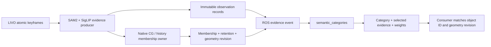

# omni_slam：类别更新接口与新场景验证

2026-11-11。**完成更新：后台三阶段均已结束，见[新场景验证报告](../benchmarks/category_holdout_2026-11-11.md)。类别 PQ 6.7434 → 7.7412，但面积加权同样达到该分数；未据此调参。**

本阶段将已选定的 `consensus_sqrt_area` 固定下来，推进两项工作：未用于类别选型的新场景验证，以及真实 LIVO 证据的类别更新接口。

## 当前完成情况

| 工作 | 状态 | 证据 |
|---|---|---|
| 类别更新模块接入真实 LIVO 缓存链路 | 完成 | 330 个实际视觉关键帧、3,112 条观测 |
| 因果前缀结果与批处理核验 | 完成 | 81,552 次对象结果比对一致，无未来观测 |
| 上游建图不受类别消费者影响 | 完成 | 既有稀疏适配 CG 的几何、成员关系和均值分类精确复现 |
| ROS 2 Humble 消息接口 | 完成 | 实际节点接收 331 次更新，全部与离线期望一致 |
| 故障处理 | 完成 | 5 类实际 ROS 故障注入均拒绝且不提交状态 |
| 构建与单元测试 | 完成 | 独立安装目录中 2 个包构建成功，15 项相关测试通过 |
| 新场景 025 / 030 / 032 | 输入准备完成 | 1,200 个几何帧、600 个语义帧，固定采样与算法 |
| 新场景强前端及评分 | 已完成 | 三场景均完成建图；025/032 完成评分，030 缺类别标注 |
| 机器狗实时 SAM2＋SigLIP 推理 | 尚未完成 | 当前 ROS 试跑检测器仍为 COCO，不能与强前端混称 |

以上 LIVO 回放使用此前真实 `LivoSemanticFrame` 原子消息对应的图像、点云、位姿与标定，并重放已有强前端缓存。它没有重新运行神经网络推理，也不是新的机器人实时帧率或语义准确率实验。

## 链路与对象所有权



目前 B 的神经网络结果来自缓存回放；G 为实际 ROS 节点。C 负责对象存在性、成员关系和几何，G 只提供类别更新。G 输出中的 `retained` 和 `geometry_revision` 原样来自 C，不能因为新类别变成背景就删除对象，也不能把新类别反馈给原生关联，造成循环依赖。

最终离线历史图使用独立的第 331 次 revision。前 330 次是原生适配 CG 的因果关键帧快照；不能把最后的离线历史合并写成已在线完成回环或在线历史图。

## 消息接口

新增可执行程序 `semantic_categories`，启动文件 `categories.launch.py`。

- 输入：`/omni/semantic/evidence`，`std_msgs/String`，JSON schema version 1。
- 输出：`/omni/semantic/category_updates`，类别、对象 ID、几何 revision、证据引用和权重。
- 状态：`/omni/semantic/category_updates/status`，成功确认或拒绝原因。
- 发布端逐条发送、等待确认。输入包含观测增量，**不能使用只保留最新帧的丢帧队列**。订阅采用 reliable QoS，revision 必须连续；检测到丢序号即拒绝，不能静默跳过。

输入结构示意（特征长度须与指定词表一致，示例不表示可直接运行的数据）：

```json
{
  "schema_version": 1,
  "session_id": "livo_run_unique_id",
  "feature_space": "frozen_model_and_vocabulary_fingerprint",
  "revision": 0,
  "frame_id": 123,
  "observations": [
    {"id": 0, "frame_id": 123, "area": 700,
     "feature": [0.1, 0.2],
     "evidence": {"keyframe_id": 123, "rgb": "path/to/frame.png"}}
  ],
  "objects": [
    {"id": "object_1", "observation_ids": [0],
     "retained": true, "geometry_revision": "upstream_geometry_revision"}
  ]
}
```

`objects` 是当前完整成员快照，而 `observations` 只携带新证据。一个观测不可属于两个对象；历史观测 ID 不可被重新定义。成员合并或位姿修正由上游提交新 revision，类别消费者按新成员重算，但不重写图像证据。新增证据必须属于当前关键帧；同帧面积平局按全局观测 ID 选择，避免因成员数组顺序变化导致类别变化。

每个事件先完成验证与计算，最后整体提交。默认容量为 20,000 条观测、5,000 个对象，超过容量显式拒绝，不偷偷丢弃仍被引用的证据。长期运行的证据压缩和历史存储尚未实现。

特征空间指纹在本次回放中包含冻结模型清单、文本特征及词表哈希。COCO 标签或 HSV 直方图不能冒充这条链路的 SigLIP 描述子。

## 启动方法

已在以下独立目录构建，未替换原机器人安装目录：

```bash
source /opt/ros/humble/setup.bash
source build/category_runtime_install/setup.bash
ros2 launch omni_semantic_map categories.launch.py \
  vocabulary_directory:=/absolute/path/to/frozen/vocabulary \
  feature_space:=fingerprint_from_frozen_producer \
  output_directory:=/absolute/path/to/new/category_session
```

需要上游强前端提供上述证据事件。单独启动节点不会对原始图像做 SAM2 / SigLIP 推理。

本轮测试用词表路径和指纹在 `build/benchmarks/evidence_retention_20261111/livo_category_stream_v2/protocol.json`。完整重放事件为同目录 `events.jsonl`，期望输出为 `expected.jsonl`。不要复用旧输出目录或混合不同 LIVO 会话。

## 回放结果与限制

实际 ROS 测试覆盖错误特征空间、重复 revision、跳过 revision、混合会话、引用尚未接收观测，五类错误均被拒绝，随后正确消息可继续提交。331 次有效更新的类别分数与权重最大误差均为 0。

沙箱内 UDP 接口发现受到限制，但本机 ROS 共享内存通信完成测试。这不验证机器狗跨机网络、无线丢包或远端 DDS 配置。

类别计算耗时中位数约 16 ms，P95 约 33 ms；仅计类别模块 CPU 计算，不包含 SAM2、SigLIP、建图、ROS 传输和独立核验，不能当作系统实时帧率。

最终历史图有 108 个区域、40 个原保留对象。5 个未保留区域的读出发生变化（墙、柱、门之间）；保留对象标签未改变。这里没有实例类别 GT，不能把这些变化计为正确率提升。特别是 wall → door 的区域仍保持未保留，不能宣称本次新增发现了一扇门。

## 新场景与后台任务

从[官方 SceneNN 列表](https://hkust-vgd.ust.hk/scenenn/main/)选取此前未用于类别优化的 025、030、032。原始输入约 2.6 GB，全部下载并解码，选场景时未查看图像、标签内容或方法分数。

官方 CVPR18 标注压缩包目录中没有 030 对应的坐标/类别成员。已在模型预测前记录 `annotation_amendment.json`：三场景都建图，仅 025、032 能按原口径评分；不替换场景、不用旧 XML 临时代替类别 GT。030 的类别结果应显示“不可评分”，不能显示为零分或从选场景记录中消失。

固定比较原均值、面积加权和 `consensus_sqrt_area`，固定原前景集合为主评价，重新过滤作为次评价。仍使用原词表、RGB-D 的 DBSCAN 和 0.025m 重叠参数、两次查询帧支持历史图及原 GT 评价域。不会在新场景上调参。

后台脚本 `scripts/benchmarks/queue_category_holdout.py` 已执行完成。运行时的资源策略为：GPU 0 连续两次检查利用率低于 10%、空闲至少 7 GiB 后开工，模型工作进程显存分配器上限 6 GiB。它不停止或修改其他 GPU 任务；依次运行强前端、建图、全部预测完成后的评分。任何阶段失败会停止后续阶段并写入错误状态。

进度路径：

- `build/benchmarks/evidence_retention_20261111/category_holdout_v1/queue_status.json`：总流程。
- 同目录 `gpu_queue_status.json`：等待状态、当前场景及模型阶段。
- `frontend_queue.log`、`mapping_queue.log`、`evaluation_queue.log`：阶段日志。
- `summary.json`：已生成，包含两个可评分新场景的完整结果；不是全数据集或机器人实时验证。

新场景属于同一数据集家族的未见序列，不等同于跨传感器、跨机器人或跨环境的泛化证明。

## 下一项缺口

本轮新场景已按原参数报告涨跌。仍需扩大独立样本，并以面积加权为必备对照。工程上还需把实际在线 SAM2 / SigLIP 工作进程、原生关联输出和该证据接口连起来，检查全链路延迟、背压和长期内存；这些与本次已经完成的类别消费者测试分开验收。

相关代码：[类别状态机](../../omni_semantic_map/omni_semantic_map/category_stream.py)、[ROS 节点](../../omni_semantic_map/omni_semantic_map/category_node.py)、[真实缓存回放](../../scripts/benchmarks/replay_livo_categories.py)、[ROS 验证](../../scripts/benchmarks/validate_category_ros.py)。

前一阶段：[公共场景类别优化结果](../benchmarks/category_evidence_2026-11-11.md)。
