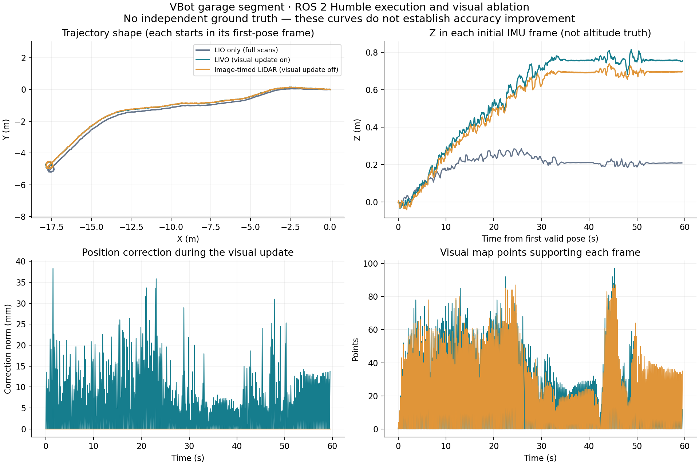

# FAST-LIVO2 Humble 移植与 VBot 首轮实验

日期：2026-11-05。目标：将官方 FAST-LIVO2 移植到 ROS 2 Humble，使用现有 VBot 数据验证视觉确实参与定位。

后续已扩展到全部录包，发现长包发散和视觉结果重复性问题，并修复扫描剩余点的时间窗。
请同时阅读[全量实验报告](fast_livo2_humble_vbot_full_2026-11-05.md)；本文保留最初 60 秒配置的历史结果。

## 1. 结果与边界

**原生 Humble 包已完成构建、安装与录包回放。** 在同一 60 秒片段上跑通了纯 LIO、LIVO 和保留图像切帧节奏但关闭光度修正的对照；三组均正常退出并保存地图。

LIVO 的 596 次有效视觉阶段中，298 次具有视觉支持点并产生超过 1 微米的非零位置修正；关闭光度更新的对照中，位置及旋转的视觉阶段修正量均为零。这说明图像已进入状态更新链路。

**本轮尚不能判断定位精度是否提高。** 无独立真值；录包 GNSS 状态为未定位，厂商里程计并非独立真值。三组曲线的差异只用于检查算法行为，不能当作 ATE、RPE 或精度提升比例。

当前成果是独立实验前端。Omni Manager 的地图 Action、后台回环归档、先验地图 ICP 初始化和 S100/Orin 实机部署仍需后续接入与验证。

## 2. 源码与构建

- 包目录：[FAST_LIVO2](../../FAST_LIVO2/README.md)，ROS 包名 `fast_livo`。
- 上游：[HKU MaRS FAST-LIVO2](https://github.com/hku-mars/FAST-LIVO2)，固定提交 `0d2c0346107b75b59934975adec9a6eeeb913c64`。
- Sophus 固定 `a621ff2e56c56c839a6c40418d42c3c254424b5c`，Vikit 固定 `6c886c8e5d83997806e00294826d528cea3581dd`；来源见 [UPSTREAM.md](../../FAST_LIVO2/UPSTREAM.md)。
- 估计器使用上游实现；本地改动集中于 ament/rclcpp、消息与参数、时间戳、TF、VBot 输入、运行目录和实验观测。
- 节点输出融合后的 IMU 位姿，TF 发布默认关闭，使用传感器/估计时间戳；轨迹和耗时不写入源码目录。
- 本机：Ubuntu 22.04 / ROS 2 Humble，AMD Ryzen 9 9950X，CPU 运行。当前结果不代表嵌入式平台速度。

验证命令与运行说明见包内 README。本轮使用独立目录执行 CMake 构建及 `colcon build`；标准安装入口为：

```bash
source /opt/ros/humble/setup.bash
source install/livo_humble/setup.bash
ros2 pkg prefix fast_livo
ROS_LOG_DIR="$PWD/ros_logs/livo_launch_check" ros2 launch fast_livo mapping.launch.py --show-args
```

测试包含 5 个 GTest 用例：未对齐字段读取/行填充/最后一条 ring、缺失时间戳、截断及错误字段类型、非有限数据与异常时间过滤，以及 ROS 2 时间转换。实际录包回放同时检查预期的 LIO/VIO 更新类型、有限轨迹及正常进程退出。

## 3. 数据选择与输入审计

在 `/home/user/vbot/data` 找到 6 份 ROS 2 MCAP 录包。首轮选择最短的 `roabag2336`，原始长度约 187.45 秒，使用按传感器采集时间截取的前 60 秒。

| 输入/处理后数据 | 数量 | 说明 |
| --- | --- | --- |
| LiDAR | 300 帧 | 约 5 Hz，WLR-722；`x/y/z/intensity/ring/timestamp` |
| 雷达 IMU | 11997 条 | 约 200 Hz；未使用 `/imu_raw` 替代 |
| 左目图像 | 599 帧 | 原始 H.265 约 30 Hz；完整解码后每 3 帧保留 1 帧 |
| 实验图像 | 640 × 360 | 从 1920 × 1080 按原始 rational 八参数模型去畸变、缩放 |
| GNSS | 60 条 | 状态均为 -1，不能作位置真值 |

原始录包只读，转换结果与全部运行输出位于 `build/experiments/vbot_2336_60s/`。该目录不进入源码版本控制。

审计与可复现资料：

- [input_audit.json](fast_livo2_humble_vbot_2026-11-05/input_audit.json)：标定、时间统计、消息计数。
- [environment.json](fast_livo2_humble_vbot_2026-11-05/environment.json)：本轮 Python 依赖版本。
- [LIO 参数](fast_livo2_humble_vbot_2026-11-05/lio.yaml)、[LIVO 参数](fast_livo2_humble_vbot_2026-11-05/livo.yaml)、[切帧对照参数](fast_livo2_humble_vbot_2026-11-05/lidar_scheduled.yaml)：复现副本将输出位置改为 `/tmp`；原始运行配置仍在实验目录。

### 标定与时间戳的关键发现

录包相机内参不同于当前 `FAST_LIO/config/vbot_calib.yaml`，本轮从录包内 CameraInfo 和 `base_link` 到 LiDAR/IMU/左目的静态 TF 推导外参，没有覆盖产品标定。TF 在本实验中作为标定事实源，仍需通过专门的投影检查及时间偏移评价确认其实际精度。

CameraInfo 的 R/P 均为零，不能作为有效的立体校正矩阵；转换使用 K/D 显式去畸变。视频消息的 `frame_id=stereo_camera` 是泛称，左目输入按所选 `/image_left_raw/h265` 与 `/stereo_left/camera_info` 的对应关系使用 `stereo_left` 标定。

本段计算出的 LiDAR→IMU 平移为 `[0.01256, 0.01699, 0.03706]` 米，旋转为单位阵。其他外参完整保存在审计文件中，不应外推为其他 VBot 的标定。

点云是 26 字节的打包格式，double 时间戳位于未对齐的 offset=18；逐点时间为绝对秒，扫描跨度约 200 ms。ring 实际为 **1–16**。新适配器使用按字段读取、检查行填充、转换扫描内毫秒并按时间排序，保留第 16 线。

视频 PTS 沿用消息采集时刻；输出不使用收到数据或播放时刻替代。接收时间相对采集时间的中位延迟约为：IMU 2.35 ms、图像 59.77 ms、LiDAR 234.06 ms。LiDAR 延迟含完整扫描累积，不能把这些接收延迟差直接用作传感器采集时间偏移。首轮相机/IMU/LiDAR 时间偏移设为零，属于待验证假设。

## 4. 三组回放结果

三组使用同一份准备后的 MCAP，均以 1.0 倍速顺序回放，使用 localhost 和独立 ROS domain；没有发布运动指令。

| 模式 | 有效最终位姿数 | 有效覆盖秒数 | 几何更新 P50 / P95（ms） | 视觉阶段 P50 / P95（ms） | 非零视觉位置修正帧数 | 采样峰值 RSS（MiB） |
| --- | --- | --- | --- | --- | --- | --- |
| 纯 LIO（完整扫描） | 298 | 59.40 | 6.84 / 9.74 | — | 0 | 365.4 |
| LIVO（光度更新开启） | 596 | 59.50 | 3.74 / 6.22 | 1.94 / 3.05 | 298 | 529.5 |
| 图像时刻切帧（光度更新关闭） | 595 | 59.50 | 3.47 / 5.58 | 1.36 / 2.17 | 0 | 525.8 |

有效位姿数排除了没有可用点云的初始化阶段。耗时是各更新函数的 CPU 墙钟时间，包含该函数内的地图处理和发布；**不含视频解码、全部 DDS 传输和 IMU 传播成本**，也不是完整端到端延迟。RSS 为间隔采样值，不是精确最大内存。

在有视觉支持点的帧中，LIVO 的支持点数中位数为 43，位置修正量中位数约 11.35 mm，单次最大约 38.28 mm。这些数值描述滤波修正，不表示位置误差或精度。

约一半视觉阶段没有可用支持点；所选场景存在低机位、运动模糊及稀疏旋转雷达与单目视野覆盖问题。具体缺失原因尚需按帧分析，本轮不把无支持帧简单归因于某一种因素。

LIO-only 使用完整扫描，LIVO 使用图像时刻切帧，两者的地图更新频率也不同；因此增加了第三组相同图像时刻但关闭光度 EKF 更新的对照。该对照仍执行图像/视觉地图处理，其耗时不能当成完全不使用相机的成本。

本轮 LIVO 与切帧对照分别保留 596 和 595 个最终状态，相差一个处理时刻。默认 SensorData QoS 为 best effort，本轮未证明逐消息交付和内部调度完全一致；后续精度消融应使用可靠交付或确定性离线调度，并检查输入接收计数。当前结果可用于验证开关的行为，不能据此单独归因精度变化。



三条轨迹各自转换到首个位姿坐标系，图中 Z 是初始 IMU 坐标分量，不是独立测量的海拔。开启/关闭视觉更新的末端相对轨迹分离约 6.1 cm；它反映输出差异，不能判断哪条更接近真实轨迹。

机器可读结果见 [summary.json](fast_livo2_humble_vbot_2026-11-05/summary.json)。全部原始轨迹、耗时和 PCD 保存在实验目录各模式子目录中；初次与调试运行另行保留，不纳入本表。

## 5. 后续实验重点

1. 在当前移植基础上确认相机—雷达投影与采集时间偏移；数据从运动中间开始，另需检查初始化条件。
2. 用可靠或确定性输入运行同节奏消融，并扩展到完整录包及其他场景；有独立真值时再计算 ATE/RPE。
3. 分别验证模糊、弱光、相机中断及恢复，不能从单段成功回放推断已具备平滑降级能力。
4. 接入 Omni 的归档、回环、先验地图初始化和生命周期，再进入目标硬件验证。
5. 为下一阶段语义地图持久化图像/标定/关键帧关联；当前视觉 patch 地图尚不提供语义标签或业务设备身份。
