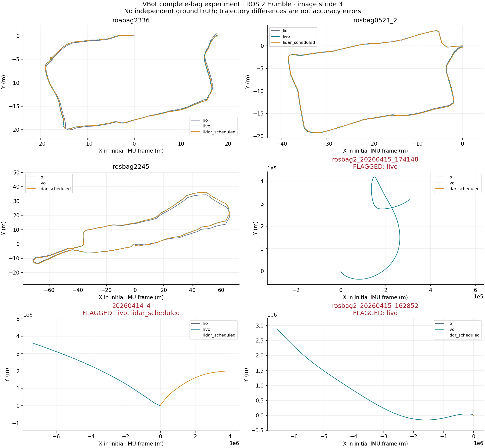
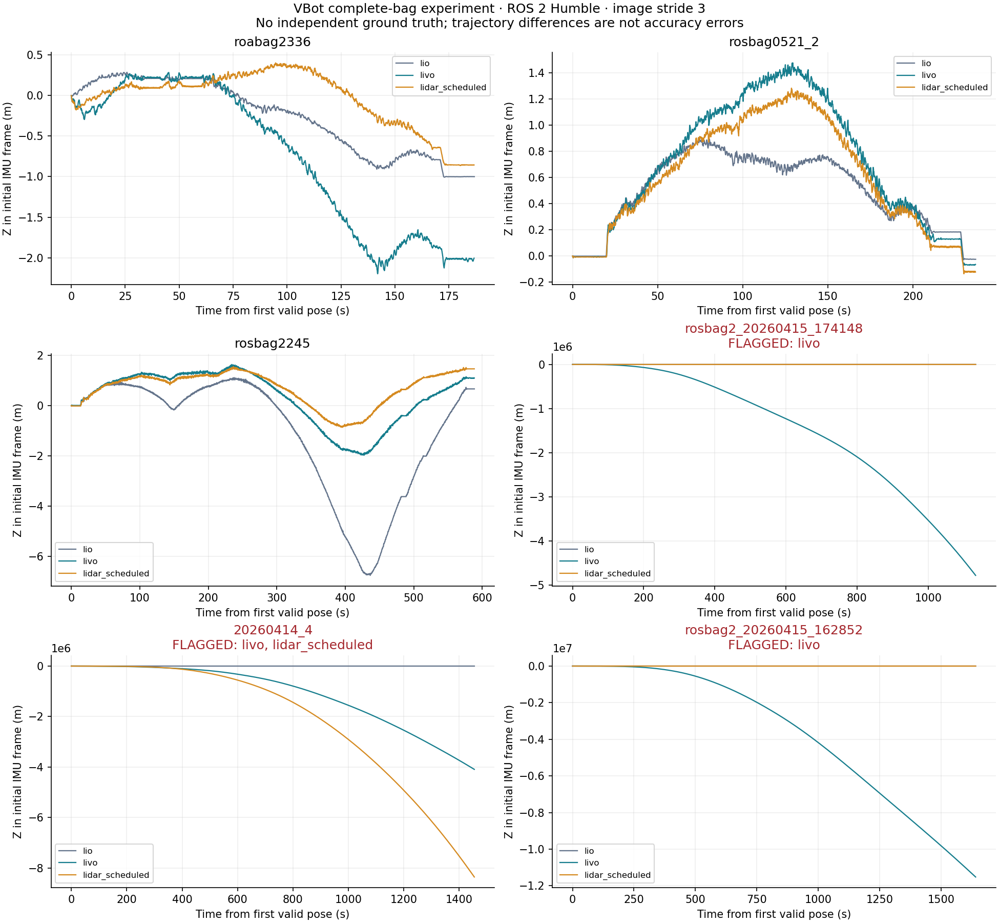

# FAST-LIVO2 Humble：6 份 VBot 全量录包实验

日期：2026-11-05。数据目录：`/home/user/vbot/data`。本报告延续此前的
[60 秒实验](fast_livo2_humble_vbot_2026-11-05.md)，扩大到所有 MCAP 文件的完整时间范围。

后续已针对这些失败进行代码与融合调度适配，见[VBot 优化实验](fast_livo2_vbot_optimization_2026-11-05.md)。
本文保留首次全量配置与失败样本，便于前后比较。

## 结果

6 份录包均完整读取，合计 **87.42 分钟**，三种模式共完成 **18 次完整运行**。
原始计数为 26,225 帧雷达、1,048,140 条雷达 IMU、
157,262 个视频包；视频解码异常为 0。

**运行完成不等于定位通过：4 组出现灾难性轨迹发散，明确判为定位失败。**
其余组未触发本文的灾难性量级检查，也不能据此认定精度合格。当前结果不支持直接把
LIVO 作为稳定的产品定位入口；应先排查图像时刻切帧/IMU 初始化及传播，再讨论语义地图接入。


## 输入与实验配置

递归发现 6 个 MCAP 文件，合计约 87.42 分钟。每个文件独立初始化；本批没有跨文件
拼接会话。原始录包只读，不改写或删除。清单脚本逐份检查整包 CameraInfo 和静态 TF，
本批未发现包内标定变化。内外参来自各自录包，不使用当前产品标定文件替换。

| 录包 | 时长（s） | 雷达 | IMU | 视频包 | 解码帧 / 选用图像 |
| --- | ---: | ---: | ---: | ---: | ---: |
| `roabag2336` | 187.45 | 937 | 37,486 | 5,621 | 5,616 / 1,872 |
| `rosbag0521_2` | 237.35 | 1,187 | 47,432 | 7,121 | 7,119 / 2,373 |
| `rosbag2245` | 589.05 | 2,945 | 117,722 | 17,673 | 17,666 / 5,889 |
| `rosbag2_20260415_174148` | 1134.19 | 5,671 | 226,612 | 33,945 | 33,942 / 11,314 |
| `20260414_4` | 1455.10 | 7,275 | 290,816 | 43,652 | 43,646 / 14,549 |
| `rosbag2_20260415_162852` | 1641.94 | 8,210 | 328,072 | 49,250 | 49,249 / 16,417 |

每份录包运行三组：

- **LIO**：FAST-LIVO2 的纯雷达惯性模式，约 5 Hz 整帧更新；不是仓库中 FAST-LIO2 的运行结果。
- **LIVO**：约 10 Hz 图像时刻切帧，几何更新后执行光度 EKF 更新。
- **关闭视觉修正**（`lidar_scheduled`）：与 LIVO 收到完全相同的图像/IMU/雷达，保留图像切帧及视觉地图处理，只关闭光度 EKF 修正。

原始左目 H.265 约 30 Hz、1920×1080。所有视频包送入解码器，每 3 个解码帧保留
1 个，按录包 rational 八参数模型去畸变，输出 640×360 pinhole 图像。初始缺少参考帧
的视频包可能没有对应解码帧，包数与图像数分别审计，不补造图像。

三组均使用 0.5 m 几何体素、0.2 m 表面降采样、16 线 VBot 点云适配、雷达自带 IMU，
相机/IMU/雷达采样时间偏移设为 0。几何局部地图滑窗半宽 60 个体素，每轴约 ±30 m，
移动 5 m 时清理窗口外体素。三种模式的滑窗设置相同；全局 PCD 单独累计，不等同于
仅导出局部窗口。视觉特征及关联图像尚未加入同样的裁剪。

## 完整性与时间处理

长包使用新增的 `fastlivo_offline`。Python 流式解码一次视频，向三个独立 C++ 进程发送
原始 IMU/PointCloud2 CDR 和校正图像；C++ 调用原节点回调和估计器，每条输入后处理
可用测量。没有生成大型未压缩中间录包，也不依靠 DDS 的 best-effort 传感器投递。
节点仍初始化 ROS 2 发布接口，但实验不发送运动指令。

原始消息先按录包接收时间读取，再按未修改的采样时间作 1 秒有界重排。首个扫描的
采样起点可能早于录包起点：为与首轮实验保持一致，采样时间在记录范围之外的消息
单独计入排除数量。这不是改写时间戳，也不把雷达约 230 ms 的接收延迟直接当成
传感器时间偏移。超出重排窗口的迟到事件会显式报错。

完整读取、传输完成、有效估计覆盖分别检查：

1. 原始 LiDAR、IMU、视频包数量必须等于 MCAP 索引总量。
2. C++ 结束标记携带预期输入数量，必须与实际接收数量完全一致。
3. 检查正常退出、有限状态、预期更新类型、轨迹/耗时行数和最终位姿时间单调性。
4. 初始化和 EOF 队列单独记录；EOF 不补送后继扫描或 IMU，末尾未触发更新的图像不外推。

传输计数不等于内部使用量：原回调仍会忽略首条雷达之前的 IMU/图像，初始化也不会
为每条消息生成有效位姿。表中的排除量仅统计录包记录范围外的采样，不包含这些内部忽略。

| 录包 | 有效位姿 LIO / LIVO / 关闭视觉 | 起始损失范围（s） | 末尾未更新范围（s） | 排除 IMU / 雷达 / 图像 | EOF 待处理图像 LIVO / 对照 |
| --- | ---: | ---: | ---: | ---: | ---: |
| `roabag2336` | 935 / 1867 / 1867 | 0.322–0.462 | 0.186–0.456 | 8 / 1 / 0 | 3 / 3 |
| `rosbag0521_2` | 1185 / 2368 / 2368 | 0.294–0.424 | 0.131–0.359 | 2 / 1 / 1 | 2 / 2 |
| `rosbag2245` | 2943 / 5884 / 5884 | 0.363–0.537 | 0.117–0.387 | 3 / 1 / 0 | 3 / 3 |
| `rosbag2_20260415_174148` | 5668 / 11307 / 11307 | 0.443–0.575 | 0.212–0.476 | 7 / 2 / 0 | 3 / 3 |
| `20260414_4` | 7273 / 14543 / 14543 | 0.348–0.488 | 0.212–0.507 | 7 / 1 / 0 | 4 / 4 |
| `rosbag2_20260415_162852` | 8207 / 16409 / 16409 | 0.448–0.593 | 0.147–0.383 | 7 / 2 / 1 | 3 / 3 |

离线重排解决本次实验的输入顺序问题，**不证明实时接收顺序下的初始化与缓存已经稳定**。
前端本身也尚未接入 Omni Manager、归档回环、先验地图初始化或 S100/Orin 实机流程。

## 轨迹与视觉更新

| 录包 | 模式 | 轨迹长度（m） | 速度 P99（m/s） | 视觉支持帧 / 总帧 | 峰值 RSS（GiB） | 质量判断 |
| --- | --- | ---: | ---: | ---: | ---: | --- |
| `roabag2336` | LIO | 84.53 | 0.70 | — | 0.97 | 未触发灾难性检查；精度待验证 |
| `roabag2336` | LIVO | 92.40 | 0.89 | 1,819 / 1,867 | 1.42 | 未触发灾难性检查；精度待验证 |
| `roabag2336` | 关闭视觉修正 | 91.05 | 0.79 | 1,811 / 1,867 | 1.36 | 未触发灾难性检查；精度待验证 |
| `rosbag0521_2` | LIO | 108.80 | 0.70 | — | 1.08 | 未触发灾难性检查；精度待验证 |
| `rosbag0521_2` | LIVO | 113.21 | 0.85 | 2,136 / 2,368 | 1.55 | 未触发灾难性检查；精度待验证 |
| `rosbag0521_2` | 关闭视觉修正 | 113.50 | 0.77 | 2,020 / 2,368 | 1.53 | 未触发灾难性检查；精度待验证 |
| `rosbag2245` | LIO | 316.26 | 0.76 | — | 1.70 | 未触发灾难性检查；精度待验证 |
| `rosbag2245` | LIVO | 325.63 | 0.85 | 5,615 / 5,884 | 2.78 | 未触发灾难性检查；精度待验证 |
| `rosbag2245` | 关闭视觉修正 | 323.88 | 0.81 | 5,624 / 5,884 | 2.74 | 未触发灾难性检查；精度待验证 |
| `rosbag2_20260415_174148` | LIO | 557.09 | 0.76 | — | 4.14 | 未触发灾难性检查；精度待验证 |
| `rosbag2_20260415_174148` | LIVO | 4.97e+06 | 10307.35 | 67 / 11,307 | 0.66 | **发散，定位失败** |
| `rosbag2_20260415_174148` | 关闭视觉修正 | 576.20 | 0.84 | 9,715 / 11,307 | 5.30 | 未触发灾难性检查；精度待验证 |
| `20260414_4` | LIO | 838.38 | 0.81 | — | 4.63 | 未触发灾难性检查；精度待验证 |
| `20260414_4` | LIVO | 9.19e+06 | 13801.22 | 48 / 14,543 | 0.91 | **发散，定位失败** |
| `20260414_4` | 关闭视觉修正 | 9.71e+06 | 16141.21 | 47 / 14,543 | 1.10 | **发散，定位失败** |
| `rosbag2_20260415_162852` | LIO | 835.12 | 0.74 | — | 4.91 | 未触发灾难性检查；精度待验证 |
| `rosbag2_20260415_162852` | LIVO | 1.38e+07 | 14873.22 | 140 / 16,409 | 1.68 | **发散，定位失败** |
| `rosbag2_20260415_162852` | 关闭视觉修正 | 860.68 | 0.81 | 16,202 / 16,409 | 7.04 | 未触发灾难性检查；精度待验证 |

灾难性诊断标记定义为：速度 P99 超过 10 m/s，或累计轨迹超过 100 km。
这只用于筛出明显错误，不是其余组的合格标准。速度由相邻最终位姿计算，没有使用外部真值。

- `rosbag2_20260415_174148` 的 **LIVO**：首个有效位姿后约 12.0 s 首次出现超过 10 m/s 的相邻位姿速度；完整轨迹长度 4969132 m，速度 P99 为 10307.4 m/s，明显不具备有效定位意义。
- `20260414_4` 的 **LIVO**：首个有效位姿后约 7.3 s 首次出现超过 10 m/s 的相邻位姿速度；完整轨迹长度 9188424 m，速度 P99 为 13801.2 m/s，明显不具备有效定位意义。
- `20260414_4` 的 **关闭视觉修正**：首个有效位姿后约 17.1 s 首次出现超过 10 m/s 的相邻位姿速度；完整轨迹长度 9714767 m，速度 P99 为 16141.2 m/s，明显不具备有效定位意义。
- `rosbag2_20260415_162852` 的 **LIVO**：首个有效位姿后约 16.4 s 首次出现超过 10 m/s 的相邻位姿速度；完整轨迹长度 13839823 m，速度 P99 为 14873.2 m/s，明显不具备有效定位意义。

开启与关闭光度更新的最终时间戳逐包完全一致，三组 IMU/雷达传输数量一致。
关闭光度更新的所有视觉阶段位置及旋转修正均为零；LIVO 产生了非零修正，但发散组
随后大量丢失视觉支持。关闭光度更新的对照也出现失败，说明尚不能只把问题归因于视觉残差。

最终轮单进程最高 RSS 为 **7.04 GiB**；滑窗控制了几何地图增长，
不能据此认定视觉地图内存长期有界。共输出 30 份 PCD，均通过二进制长度与
声明点数校验；失败轨迹对应的地图也必须视为无效结果。

以下曲线保留全部数据，异常组会放大该面板的坐标轴。正常组的细节和完整数值见汇总 JSON。






每条轨迹分别转换到自己的首个位姿坐标系。Z 是初始 IMU 坐标分量，不是独立测量的海拔。
轨迹长度、速度和相互分离用于诊断，不是 ATE/RPE。光度修正非零说明图像进入状态更新，
不能单独证明修正方向正确或定位精度提高。录包厂商 odometry 不作为独立真值。

## 全量运行发现的问题

**点云时间窗。** 原同步逻辑会把上次扫描剩余的点全部用于下一次图像更新，包含采样
时刻晚于该图像的点。本地改为再次按当前图像时间拆分，未来点保留并重新计算相对时间。
另处理 epoch double 与 float 转换产生的 1 微秒以内负舍入量，更大的负时间仍报错。
新增回归覆盖高频切帧、点守恒/绝对时间保持、边界归属和舍入误差。

**初始化顺序。** 按接收顺序直接喂数时，晚到雷达之前的 IMU 会被原回调丢弃，并且
首个不完整扫描与相机不在同一时间范围；10 秒检查出现数十米的非物理漂移。
采用与首轮一致的采样窗口及采样时间排序后，10 Hz 三组短轨迹恢复到约 5.6～5.9 m。
因此本报告明确限定离线输入协议，后续实时入口仍需专门验证。

**30 Hz 配置。** 修复时间窗和排序后的 10 秒原帧率检查中，关闭光度更新的对照仍有
明显异常，不能把 30 Hz 图像与 5 Hz 雷达的默认组合视为已验证。本轮统一使用 10 Hz，
没有用 30 Hz 的异常结果替换最终完整录包结果。

**重复性。** 对 `rosbag2_20260415_174148` 的前 30 秒以相同数据和参数复跑（仅输出目录
及结束截断不同），最终时间戳一致，LIO 和关闭光度修正的轨迹逐值一致；LIVO 却从约
1.7 s 开始不同，末端分离约 352.5 m，完整运行该前缀累计 388.2 m，短复跑为 33.6 m。
因此确定输入顺序不等于估计结果已具备重复性。该差异需要进一步排查，尚未定位根因，
也不能据此认定短复跑就是准确结果。机器记录见
[repeatability_probe.json](fast_livo2_humble_vbot_full_2026-11-05/repeatability_probe.json)。

**长包内存。** 关闭几何滑窗时，长包单进程增长到十几 GB，多包并行产生内存压力，
已主动中止并保留日志。最终轮启用已有几何滑窗，录包之间串行，三种模式共享 CPU。
各 worker 限制虚拟地址空间为 24 GiB，避免无限制申请。该限制不是实际硬件内存需求；
实际峰值 RSS 见上表。视觉特征及图像仍会保留，需要继续做长期内存管理。

初始化诊断、30 Hz 短检查、时间边界异常及未启用滑窗的运行均保存在
`build/experiments/full_20261105/`，没有纳入最终结果表。

## 复现与验证

```bash
source /opt/ros/humble/setup.bash
python3 FAST_LIVO2/scripts/inspect_full_bags.py /home/user/vbot/data \
  --output build/experiments/full_repeat/inventory.json
python3 FAST_LIVO2/scripts/run_full_bags.py \
  --inventory build/experiments/full_repeat/inventory.json \
  --output build/experiments/full_repeat/results \
  --executable install/livo_humble/fast_livo/lib/fast_livo/fastlivo_offline \
  --image-stride 3 --local-map-half-size 60
MPLCONFIGDIR=/tmp/livo_matplotlib python3 FAST_LIVO2/scripts/analyze_full_bags.py \
  build/experiments/full_repeat/results --output build/experiments/full_repeat/analysis
```

本机为 Ryzen 9 9950X、125 GiB RAM、Ubuntu 22.04 / ROS 2 Humble。三进程共享 CPU；
函数耗时不包含全部解码、输入及 IMU 传播成本，不作为独占 CPU 或端到端实时性基准。
峰值 RSS 来自 `getrusage`，不是间隔采样估计。标准 CMake/colcon 构建与安装通过；
9 个 GTest 用例通过（colcon 含测试包装项共计 10 tests，0 failures）。

完整清单可由新增检查脚本复现，已逐份比对原清单的数量、记录时间和标定一致。
Python 脚本通过 Ruff 错误/未定义变量检查；实际全量执行同时验证解码与输入协议。
环境版本见 [environment.json](fast_livo2_humble_vbot_full_2026-11-05/environment.json)。

最终运行根目录为 `build/experiments/full_20261105/results_sliding_10hz/`。
逐包目录含三套参数、输入审计、厂商里程计参考、原始轨迹、TUM 轨迹、耗时、节点日志、
传输审计以及 `Log/pcd/` 地图。可审阅的汇总副本见
[summary.json](fast_livo2_humble_vbot_full_2026-11-05/summary.json) 和
[inventory.json](fast_livo2_humble_vbot_full_2026-11-05/inventory.json)。
