# FAST-LIVO2 六包地图质量与回环复核

完成日期：2026-11-06；实验目录沿用启动时的 `20261105` 标识。承接[高度一致性实验](fast_livo2_vbot_vertical_2026-11-05.md)。

> 主线版本说明：继续使用上一轮完整关键帧 LIVO 作为视觉定位和语义建图开发基线，见[当前主线](fast_livo2_vbot_mainline.md)。本报告的整帧留出方案同时减少了回环拟合扫描、改变了配准条件，属于敏感性与留出诊断，不是同输入的新旧版本性能比较。删边地图单独保存，不替换全量基线。

本轮完成六包固定配置 LIO/LIVO 对照，检查回环前后的墙面重影、地面错层和可疑闭合。新增六次完整纯 LIO 回放，复用同一冻结程序、同一 SI 配置的六次完整 LIVO 结果；每种模式覆盖原始数据 **87.42 分钟**。随后为两种模式重建共 12 组整帧留出后端结果，并检查全部七个回访事件。

**结论：部分地图的局部一致性明显改善，但视觉融合尚未显示稳定的全面优势，四月 14 日末段大回环不能认定为可靠闭合。** 六个回访事件获得未参与回环拟合的扫描支持，一个事件未通过复核。该事件的七条 LIO 边已从单独导出的复核地图中隔离。`162852` 的墙面重影指标略有变差，也保留在结果中。

## 固定配置与验证范围

两模式使用相同冻结原生程序、CameraInfo/静态 TF 来源、SI IMU 尺度、数据起止范围及图像解码流程。逐包比较 YAML，除 `common.img_en` 与输出目录外完全一致；原生最终状态的时间戳逐值一致，输入消息计数一致。相机内外参此次没有重新标定，因此结论只适用于当前参数。

- 加速度尺度固定为 `1.0`，使用[本轮 SI 覆盖参数](../../FAST_LIVO2/config/vbot_si_overrides.yaml)。
- LIVO 按雷达完整扫描时刻融合，图像最大年龄 40 ms，曝光估计关闭，图像观测协方差参数 10000。
- LIO 仅关闭视觉更新。两模式完整处理全部雷达和 IMU 数据，未截取表现好的片段。
- 六包新 LIO 回放均完成，无输入处理失败；与既有 LIVO 共形成 12 份完整前端结果。前端没有因本轮地图评估而重调参数。

冻结原生程序 SHA-256：

```text
c56700b2babff8fafc7c0cef21f06277922b61cfa341b7badebcb48edfe2bf8b
```

## 为什么重新做整帧留出

上一轮 LIVO 的 215 条几何回访边，按参考和回访两端的时间共同聚类，实际上只有七个回访事件。相邻边共用扫描和局部子图，不能把 215 条边当成 215 次独立验证。

本轮以两模式共同的首个原生状态时刻为原点，交替划分 2 秒时间块：偶数块仅用于回环候选描述子和 ICP 拟合，奇数块中的扫描用于复核。前端仍处理全部数据，地图仍导出全部关键帧。新增 `--loop-fit-half-period-s 2` 仅改变后端拟合扫描集合；默认 0 保留原算法行为。

回环拟合仍使用原几何门限：双向最小重叠率 0.4、平均重叠率 0.5、点距 RMSE 0.20 m、面距 RMSE 0.12 m、可观测性比值 1e−4，以及原有多初值歧义和修正幅度检查。没有为四月 14 日降低门限。

对两模式的候选并集按双端时间 15 秒邻域的连通分量形成事件；每个事件选择同一对物理时刻，再取每侧最多五帧、35 秒及 8 m 范围内的留出扫描。代表时刻按可用扫描数和时间邻近程度确定，不按配准残差挑选。复核重新执行几何门限，并要求相对原回环测量的变化不超过 0.3 m / 3°。

**留出的是回环拟合扫描，不是独立录包或外部真值。** 所有扫描仍参与过前端估计；同一事件内的平面和边也相关。因此本轮不能给出 ATE、全地图绝对精度或误闭合率。

## 墙面重影的固定平面对比

量化使用两次回访在同一参考平面上的中位距离差绝对值，再对有效平面取中位数，单位 cm。参考平面只拟合一次，四个版本使用完全相同的点样本；没有对每张地图重新拟合平面来掩盖错层。参考和回访各取等量点计算 90% 宽度，作为厚度补充指标。

为隔离位姿影响，四种位姿统一作用于留出的 **LIO 去畸变扫描**。这比较位姿造成的地图一致性，不独立比较两模式各自的去畸变质量。另附各自真实 PCD 的同区域图作为定性对照。自动提取的是垂直平面候选，未做语义墙面标注。

| 录包 | 有效垂直平面数 | LIO 回环前 → 后（cm） | LIVO 回环前 → 后（cm） |
| --- | ---: | ---: | ---: |
| `roabag2336` | 0 | — | — |
| `rosbag0521_2` | 8 | 10.46 → 0.94 | 9.35 → 0.77 |
| `rosbag2245` | 10 | 9.61 → 1.45 | 11.85 → 2.20 |
| `rosbag2_20260415_174148` | 8 | 2.63 → 2.56 | 1.58 → 1.10 |
| `20260414_4`¹ | 16 | 1.65 → 1.62 | 1.79 → 1.68 |
| `rosbag2_20260415_162852` | 24 | 0.74 → 1.33 | 0.91 → 1.75 |

¹ 四月 14 日仅早期回访贡献这 16 个平面，末段回访未通过复核、未参与平面统计。该行 LIO「后」仍是固定后端原始对照，包含后来被隔离的末段事件；不能由早期平面数值认可整张地图。隔离后的地图另存。

`0521`、`2245` 的改善明显；`174148` 的局部变化较小。`162852` 两模式的重影差和 90% 宽度均略有增加，不能写成全场景改善；不足 1 cm 的变化也没有足够独立样本支撑显著性判断。五个可量化场景中，LIVO 回环后该指标仅在两个场景低于 LIO，不能据此宣称视觉融合整体优于纯 LIO。

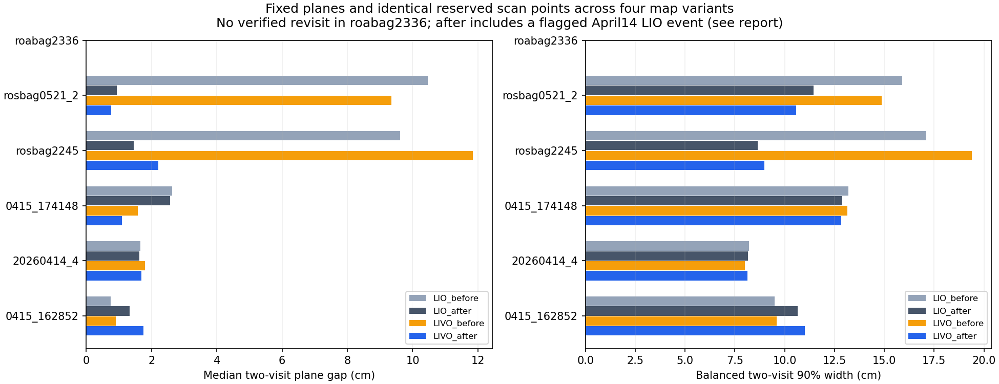

图中的 `before` 是仅做固定重力坐标变换的地图，`after` 是固定配置图优化结果。空白表示无合格回访或平面，不表示零误差。

## 地面错层的证据和覆盖限制

`rosbag2245` 的第二次回访有一个合格地面片：参考 185 点、回访 19 点。LIO 地面层间差 **61.19 → 3.98 cm**，LIVO **60.99 → 3.85 cm**；等量混合点的 90% 宽度分别由 79.94 / 79.71 cm 降至 16.49 / 16.30 cm。仍有厚度，不能把约 4 cm 的层间差写成 4 cm 绝对建图精度。

其余场景没有满足当前点数、几何和留出条件的地面片。六包总共只有这一片合格地面证据，不能推出所有场景的地面错层已经消失。地面拟合仅用于评估，保留实际坡度，没有给位姿图施加水平地面或零高度约束。

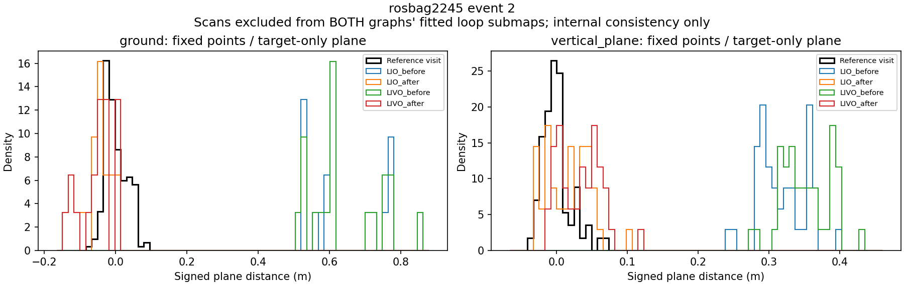

直方图每类展示该事件中 LIVO 回环前层间差最大的平面，用于观察问题；上表则统计全部有效平面的中位数，二者口径不同。

## 错误闭合复核与四月 14 日修正

新后端接受的候选边合计为 LIO 175 条、LIVO 166 条；这些边包括原后端按每四条留出一条、不加入位姿图的边。事件并集共七个，其中六个在两模式下均获得留出扫描支持，一个仅 LIO 检出且未通过复核。

| 录包 | LIO / LIVO 候选边 | 回访事件数 | 留出扫描复核 |
| --- | ---: | ---: | --- |
| `roabag2336` | 0 / 0 | 0 | 无通过原门限的回访，无法评价闭合正确性 |
| `rosbag0521_2` | 22 / 22 | 1 | 两模式均获支持 |
| `rosbag2245` | 36 / 36 | 2 | 两模式均获支持 |
| `rosbag2_20260415_174148` | 58 / 55 | 1 | 两模式均获支持 |
| `20260414_4` | 31 / 25 | 2 | 早期通过；末段 LIO 未通过，LIVO 未检出 |
| `rosbag2_20260415_162852` | 28 / 28 | 1 | 两模式均获支持 |

六个获支持事件未发现复核冲突，但这不是「零误闭合」结论。对应视频也已逐事件查看：室内车库存在相似柱列，室外庭院有不同朝向和局部遮挡，图像只能辅助判断地点，不能替代三维相对位姿验证。

四月 14 日末段参考时刻约 5 s、回访约 1434 s：

- 原先全关键帧拟合的 LIVO 后端能闭合；改为整帧留出后，该末段事件未被 LIVO 接受，只保留早期回访。
- LIO 仍接受该事件七条边，但留出扫描点距 RMSE 为 **0.2061 m**，超过固定的 **0.20 m** 门限。面距 RMSE 0.1137 m、双向重叠 0.555 / 0.674，单看这些项会遗漏失败项。
- 两张图像可见庭院、廊架和楼体等相似结构，不能据此断言是错误地点匹配。当前归类为 **未验证、对扫描选择敏感**，而非已证明误闭合。
- 已从独立复核地图移除该事件全部七条边，其中六条原本加入位姿图；原始对照结果保留以便追溯。

| 四月 14 日结果 | 首尾沿重力方向高度差（m） | 解读 |
| --- | ---: | --- |
| LIO 回环前 | −5.237 | 前端结果 |
| LIO 固定后端原始对照 | +0.005 | 包含未通过复核的末段事件，不能因首尾接近零就认可 |
| LIO 隔离末段事件后 | −5.224 | 复核地图仍保留大幅高度差 |
| LIVO 回环前 | −4.376 | 前端结果 |
| LIVO 整帧留出后端 | −4.329 | 没有可靠末段闭合来消除高度差 |

这些是估计轨迹的首尾高度差，不是外部真值误差。四月 14 日局部点云叠加同时显示明显重复层；对于起终位置不同的其他路线，不能仅凭首尾 Z 差诊断漂移。

**对上一轮报告的修正：**「四月 14 日高度错层已收拢」只描述旧后端在原拟合扫描集合下的结果。更严格的留出复核没有证明它稳定成立；当前不能将其当作已解决的问题或上线依据。原 Word 汇报作为历史实验记录保留，应与本复核一起阅读。

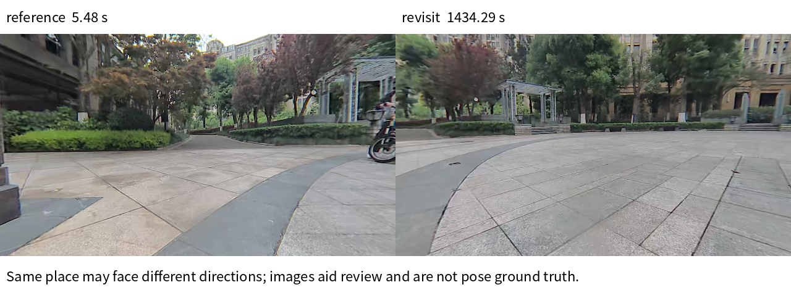
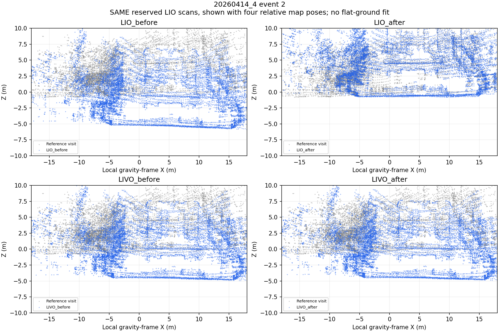

上图右上角虽看起来闭合，使用的却是含未验证边的 LIO 对照；这正是需要独立扫描门限的原因。下方 LIVO 仍有明显双层。

## 六包真实地图与轨迹

以下点云图直接读取各模式输出 PCD，以共同初始位姿刚体对齐，使用同一参考区域的 15 m 水平半径、相对高度 ±8 m 裁剪和相同色标。颜色表示高度，不是语义类别；X–Z 投影叠加了不同 Y 位置的结构，适合观察大错层，不用于替代上述固定平面统计。完整点云不做该裁剪。

### roabag2336

无合格回环，回环前后保持相同地图；不能用它评价回环收益或错误闭合。

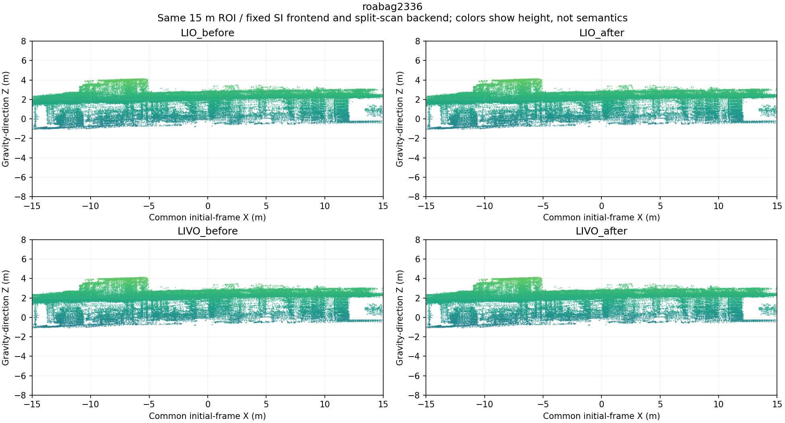
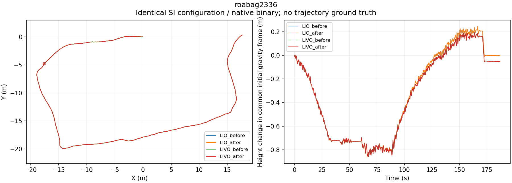
### rosbag0521_2

车库回访的垂直平面重影明显收敛，LIO 和 LIVO 都有收益。

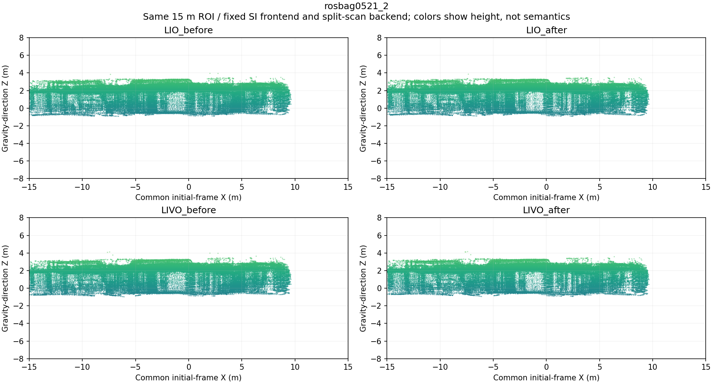
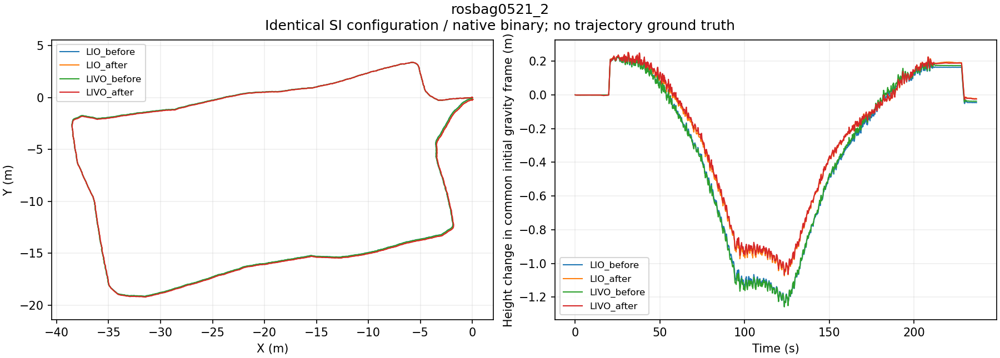
[回访 1 图像证据](fast_livo2_vbot_map_audit_2026-11-05/rosbag0521_2_event_01_images.png) · [同点云位姿对比](fast_livo2_vbot_map_audit_2026-11-05/rosbag0521_2_event_01_xz.png)

### rosbag2245

两次车库回访均获留出扫描支持，墙面候选及一处地面错层改善。

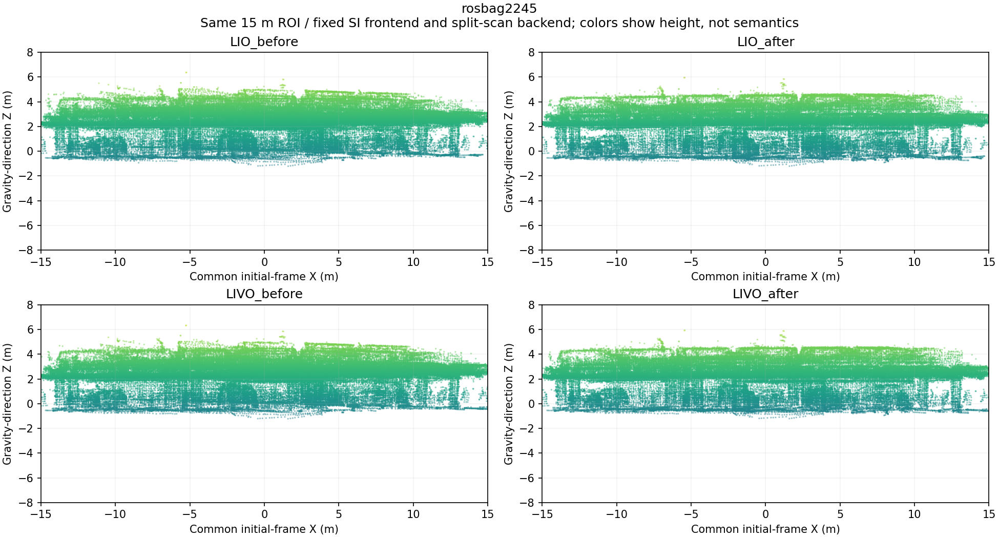
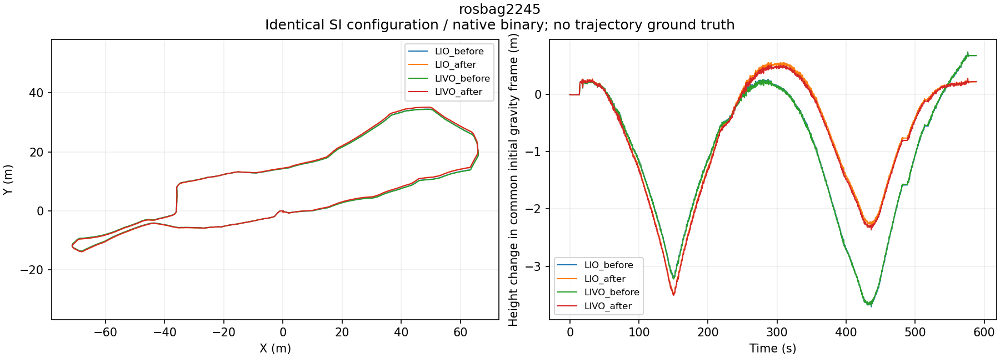
[回访 1 图像证据](fast_livo2_vbot_map_audit_2026-11-05/rosbag2245_event_01_images.png) · [同点云位姿对比](fast_livo2_vbot_map_audit_2026-11-05/rosbag2245_event_01_xz.png)

[回访 2 图像证据](fast_livo2_vbot_map_audit_2026-11-05/rosbag2245_event_02_images.png) · [同点云位姿对比](fast_livo2_vbot_map_audit_2026-11-05/rosbag2245_event_02_xz.png)

### rosbag2_20260415_174148

局部回访获支持，但路线起终点不同。首尾高度差包含实际地形变化，不能直接当作漂移；局部平面通过也不验证整段高程。

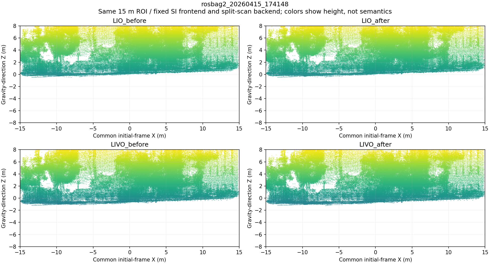
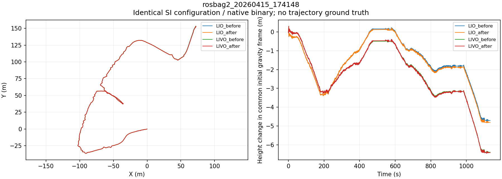
[回访 1 图像证据](fast_livo2_vbot_map_audit_2026-11-05/rosbag2_20260415_174148_event_01_images.png) · [同点云位姿对比](fast_livo2_vbot_map_audit_2026-11-05/rosbag2_20260415_174148_event_01_xz.png)

### 20260414_4

早期回访通过，末段闭合未验证。图中 LIO_after 含待隔离边，仅供对照；实际复核地图使用下文独立文件。

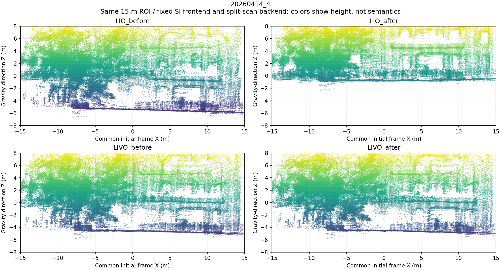
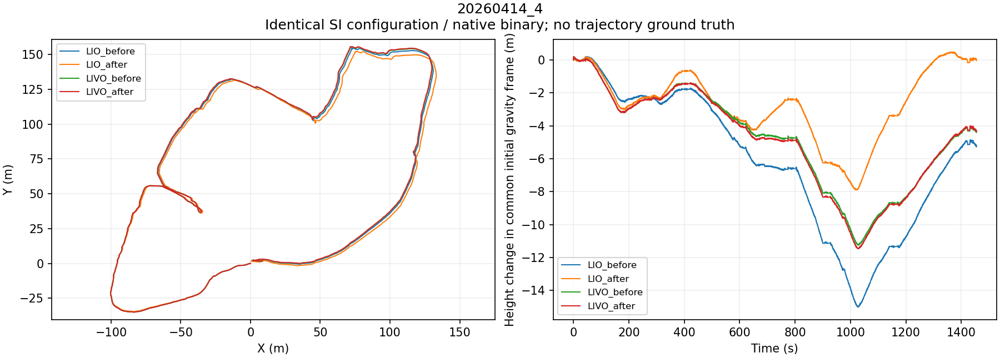
[回访 1 图像证据](fast_livo2_vbot_map_audit_2026-11-05/20260414_4_event_01_images.png) · [同点云位姿对比](fast_livo2_vbot_map_audit_2026-11-05/20260414_4_event_01_xz.png)

[回访 2 图像证据](fast_livo2_vbot_map_audit_2026-11-05/20260414_4_event_02_images.png) · [同点云位姿对比](fast_livo2_vbot_map_audit_2026-11-05/20260414_4_event_02_xz.png)

### rosbag2_20260415_162852

早期回访获支持，但墙面指标略有回退；后端没有消除整段高度变化，也没有外部高程真值证明该变化的误差。

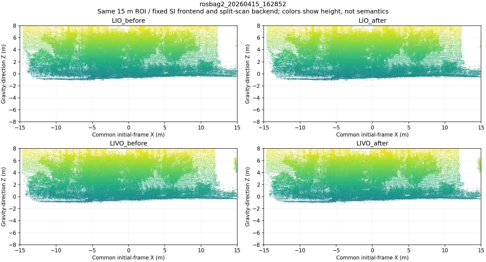
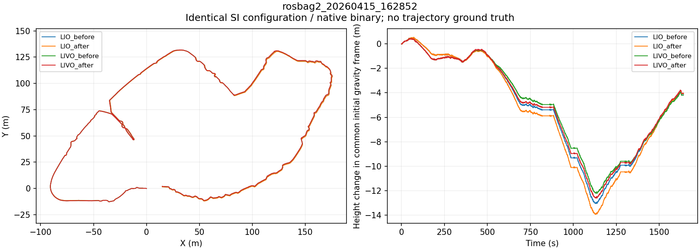
[回访 1 图像证据](fast_livo2_vbot_map_audit_2026-11-05/rosbag2_20260415_162852_event_01_images.png) · [同点云位姿对比](fast_livo2_vbot_map_audit_2026-11-05/rosbag2_20260415_162852_event_01_xz.png)

## 地图文件与复现材料

全部固定后端对照按 `split_maps/<LIO或LIVO>/<bag>/` 保存。`map_gravity_only.pcd` 为回环前，`map_loop_corrected.pcd` 为回环后；对应 `trajectory_gravity.tum` / `trajectory_corrected.tum`。这些是离线诊断结果，后端未反馈在线前端。

下表链接为每个场景的复核后地图；四月 14 日 LIO 已替换为剔除未验证事件的单独导出，其余链接沿用原图。地图保留原生 XYZRGB，颜色来自相机可见区域，其他区域为灰色。

| 录包 | LIO 复核地图 | LIVO 复核地图 |
| --- | --- | --- |
| `roabag2336` | [PCD](../../build/experiments/map_audit_20261105/split_maps/LIO/roabag2336/map_loop_corrected.pcd) | [PCD](../../build/experiments/map_audit_20261105/split_maps/LIVO/roabag2336/map_loop_corrected.pcd) |
| `rosbag0521_2` | [PCD](../../build/experiments/map_audit_20261105/split_maps/LIO/rosbag0521_2/map_loop_corrected.pcd) | [PCD](../../build/experiments/map_audit_20261105/split_maps/LIVO/rosbag0521_2/map_loop_corrected.pcd) |
| `rosbag2245` | [PCD](../../build/experiments/map_audit_20261105/split_maps/LIO/rosbag2245/map_loop_corrected.pcd) | [PCD](../../build/experiments/map_audit_20261105/split_maps/LIVO/rosbag2245/map_loop_corrected.pcd) |
| `rosbag2_20260415_174148` | [PCD](../../build/experiments/map_audit_20261105/split_maps/LIO/rosbag2_20260415_174148/map_loop_corrected.pcd) | [PCD](../../build/experiments/map_audit_20261105/split_maps/LIVO/rosbag2_20260415_174148/map_loop_corrected.pcd) |
| `20260414_4` | [PCD](../../build/experiments/map_audit_20261105/reviewed_maps/20260414_4/LIO/map_loop_reviewed.pcd) | [PCD](../../build/experiments/map_audit_20261105/split_maps/LIVO/20260414_4/map_loop_corrected.pcd) |
| `rosbag2_20260415_162852` | [PCD](../../build/experiments/map_audit_20261105/split_maps/LIO/rosbag2_20260415_162852/map_loop_corrected.pcd) | [PCD](../../build/experiments/map_audit_20261105/split_maps/LIVO/rosbag2_20260415_162852/map_loop_corrected.pcd) |

[全部回环前后对照目录](../../build/experiments/map_audit_20261105/split_maps) · [四月14日隔离记录](../../build/experiments/map_audit_20261105/reviewed_maps/20260414_4/LIO/review.json) · [完整汇总 JSON](fast_livo2_vbot_map_audit_2026-11-05/summary.json)

复现脚本与记录：

- [批量前端状态](../../build/experiments/map_audit_20261105/lio_full/status.json)及[复用 LIVO 状态](../../build/experiments/z_20261105/si_full/status.json)，记录二进制哈希、输入消息数及完成状态。
- [后端批处理](../../build/experiments/map_audit_20261105/run_split_maps.py)、[复核批处理](../../build/experiments/map_audit_20261105/run_audits_v2.py)使用冻结代码；输出目录存在时拒绝覆盖，应使用新的实验目录。
- [几何复核脚本](../../FAST_LIVO2/scripts/audit_map_quality.py)、[平面评估实现](../../FAST_LIVO2/scripts/map_quality.py)、[图像提取脚本](../../FAST_LIVO2/scripts/extract_revisit_images.py)。各包 JSON 保存候选边、事件、扫描时刻和每片平面统计。
- 图像从原 MCAP 的 H265 视频按采集时间就近提取，经录包 CameraInfo 校正；时间偏差和解码方式保存在各包 `image_evidence.json`。它们只辅助场景审阅。
- [代码哈希清单](fast_livo2_vbot_map_audit_2026-11-05/source_manifest.json)与本目录日志供追溯。原始录包未修改。

本次新增五项评估测试覆盖双墙错层不被重新拟合隐藏、双端时间事件聚类、位姿时间边界、整帧划分及保留实际地面坡度；另有四项后端几何测试通过。Ruff 通过，ROS 2 Humble 的 colcon 构建安装通过。环境会提示现有 SciPy 与 NumPy 版本范围不匹配，当前测试和全部后端任务均完成；复现实验应保留环境信息或使用验证后的统一环境。

## 后续处理优先级

首先保留本轮固定基线，针对四月 14 日末段检查时间同步、相机外参和运动初始化；随后用不同扫描划分重复验证该事件能否稳定通过，而非降低 0.20 m 门限。`162852` 要结合边的权重和局部残差检查回环为何略微增加重影。地面量化需要更多有足够交叠的扫描或专门重复路线采集，才能把「一处错层改善」扩展到跨场景结论。

语义目标关联仍可做离线原型，但当前几何底图尚不能提供已验证的跨场景高度一致性保证。
