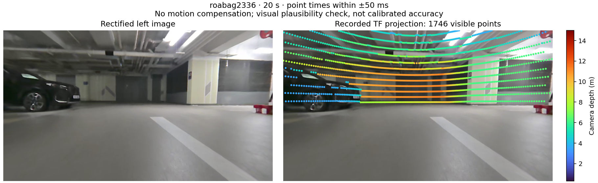
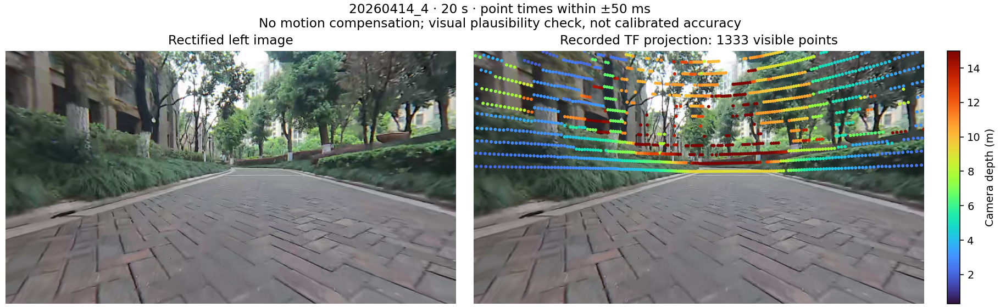
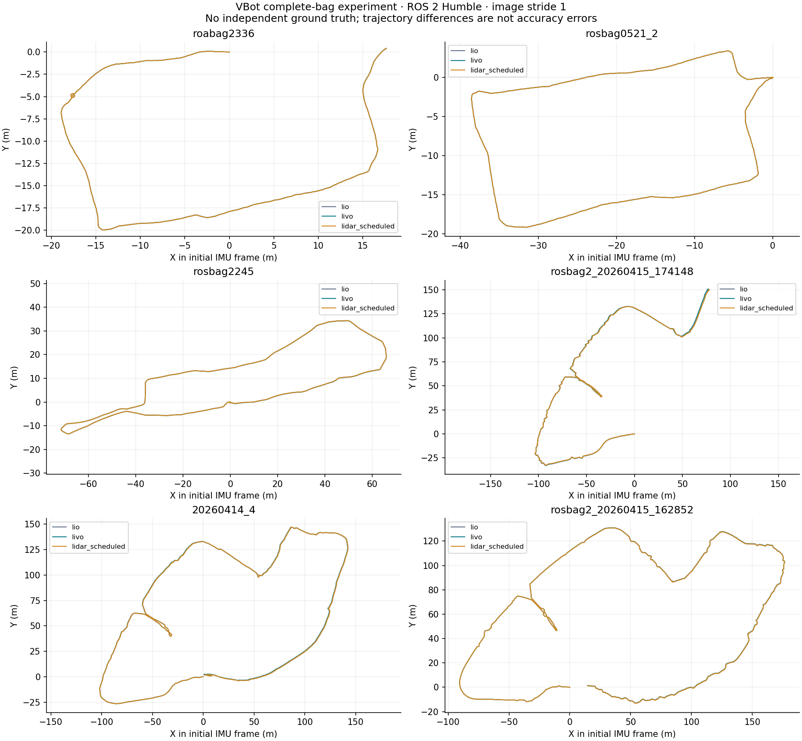
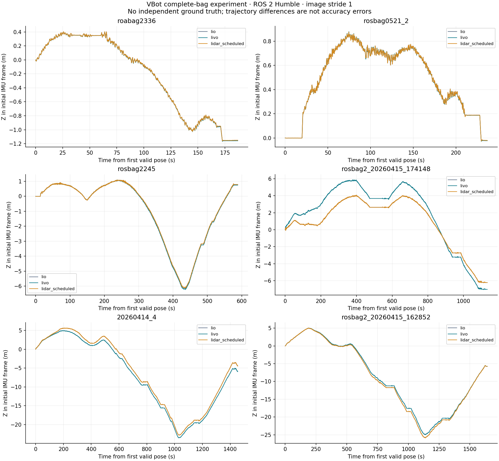

# FAST-LIVO2 在 VBot 数据上的适配与优化实验

日期：2026-11-05。承接[首轮全量实验](fast_livo2_humble_vbot_full_2026-11-05.md)。
目标是定位发散和重复性问题，保留可靠的雷达惯性几何更新，再加入视觉约束。

后续针对高度分量、SI 加速度单位与三维回环地图的实验见
[高度一致性优化](fast_livo2_vbot_vertical_2026-11-05.md)。本报告保留原轮数据。

## 结果

已完成代码修复和 VBot 融合调度适配，并重跑全部 **6 份录包、87.42 分钟、18 组**。
**原轮 4 组灾难性发散，在本轮 18 组完整运行中均未再触发。**

关闭光度更新后，六包的完整最终轨迹与纯 LIO 逐值一致。开启视觉后仍有实际修正，
不是把相机关闭后宣称成功；失败长包的前 60 秒独立复跑也与全量运行逐值一致。
**这证明本批离线实验的稳定性和可重复性明显改善，尚不能证明定位精度提高或已可部署。**


## 调研与判断

[FAST-LIVO2 论文](https://arxiv.org/abs/2408.14035)使用顺序滤波融合几何和光度约束，
视觉 patch 附着于雷达地图，并动态更新参考 patch。因而参考 patch 的选择、相机曝光
以及几何更新提供的先验都直接影响本批数据的适配；不能仅完成消息接口转换就判为可用。
本轮同时核对了[官方 IMU 实现](https://github.com/hku-mars/FAST-LIVO2/blob/main/src/IMU_Processing.cpp)
和[官方视觉实现](https://github.com/hku-mars/FAST-LIVO2/blob/main/src/vio.cpp)。

初始化及时间标定方面，[LI-Init](https://github.com/hku-mars/LiDAR_IMU_Init)专门处理
雷达/IMU 的时延、外参与初始状态。本轮没有引入 LI-Init，也没有重新估计硬件时延或外参；
所完成的是传播边界、状态初始化和本机传感器更新节奏的修正。精标定仍是独立后续工作。

首轮中，关闭光度修正的图像切帧对照也发散。因此需要把“几何更新节奏改变”和
“视觉残差引入”分开验证。只有恢复相同雷达节奏、确认关闭视觉的轨迹与纯 LIO 一致，
才有条件讨论视觉辅助本身的效果。

公开的[长序列退化反馈 #451](https://github.com/hku-mars/FAST-LIVO2/issues/451)及其评论中，
也有人报告长时间退化、IMU 时序异常和重复运行结果差异。这些是他人数据上的问题线索，
本轮没有把它们当成 VBot 的已证实根因，也没有据此修改录包时间戳。

## 具体修改

1. **IMU 时间边界**：传播起点显式初始化，初始化消耗的测量窗口同步推进切帧时间；
   Reset 清理传播状态。点云排序后反向去畸变，最早一个点处理完成即退出，避免被重复变换。
2. **视觉评分与内存**：参考 patch 的 NCC 按每对样本重新计算，消除缓存均值分支中的
   未初始化读取及跨样本累计错误；常量 patch 返回零相关性。仅在确实保留新观测时分配 patch，
   用所有权转移避免未保存 patch 的泄漏，参考 patch 指针初始化为空。
3. **图像采样边界与重复性**：每次迭代按实际金字塔层级、搜索层级检查投影和梯度邻域，
   无效观测的残差/雅可比清零；无测量时不做协方差更新。并行计算每个 patch 的误差后，
   按固定顺序汇总，避免并行浮点归约改变误差比较。协方差更新后显式对称化。
4. **完整雷达扫描为主的融合**：新增 `vio.lidar_timed_fusion`。雷达/IMU 按完整扫描处理，
   相机不再切开扫描。每次几何更新后，选择不晚于扫描结束、年龄不超过 40 ms 的最新图像。
   用 IMU 积分补偿图像至雷达时刻的旋转，按当前速度一阶补偿短时平移；融合状态仍对应
   雷达更新时刻，图像输出保留真实采样时间。缺少新鲜图像时继续 LIO。
5. **保守视觉配置**：输入视频全部解码、校正，约 30 Hz 送入同步器，约 5 Hz 参与视觉更新；
   关闭在线曝光估计，`img_point_cov=10000`。相较原值 100，降低了光度观测权重，
   因此不能把稳定性变化单独归因为某一项代码修改，也不能宣称该值是精度最优值。

新调度是本地实验变体，配置见
[vbot_lidar_timed_overrides.yaml](../../FAST_LIVO2/config/vbot_lidar_timed_overrides.yaml)。
原图像切帧路径保留作对照，未替换 Omni 默认前端。完整参数、原始标定及所有尝试结果均保留。

## 短片段对照与淘汰方案

所有表中数字为前 60 秒的轨迹累计长度，单位 m。原始源数据、标定不变；不同配置下的
初始化和有效输出起点可能不同，长度只用于检查异常量级，不是精度误差。
探索期间程序版本也在逐步更新，这些列不构成严格的单变量消融；最终六包完整回归使用
同一份冻结程序和同一套参数。

| 录包 | 仅关闭曝光 | 逆向组合 | 预热后 10 Hz 切帧 | 预热后 5 Hz 切帧 | 新方案前 60 s |
| --- | ---: | ---: | ---: | ---: | ---: |
| `roabag2336` | 23.78 | 23.74 | 63.15 | 62.41 | 20.99 |
| `rosbag0521_2` | 22.39 | 22.54 | 21.70 | 41.91 | 21.40 |
| `rosbag2245` | 25.25 | 25.40 | 22.05 | 22.95 | 24.26 |
| `rosbag2_20260415_174148` | 893.92 | 4615.56 | 450.86 | 482.70 | 35.98 |
| `20260414_4` | 3084.11 | 6383.13 | 201.97 | 124.64 | 38.47 |
| `rosbag2_20260415_162852` | 24.53 | 1256.80 | 15.93 | 262.50 | 25.19 |

只修复初始化/评分、只关闭曝光、切换逆向组合更新、整帧预热后继续切帧、降低视觉权重、
或降低图像切帧频率，都没有解决全部片段。最终采用整帧雷达调度，其关键检查是关闭视觉后
在共有时刻回到纯 LIO 的同一轨迹，而不是仅把视觉权重调得足够小。

这些方案未做所有参数组合的全局搜索；前缀筛选也不能证明长包稳定。最终轮冻结可执行文件，
记录 SHA-256，六份录包串行、每包三进程，并重新覆盖所有完整时长。

## 标定投影检查

六包分别从 CameraInfo 和静态 TF 获取标定，与原轮一致，未拟合新参数。
每包采样 5 s、20 s 两帧，将采样时刻 ±50 ms 的点投影到校正图像，共 12 组图。
这是未做运动补偿的粗略几何检查：已查看的图中未发现明显的坐标轴翻转，不能据此证明
外参达到像素级精度或时间偏移为零。





全部图及投影审计位于 `build/experiments/opt_20261105/projection/`。

## 完整录包对照

| 录包 | 原 LIVO 长度（m） | 新 LIO / LIVO 长度（m） | LIVO 速度 P99（m/s） | 视觉支持 / 视觉帧 | 单包三组最高 RSS（GiB） |
| --- | ---: | ---: | ---: | ---: | ---: |
| `roabag2336` | 92.40 | 84.56 / 84.49 | 0.707 | 933 / 935 | 1.12 |
| `rosbag0521_2` | 113.21 | 108.82 / 108.82 | 0.711 | 1,184 / 1,185 | 1.28 |
| `rosbag2245` | 325.63 | 316.22 / 316.18 | 0.753 | 2,942 / 2,943 | 2.14 |
| `rosbag2_20260415_174148` | 4.97e+06 | 557.41 / 557.06 | 0.759 | 5,654 / 5,660 | 4.10 |
| `20260414_4` | 9.19e+06 | 838.59 / 838.58 | 0.806 | 7,272 / 7,273 | 4.56 |
| `rosbag2_20260415_162852` | 1.38e+07 | 835.17 / 834.71 | 0.737 | 8,205 / 8,206 | 5.02 |

沿用首轮的灾难性检查：相邻位姿速度 P99 超过 10 m/s，或累计长度超过 100 km。
这是筛除显然错误的宽松阈值，不是定位精度合格标准。

最终读取 26,225 帧雷达、1,048,140 条 IMU、
157,262 个视频包，解码 157,238 帧，解码异常为 0。
原始计数与 MCAP 索引一致，三组传输计数均校验通过。完整输入审计仍区分记录范围外排除、
回调初始化忽略、估计覆盖和 EOF 队列；整包读取不等于每一帧都形成视觉更新。

- 六包关闭光度更新的完整最终轨迹与纯 LIO **逐值一致**，位置及旋转的光度修正均为零。
- LIVO 共 26,190 帧具有视觉支持，26,131 帧产生超过 1 微米的位置修正；单次最大 29.93 mm。这些是滤波修正量，不是精度误差。
- 所有视觉帧的图像年龄均在 0–40 ms；逐包 P95/最大值见 [alignment_checks.json](fast_livo2_vbot_optimization_2026-11-05/alignment_checks.json)。
- `rosbag2_20260415_174148` 前 60 秒的三组独立复跑与全量输出在所有共有时刻逐值一致，见 [repeatability.json](fast_livo2_vbot_optimization_2026-11-05/repeatability.json)。这是一份失败样本的检查，不是所有运行环境下的确定性证明。
- 相机完全无输入时仍正常产生 LIO 位姿，见 [camera_outage.json](fast_livo2_vbot_optimization_2026-11-05/camera_outage.json)。该检查覆盖全程无图像，未验证所有中断/恢复组合。
- 共输出 30 份 PCD，声明点数与二进制文件长度一致；单进程最高 RSS 为 5.02 GiB。三进程共享 CPU，不把函数耗时当作独占 CPU 或端到端速度基准。

原轮与本轮同时改变了扫描调度、视觉权重及若干正确性问题，不能用表中差异单独归因某一修改。
新方案前 60 s 一列取自冻结程序的完整轨迹时间范围，其余列为限长实验；边界可能相差一次更新。






曲线各自使用首个位姿坐标系。Z 是坐标分量，不是海拔真值。没有独立地面真值，
不报告 ATE/RPE 或精度提升百分比；未触发灾难性量级检查也不代表准确。

## 复现、验证与适用范围

```bash
source /opt/ros/humble/setup.bash
python3 FAST_LIVO2/scripts/run_full_bags.py \
  --inventory build/experiments/full_20261105/inventory.json \
  --output build/experiments/opt_repeat/results \
  --executable install/livo_humble/fast_livo/lib/fast_livo/fastlivo_offline \
  --image-stride 1 --params-override FAST_LIVO2/config/vbot_lidar_timed_overrides.yaml
MPLCONFIGDIR=/tmp/livo_matplotlib python3 FAST_LIVO2/scripts/analyze_full_bags.py \
  build/experiments/opt_repeat/results --output build/experiments/opt_repeat/analysis
```

13 个 GTest 用例覆盖打包点云、时间窗、epoch 时间初始化、首点去畸变、NCC 常量及重复评分、
粗层级采样边界和带偏置的图像至雷达旋转积分。标准 colcon 构建/安装和测试另行执行；
Python 脚本经过 Ruff 错误检查。相机全程无输入的 10 秒检查保持 `img_en=1`，验证仍输出
LIO 且与纯 LIO 参考一致（TUM 文本格式误差容限 `1e-11`）。

融合中的平移补偿是一阶模型，最长 40 ms；高速运动、近距离物体、动态植被、曝光变化、
硬件时延和外参误差仍可能影响精度。尚未实现完整的异步状态克隆与交叉协方差建模。
视觉特征地图及关联图像仍会累计，局部几何滑窗并不保证视觉内存长期有界。
本轮仅验证 x86/Humble 离线估计，没有完成在线 ROS 输入时序、硬件部署、跨会话重定位、
回环和语义地图，也未从本轮数据估计新的相机—雷达/IMU 标定。

完整输出目录为 `build/experiments/opt_20261105/full_lidar_timed/`，含逐包参数、审计、
轨迹、PCD、节点日志与耗时。候选程序冻结在 `build/experiments/opt_20261105/candidate/`。
机器结果见 [summary.json](fast_livo2_vbot_optimization_2026-11-05/summary.json)。
