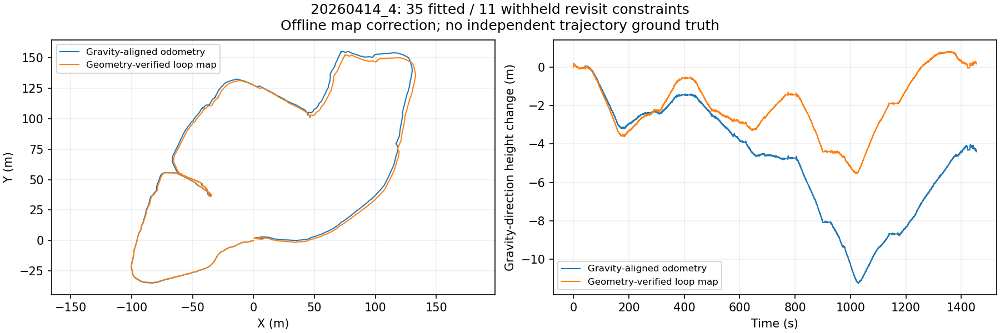
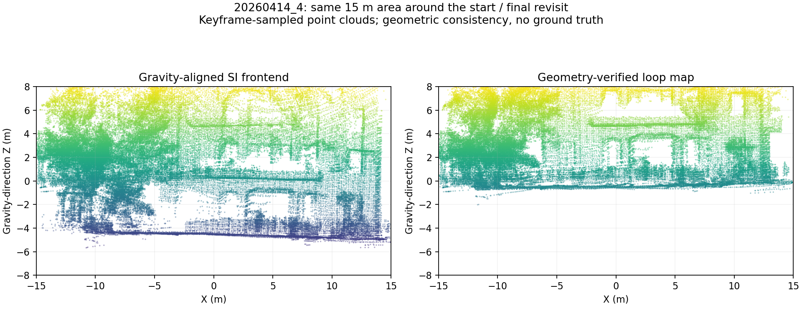
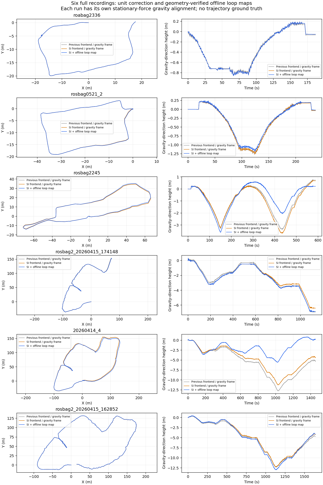

# FAST-LIVO2：VBot 高度一致性与离线回环优化

> 2026-11-06 复核更新：整帧留出验证发现，四月 14 日末段大回环对扫描选择敏感，尚不能认定为稳定闭合。下文的高度收拢数字保留为旧后端结果；最新判定、隔离地图和六包 LIO/LIVO 对照见[地图质量复核](fast_livo2_vbot_map_audit_2026-11-05.md)。

日期：2026-11-05。承接[稳定性优化实验](fast_livo2_vbot_optimization_2026-11-05.md)。

## 本轮结论

完成 SI 加速度单位适配、原生关键帧归档与三维回环后端。六份原始 MCAP 全量重跑两轮：
保留原尺度的归档对照、显式 SI 单位版本，每轮 **87.42 分钟**；不是只跑短片段。
两轮均完成，无输入传输失败。对照六包的最终轨迹与上一轮冻结程序逐值一致，说明归档没有改变估计结果。

SI 版本有 **215 组**通过检查的几何回访，其中 **52 组**没有加入位姿图。
`20260414_4` 的留出回访高度残差 RMSE 从 **2.5722 m 降到 0.0085 m**，
`rosbag2245` 从 **0.2825 m 降到 0.0042 m**。起终点附近点云的明显高度错层得到改善。

**这是离线地图内部的一致性改善，不是毫米级绝对定位精度。** 留出边仍共享原始录包、相邻帧及局部子图，
并非独立验证集；没有外部轨迹真值。后端没有反馈前端状态，在线里程计的长期漂移仍然存在。
`roabag2336` 没有通过检查的回环，只做重力坐标系变换，没有强行闭合。

## 处理了什么

### 1. 已有 SI 输入不再二次标定尺度

[ROS 2 Humble 的 IMU 消息定义](https://github.com/ros2/common_interfaces/blob/humble/sensor_msgs/msg/Imu.msg)
要求加速度使用 m/s²。录包值约为 9.81；原实现仍用初始化均值的模长计算 `9.81 / mean_acc.norm()`。
本批起步存在运动，首个约 0.2 s 的均值不能充当尺度标定。
最终程序从同一录包前 30 s 回放中直接打印的初始化量如下：

| 录包 | 初始化均值模长（m/s²） | 原自动尺度 |
| --- | ---: | ---: |
| `roabag2336` | 10.3871 | 0.94444 |
| `rosbag0521_2` | 9.8121 | 0.99978 |
| `rosbag2245` | 9.8105 | 0.99995 |
| `rosbag2_20260415_174148` | 9.4510 | 1.03799 |
| `20260414_4` | 9.9127 | 0.98964 |
| `rosbag2_20260415_162852` | 10.0426 | 0.97683 |

新增 `imu.acceleration_scale`：0 保留旧自动模式，1 保持 SI，其他正数表示显式单位转换系数；拒绝负数和非有限值。
扫描 IMU 传播、去畸变、比力归档和可选高频传播使用同一系数。
本轮专用[参数覆盖文件](../../FAST_LIVO2/config/vbot_si_overrides.yaml)使用 1，其余视觉配置与上一轮相同。

这修复了单位处理，但不能保证每段精度提升。SI 前端自身的回访残差仍是混合结果：例如
`rosbag0521_2` 的各自留出边 RMSE 从旧版本约 0.0113 m 变为 0.0174 m，
`174148` 从 0.0152 m 变为 0.0210 m；两版检索边不完全相同，不能当作严格精度消融。
**本轮主要的米级改善来自经三维几何验证的地图回环，不能归功于视觉或 SI 参数本身。**
动态初始化对重力方向的影响、外参和硬件时延尚未重新标定。

### 2. 区分坐标倾斜与高度漂移

旧 Z 分量对应初始 tracking frame，并不天然沿重力。归档速度低于 0.04 m/s、角速度低于
0.03 rad/s 的静止候选，使用世界系比力的稳健方向估计一次固定旋转，将其对齐 +Z；
方向离群超过 3° 的样本不参与平均。静止帧不足时用估计重力回退并明确标记。
本轮六包均有足够静止候选，旋转量约 2.2°–5.3°。

固定刚体坐标变换不会修复漂移，也不会改变地图几何。例如 `roabag2336` 的原坐标 Z
末端变化约 −1.61 m，重力方向下约 −0.05 m，不能把原 Z 全部解释成高度漂移。
静止判断和比力方向本身也依赖估计状态，不能作为测量真值。

### 3. 保留真实三维结构的回环后端

新增原生 IMU 坐标关键帧，每 2 s、1 m 或 15° 任一条件触发，保存完整雷达视野 XYZRGB
及最终融合位姿。相机可见部分取实际图像颜色，其余为灰色。相机参数仍来自各包 CameraInfo 与静态 TF。

离线后端采用[Open3D 多视图位姿图方法](https://www.open3d.org/docs/release/tutorial/pipelines/multiway_registration.html)：

1. 每个关键帧与前后最多 2 帧组成局部子图，邻帧平移不超过 3 m，配准体素 0.3 m。
2. 检索相隔至少 90 s、水平位置邻域 8 m 内的 Scan Context 风格高度描述子候选，描述子距离上限 0.6；
   每帧最多尝试 2 个、参考时刻至少间隔 4 s 的视角。描述子只用于候选筛选。
3. 三维粗配准沿重力试探 −6、−3、0、3、6 m 高度初值；若存在评分接近而位置差超过 1 m 的多解则拒绝。
   使用稳健点到面 ICP 精配准，不设置高度相等或地面平坦约束。
4. 配准留出四分之一点进行检查：双向重叠最小 0.4、平均至少 0.5，点距 RMSE ≤0.20 m、
   面距 RMSE ≤0.12 m，法向雅可比信息矩阵最小/最大特征值比 ≥1e−4。单平面不能验证完整六自由度回环。
   相比里程计超过 12 m 或 20° 的修正被拒绝。
5. 每四组已验证回访留出一组，其余作为不确定回环边与连续里程计边共同优化。
   输出关键帧地图，并用平移插值与旋转 Slerp 生成完整时刻的地图轨迹。

最初 `20260414_4` 末段未闭合：候选集中于刚起步的参考帧，该帧残差不通过；15 s 的参考候选排斥窗口又跳过了其他视角。
局部子图增加密度，并将候选视角间隔改为 4 s 后，另一参考视角通过了**相同**几何残差与可观测性检查，
才引入末段回环。没有降低配准残差阈值来强行闭合。

## 六包结果

数值均为 SI 版本留出回访边沿重力方向的平移一致性 RMSE，单位 m；不是 ATE。
不同包的留出边数量与覆盖范围不同，不能直接排名。

| 录包 | 验证回访 / 留出边 | 图优化前 | 图优化后 |
| --- | ---: | ---: | ---: |
| `roabag2336` | 0 / 0 | — | — |
| `rosbag0521_2` | 22 / 5 | 0.0174 | 0.0035 |
| `rosbag2245` | 36 / 9 | 0.2825 | 0.0042 |
| `rosbag2_20260415_174148` | 80 / 20 | 0.0210 | 0.0121 |
| `20260414_4` | 46 / 11 | 2.5722 | 0.0085 |
| `rosbag2_20260415_162852` | 31 / 7 | 0.0233 | 0.0097 |

`20260414_4` 中多组末段回访提供了约 4–5 m 的高度修正依据；原自动尺度对照也能被同一后端闭合，
其留出 RMSE 为 3.3076 → 0.0072 m。这进一步说明主要收益来自回环地图。

末端高度变化及整段高度跨度如下。这些是描述值，既不要求末端回零，也不以跨度越小越好：

| 录包 | 末端高度变化：优化前 → 后（m） | 高度跨度：前 → 后（m） |
| --- | ---: | ---: |
| `roabag2336` | -0.05 → -0.05 | 1.05 → 1.05 |
| `rosbag0521_2` | -0.04 → -0.02 | 1.49 → 1.43 |
| `rosbag2245` | +0.68 → +0.22 | 4.43 → 4.21 |
| `rosbag2_20260415_174148` | -6.40 → -6.86 | 6.75 → 7.21 |
| `20260414_4` | -4.38 → +0.20 | 11.45 → 6.38 |
| `rosbag2_20260415_162852` | -4.20 → -4.11 | 12.65 → 13.39 |

`174148` 和 `162852` 的末端高度仍为负，不能因数值未回零认定失败，也不能宣称已解决全部 Z 漂移。
它们的可验证回访只覆盖部分轨迹，非闭合路段缺少绝对高度约束。优化后仍保留数米的三维起伏；
仅合成测试能验证算法没有平坦地面假设，真实地形的绝对高程还需外部测量。

## 新地图

以下是新导出的**关键帧采样、0.15 m 体素、完整雷达视野 XYZRGB** 地图。
颜色是图像颜色或视野外灰色，尚无物体语义。每包同目录保留 `map_gravity_only.pcd` 作对照、
两套 TUM、`result.json`、关键帧优化位姿及预览图。既有地图、录包均未覆盖。

| 录包 | 新地图 |
| --- | --- |
| `roabag2336` | [178,179 点](/home/user/work/bgyfw/omni_code/omni_slam/build/experiments/z_20261105/si_maps/roabag2336/map_loop_corrected.pcd) |
| `rosbag0521_2` | [199,488 点](/home/user/work/bgyfw/omni_code/omni_slam/build/experiments/z_20261105/si_maps/rosbag0521_2/map_loop_corrected.pcd) |
| `rosbag2245` | [565,579 点](/home/user/work/bgyfw/omni_code/omni_slam/build/experiments/z_20261105/si_maps/rosbag2245/map_loop_corrected.pcd) |
| `rosbag2_20260415_174148` | [2,147,554 点](/home/user/work/bgyfw/omni_code/omni_slam/build/experiments/z_20261105/si_maps/rosbag2_20260415_174148/map_loop_corrected.pcd) |
| `20260414_4` | [2,760,287 点](/home/user/work/bgyfw/omni_code/omni_slam/build/experiments/z_20261105/si_maps/20260414_4/map_loop_corrected.pcd) |
| `rosbag2_20260415_162852` | [3,063,078 点](/home/user/work/bgyfw/omni_code/omni_slam/build/experiments/z_20261105/si_maps/rosbag2_20260415_162852/map_loop_corrected.pcd) |

全量原始关键帧在 `build/experiments/z_20261105/si_full/<bag>/livo/keyframes/`，
固定后端代码副本为 `build/experiments/z_20261105/backend_v3/`，运行记录见
[批处理日志](fast_livo2_vbot_vertical_2026-11-05/map_batch.log)。

## 验证与实际边界

- 两轮共 12 次全量估计，单轮读取 LiDAR 26,225、IMU 1,048,140、视频包 157,262、解码帧 157,238；
  六包完成状态、原始输入审计、EOF 待处理量均保留。输入完整不代表每条输入都产生状态。
- SI 六包状态有限、时间严格递增；轨迹速度 P99 均小于 0.82 m/s，未发现米级单步突跳。
  原版归档对照与上一轮六包轨迹逐值相同。
- 最终安装程序复跑六包各 30 s，去除截断 EOF 的最后一个状态后，均与 SI 全量逐值一致。
  五包含最后状态也一致；`rosbag2245` 截断末行只来得及 LIO，完整回放同刻有 VIO，位置相差约 0.00041 m。
  可选高频传播仅做系数统一，本次同步离线入口没有验证其在线发布时序。
- Humble 构建安装通过；14 个原生 GTest 用例通过，colcon 计数含包装为 15。
  Python 4 项几何回归通过，覆盖重力最小旋转、单平面退化、真实 2 m 高差及保留坡度的回环。
  FAST_LIVO2 脚本 Ruff 检查通过。见同目录验证日志。
- 六包地图均实际写出；点数、文件 SHA-256、程序和后端指纹见
  [summary.json](fast_livo2_vbot_vertical_2026-11-05/summary.json) 与
  [source_manifest.json](fast_livo2_vbot_vertical_2026-11-05/source_manifest.json)。
- 这是实验后端，当前输出文件，不发布在线 map→odom、不反馈滤波器，也未接入 Omni Manager。
  现有默认启动链未切换；未做 S100/Orin 实机、跨会话重定位或语义目标关联验证。

下一步接在线 `map→odom` 前，应先补独立闭合高度/控制点或参考轨迹验证，并验证运动起步的重力初始化。
不要把本轮内部一致性数值用作导航定位精度承诺。
