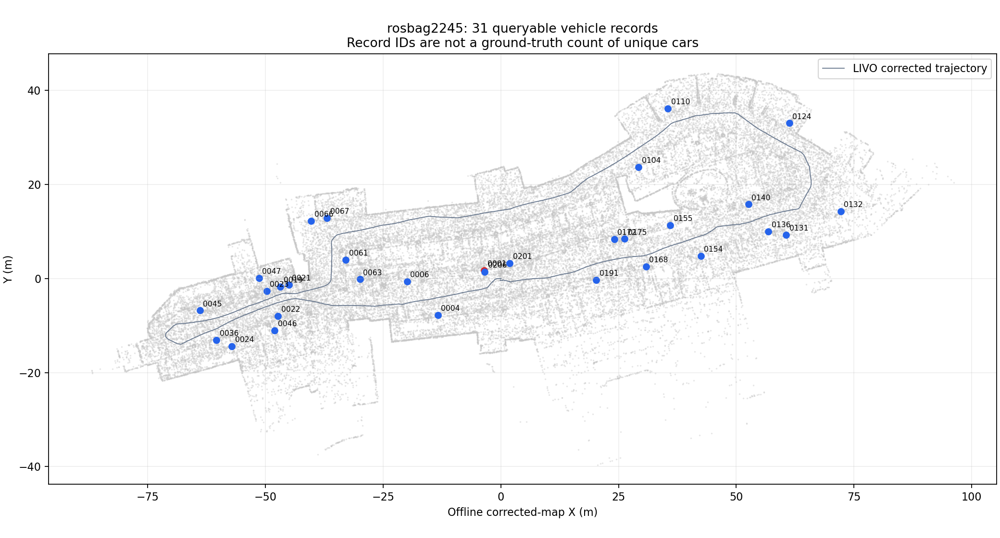
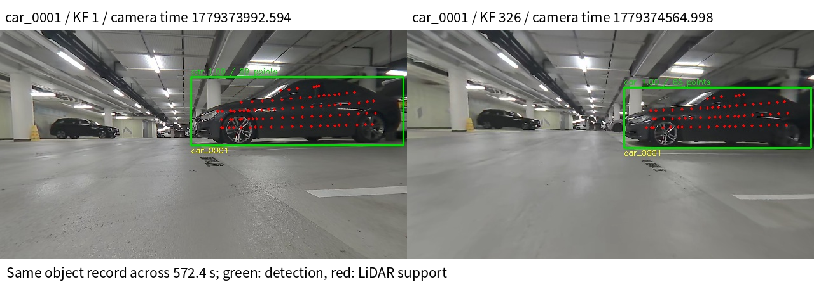
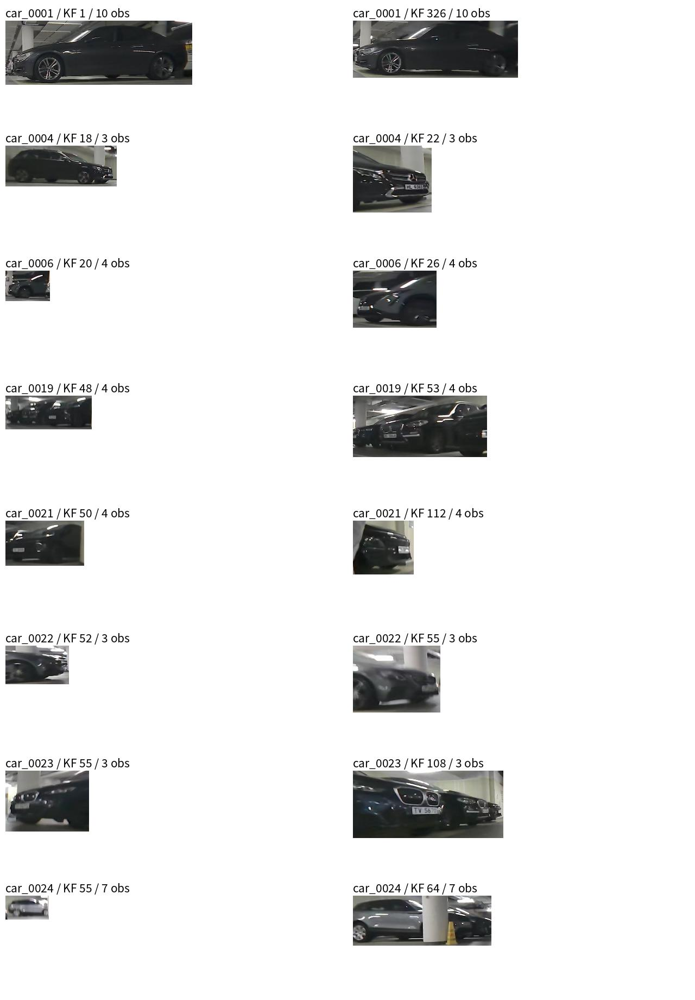
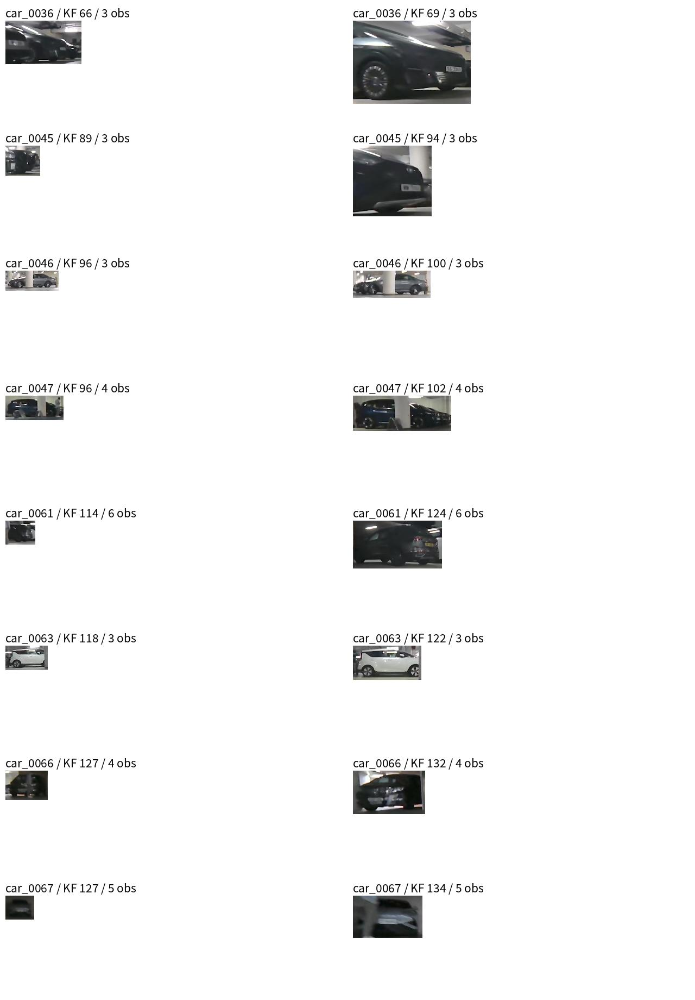
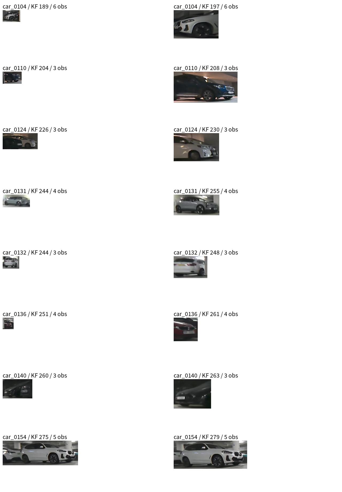
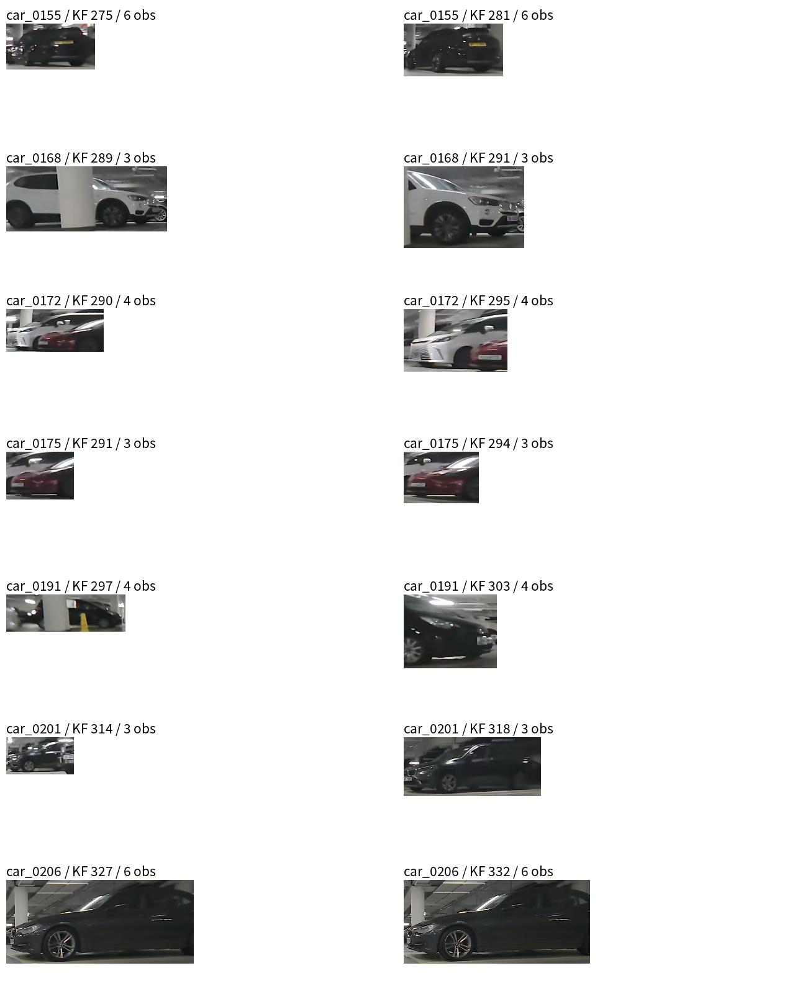

# LIVO 项目接入与车库语义目标查询

日期：2026-11-06。基于[已固定的上版全量 LIVO](fast_livo2_vbot_mainline.md)，本轮完成 Manager 建图接入，并在 `rosbag2245` 上跑通离线车辆识别、三维投影、跨帧关联、位置与证据查询、回环后位置重算。

**主线已经有可运行的接口和目标查询结果。** 接入后的完整 `rosbag2245` 回归共 2943 个最终位姿，与冻结上版逐值一致。在线接口用 30 秒真实录包回放验证，包含 10 秒缺图和恢复；语义原型覆盖完整 589 秒路线抽取的 182 个关键帧。两者验证范围不同，没有宣称整段 ROS 实时运行或机器人实机部署已完成。

## 视觉定位接入

Manager 新增 `mapping_backend=fast_livo`，保留默认 FAST-LIO。LIVO 模式要求明确指定传感器 YAML 和 TF 配置，检查 IMU–LiDAR、Camera–LiDAR 外参一致后启动。每次会话使用新运行目录，避免覆盖原关键帧。

录包中的 IMU 相对机体含 180° 朝向，和当前真机默认 TF 配置不同。本轮从录包静态 TF 生成专用配置，未把真机默认值套用到数据上，也未修改原真机配置。里程计仍输出 `T_odom_tracking`，由唯一 TF Manager 计算 `T_odom_base = T_odom_tracking × inverse(T_base_tracking)`。

| 接口 | 内容 |
| --- | --- |
| `/state_estimation` | 最终融合位姿，父系 `omni_odom`、子系 `omni_imu_link` |
| `/cloud_registered_global` | 当前扫描世界系点云，缺图时仍非空 |
| `/omni/slam/livo/keyframes` | 新增 `LivoKeyframe` 消息：会话内 ID、最终位姿、IMU 系完整雷达视野点云、实际图像时间及视觉更新标志 |
| `/map_save` | 原子保存当前前端关键帧地图，供 Manager 的 SaveMap action 导入版本资产 |
| `/omni/tf_manager/body_odom` | 按匹配安装变换生成机器人机体位姿 |

缺图时，原实现虽然继续输出 LIO 位姿，但 LIVO 模式的点云发布分支没有生成有效点云。本轮修复此分支，并避免同一扫描在等待视觉更新时提前发布中间点云。没有修改滤波器观测权重、原生同步策略或已冻结基线。

### 真实 ROS 回放检查

在独立 ROS 域内启动 Manager 和 TF Manager，通过 StartMapping 服务拉起 LIVO，发布相机、雷达、IMU 与采集时钟；第 12–22 秒主动停发图像，再恢复。

| 检查项 | 结果 |
| --- | ---: |
| 收到传感器/机体位姿 | 148 / 148 |
| 配对位姿坐标变换最大数值差 | 4.44e-16 |
| 缺图中间 8 秒位姿 / 非空点云 | 40 / 40 |
| 关键帧 / 其中视觉更新关键帧 | 17 / 11 |
| 图像恢复后重新出现视觉关键帧 | 通过 |
| Manager 进入 MAPPING、保存资产、停止 | 通过 |

图像关键帧携带实际相机采集时刻，并检查与雷达最终状态时刻相差不超过 40 ms。位姿变换数值差验证的是接口计算一致性，不是定位精度。保存的是前端 odom 系地图；在线建图时 map→odom 为恒等关系，保存动作没有暗中运行离线回环。

[回放结果 JSON](../../build/experiments/semantic_20261106/managed_replay_v2/result.json) · [保存的版本化 PCD](../../build/experiments/semantic_20261106/managed_replay_v2/maps/livo_test/versions/v000001/map.pcd) · [全量轨迹回归](../../build/experiments/semantic_20261106/frontend_regression/comparison.json)

## 车辆语义地图

使用 [Torchvision 官方 Mask R-CNN ResNet50 FPN v2 COCO_V1](https://docs.pytorch.org/vision/stable/models/generated/torchvision.models.detection.maskrcnn_resnet50_fpn_v2.html) 提取车辆实例。此模型提供检测和实例分割；本轮输入缩放范围为 360×640，CPU 执行，结果不等同于官方标准评测指标。

1. 用录包 CameraInfo 校正图像，保留实际视频采集时间。
2. 根据图像时刻的前端位姿，将原生关键帧雷达点投到相机。仅在车辆掩码内部取点，并使用深度、三维连通性与最小支持点数检查，避免直接把整个框内地面和邻车当作目标。
3. 观测保存 `keyframe_id`、关键帧局部表面位置、图像时间、置信度、颜色描述和证据路径。关联在全量回环地图中使用 1 m 距离门限、0.35 外观距离门限及一对一分配；歧义匹配保留为新的候选。
4. 至少三个关键帧、四秒跨度、表面位置 P90 离散度不超过 0.8 m 的对象记录进入默认查询。
5. 按类别或对象 ID 查询位置与证据图；地图位姿更新时，用保存的关键帧局部观测重新计算对象位置，保留对象 ID。

| 本轮最终结果 | 数量 |
| --- | ---: |
| 全程抽取关键帧 | 182 |
| 边界处无可插值图像位姿而跳过 | 1 |
| 车辆检测 | 670 |
| 有雷达深度支持的观测 | 332 |
| 对象候选记录总数 | 206 |
| 达到重复观测门槛、可默认查询的记录 | 31 |

**31 条可查询记录不等于 31 辆唯一车辆。** 为减少错误合并，本轮关联较保守；已经观察到同车拆分，例如 `car_0001` 与末段的 `car_0206` 对应同一黑色车辆的不同表面观测。相似外观、遮挡仍可能造成错误关联，当前没有人工真值统计精确率和召回率。`confirmed` 仅表示达到重复观测门槛。



数字是对象 ID 后缀。灰色为完整基线地图的 XY 投影，蓝线为轨迹；同车拆分可能产生接近或重叠的记录。位置表示可见表面估计，不能直接作为机器人驶入的目标点。

### 一次实际查询

```bash
source install/livo_integration/setup.bash
ros2 run omni_semantic_map semantic_map query \
  build/experiments/semantic_20261106/rosbag2245_final/objects.json car_0001
```

返回 `car_0001`，位置约 **(-3.50, 1.73, 0.36) m**，共 10 次观测，关联跨度 **572.4 s**，并附证据图路径。表面位置 P90 离散度约 0.092 m，只表示这组观测的内部一致性。



输入“找车”“汽车”或 `car` 返回类别列表；输入对象 ID 返回指定记录。当前是类别别名和 ID 查询，不是任意自然语言理解。人物没有写入车辆地图，车牌没有被 OCR 或作为身份依据。

[车辆查询输出](livo_semantic_integration_2026-11-06/query_cars.json) · [单对象查询输出](livo_semantic_integration_2026-11-06/query_car_0001.json) · [完整对象数据库](../../build/experiments/semantic_20261106/rosbag2245_final/objects.json)

### 回环后对象位置更新

`semantic_map reproject` 校验原始关键帧索引哈希以及新位姿的关键帧时间戳，拒绝将另一条轨迹套到本地图。用真实回环前位姿重算全部记录，再恢复到原回环后位姿；对象 ID 保留，位置数值恢复一致。单元测试另验证了已知平移下的对象移动。

[重投影验证](../../build/experiments/semantic_20261106/reprojection_validation.json)。这一步更新位置和查询资格，不重新执行对象关联。后续较大的地图修正可能还需重新关联。

语义结果标记为 `offline_livo_map` 并绑定地图位姿文件哈希，与在线 `omni_map` 不混用。本轮实现的是在线建图接口加离线语义原型，尚未将识别器作为实时 ROS 语义节点运行，也没有接机器人导航。

## 验证与复现

- 四个包 `omni_slam_interfaces`、`fast_livo`、`omni_slam_manager`、`omni_semantic_map` 构建安装通过。
- 新增语义/外参检查共 8 项测试通过；Manager 测试 71 项（其中含 3 项新增外参测试）及另行运行的 5 项 ROS 保存取消测试通过。原生 GTest 测试集通过。
- 真实 ROS 回放验证缺图回退、恢复、关键帧时刻、机体坐标变换、Manager 保存和停止。
- `rosbag2245` 原生前端全量回归完成，2943 个最终状态与上版逐值一致。
- 已查看全部 31 条默认可查询记录的首末图像；这是定性复核，不代替完整身份标注。证据覆盖见下方四张图。

[Manager 使用说明](../../omni_slam_manager/README.md) · [语义包使用说明](../../omni_semantic_map/README.md) · [代码哈希](livo_semantic_integration_2026-11-06/source_manifest.json) · [汇总 JSON](livo_semantic_integration_2026-11-06/summary.json)

环境沿用现有 Python / ROS 2 Humble 实验环境。SciPy 会提示与当前 NumPy 的声明版本范围不一致，相关测试和实验均完成；模型权重和源文件哈希已保存以便复现。

## 对象首末证据索引

裁剪仅为便于查看，完整帧、检测框、雷达支持点和原图保存在实验目录。小目标保持原始分辨率，没有生成式补全。









