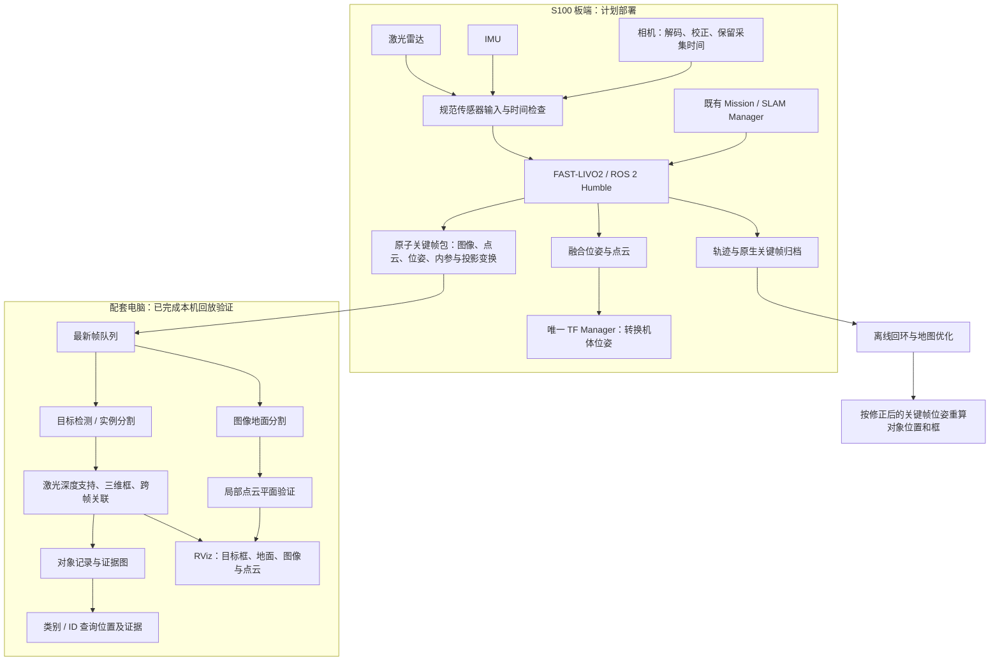

# 机器狗视觉辅助定位与三维语义建图整体方案

更新日期：2026 年 11 月 6 日 · 工程：Omni SLAM · 目标平台：VBot / S100 · 软件接口：ROS 2 Humble / TROS

**2026-11-11 研究主线补充：当前推荐强基线为 SAM2.1 Hiera L → SigLIP-384＋已有冻结融合器 → 关联前缓存 → ConceptGraphs 对象关联与几何融合 → 合并守恒修正 → 不同帧特征均值读出。八场景开发 PQ×100 为 42.44。** 当前该成绩来自 RGB-D＋给定位姿；强基线与 LIVO 的在线接入待完成，DINO 是独立的候选增强分支。完整配置、架构图与结果见 [当前强基线方案](paper/dino_livo_architecture_2026-11-10.md)。以下保留 11 月 6 日工程部署链路及其验证边界。

## 1. 我们要实现什么

让机器狗在建立几何地图的同时，知道地图中有哪些目标、目标在哪里，并能通过原始图像解释识别结果。

整套方案围绕三个问题展开：

| 问题 | 对应能力 | 给用户的结果 |
| --- | --- | --- |
| 机器狗在哪里，周围环境是什么形状？ | 雷达、IMU、相机融合定位与建图 | 位姿、轨迹、三维点云地图 |
| 目标是什么，具体在什么位置？ | 图像识别、激光深度关联、跨帧对象关联 | 类别、对象 ID、XYZ 坐标、三维框、证据图 |
| 哪些观测属于地面？ | 图像地面分割与局部点云几何验证 | 图像地面掩膜、三维地面点云 |

**当前已经完成离线大场景实验和本机 ROS 在线链路验证，正在准备 S100 实机试跑。** 首轮部署安排为 **S100 运行 LIVO，配套电脑运行语义推理与三维显示**。模型尚未适配 S100 BPU；实机编译、传感器输入、网络与性能尚未验证。

## 2. 总体架构

定位与语义处理采用独立进程。定位按传感器时间持续更新；语义处理消费关键帧，在自己的计算预算内更新对象记录和显示结果。



图中的 S100 与电脑分工是首轮上机安排；当前在线链路测试在同一台 x86 电脑上完成，尚未验证跨机器 DDS。离线回环是单独的实验流程，目前没有反馈到在线 LIVO 状态，也没有接入在线语义地图的自动修正。

## 3. 定位与几何建图：以 FAST-LIVO2 为基础

### 3.1 三类传感器的作用

- **IMU**提供短时间内的运动预测，参与雷达去畸变和状态传播。
- **激光雷达**提供几何约束和实际尺度，构建三维点云地图。
- **相机**提供视觉特征与光度约束，参与位姿更新，同时提供语义识别所需的图像。

工程已完成 FAST-LIVO2 的原生 ROS 2 Humble 移植，支持现有 VBot 录包中的雷达 PointCloud2、IMU 和校正图像。当前主线沿用冻结的整帧雷达时刻融合方案，保留上一轮完整关键帧 LIVO 基线。

雷达完成一次扫描后选择时间合适的相机图像参与更新；图像保留真实采集时间，短时旋转由 IMU 补偿，平移采用短时运动近似。没有合适图像时继续 LIO 更新，避免相机短时断流使定位链路停止。此前 30 秒 Manager 回放已验证主动停图 10 秒后的位姿、点云连续输出及图像恢复。[定位接入实验](experiments/livo_semantic_integration_2026-11-06.md)

### 3.2 与既有工程的关系

`omni_slam_manager` 已支持可选的 `mapping_backend=fast_livo`，原默认后端仍为 FAST-LIO。Manager 负责建图会话、进程管理、地图保存与停止；`omni_tf_manager` 负责既有坐标变换，LIVO 不另外发布一套托管 TF。

LIVO 位姿对应 IMU tracking frame，TF Manager 根据安装外参转换成机体位姿。保存地图时导出前端关键帧地图；保存动作不会自动运行离线回环。

### 3.3 标定与高度问题

相机内参、相机—雷达外参、雷达—IMU 外参、机体安装关系和时间偏移必须匹配实际设备。离线实验按录包 CameraInfo 和静态 TF 生成配置；录包安装关系与当前真机默认配置存在差异，因此示例配置不能直接作为现场标定。

已对六个包做固定配置的 LIO/LIVO 对照及地图复核。部分场景表现出局部一致性改善，但没有证明视觉融合在全部场景稳定提高精度。Z 向漂移、地面错层和墙面重影仍是需要跟踪的问题；四月 14 日末段回环对扫描选择敏感，整帧留出诊断不等同于证明旧全量地图闭合错误。

因此继续保留全量 LIVO 基线用于语义开发，同时单独保留回环诊断结果。离线回环优化改善地图一致性，不能把这些改善全部归因于视觉，也不能据此宣称在线高度问题已经解决。[基线说明](experiments/fast_livo2_vbot_mainline.md) · [六包地图复核](experiments/fast_livo2_vbot_map_audit_2026-11-05.md)

## 4. 目标语义建图：从二维识别到可查询对象

### 4.1 处理流程

```text
图像检测 / 实例分割
        ↓
将该时刻对应的激光点投影到图像
        ↓
筛选目标区域内的点，检查深度、连通性和支撑点数量
        ↓
生成关键帧局部三维观测与观测框
        ↓
结合空间距离、外观和一对一匹配进行跨帧关联
        ↓
保存对象 ID、类别、位置、三维框、观测次数和证据图
        ↓
按类别或对象 ID 查询，并在三维地图中定位
```

三维位置来自实际激光深度。缺少足够深度支撑的图像检测可以保留二维结果，但不会凭空生成三维框。

关联使用空间邻近和图像颜色描述，并对歧义匹配保持保守。默认至少三个不同关键帧、四秒观测跨度，且表面位置 P90 离散度不超过 0.8 米，才进入默认可查询记录。`confirmed` 表示满足这些重复观测条件，不表示经过真值核验的唯一物体或已证明静止。

### 4.2 离线实验与在线试跑的识别范围

| 路径 | 当前模型 | 目标范围 | 深度处理与验证范围 |
| --- | --- | --- | --- |
| 车库离线实验 | Mask R-CNN COCO | 车辆 | 完整录包上的实例分割、投影、关联和查询 |
| 室外离线实验 | Grounding DINO tiny | 门/入口候选、花盆、消火栓、行人 | 静态目标可融合过去一秒扫描；消防结果还经过颜色过滤、人体否决及显式视觉审查 |
| 在线试跑节点 | Mask R-CNN COCO | 车辆、花盆、消火栓、行人 | 当前只使用单关键帧点云；本机短回放已验证车辆链路，其他类别尚待现场核验 |

在线试跑尚未包含门/建筑入口识别，也没有直接继承室外离线实验经过审查的消防识别效果。建筑语义目前只做过入口候选，没有建立整栋建筑身份。行人作为短时观测显示，不进入永久对象表、不做个人身份关联；背景点云也尚未完整清除动态物体。

### 4.3 三维框与位置显示

每次观测对目标支撑点计算稳健范围，保存在关键帧局部坐标中，再用位姿转换到地图坐标，形成三维包围框。框表示已经观测到的表面范围，可能只有物体的一部分，不能直接解释为完整长宽高或真实物体中心。

显示约定：**蓝框**为达到重复观测门槛的记录，**橙框**为暂定记录，**紫框**为所选时刻或当前短时行人观测。离线交互地图支持点击目标查看 XYZ、观测范围和证据图；在线试跑通过 RViz MarkerArray 显示框与 ID，详细对象记录写入 JSON。


*图：离线校正地图中的观测框。右侧显示位置、观测次数和原始图像；它不代表 S100 实机运行画面。*

### 4.4 为什么把对象绑定到关键帧

对象记录同时保存关键帧 ID、时间和局部位置/框支撑。地图优化改变关键帧位姿后，可以用新位姿重新计算对象位置和三维框，避免目标仍留在旧地图位置。

离线重投影已验证，保留对象 ID 并更新位置、离散度和查询资格；较大的地图修正可能还需要重新关联。当前查询是类别别名或对象 ID，例如“找车”“花盆”“入口”，不是任意自然语言理解。在线节点结果可通过现有文件查询工具读取，尚未提供产品级远程查询服务。

## 5. 地面识别：图像分割与激光几何共同验证

先使用 SegFormer B0 Cityscapes 对图像逐像素分割，提取道路、人行道及 terrain 等地面候选，置信度门槛为 0.65。随后将候选区域关联到激光点，在局部区域拟合平面，检查法线方向、点到平面距离、支撑面积和点密度。

点云验证使用当前世界坐标系的 Z 方向作为近水平检查参考，因此仍依赖前端姿态与重力估计。保留点的原始高度，不把整个场景压成一张平面；坡道和不同标高可以保留各自的局部几何。

| 显示结果 | 含义 |
| --- | --- |
| 图像中的绿色区域 | 模型认为可能属于地面的像素 |
| 地图中的绿色点 | 同时获得图像语义与局部激光几何支持的点 |
| 后续可通行区域 | 还需结合坡度、台阶、障碍、机体尺寸等判断，当前未实现 |

离线大场景处理了 440 个语义关键帧，其中 336 帧获得通过几何验证的地面，最终降采样显示 30,252 个地面点。未提供人工地面真值，因此这些数量不是分割精度指标。在线试跑按关键帧发布地面点云，RViz 以时间窗口保留显示，尚未形成持久化可通行地图。[三维框与地面实验](experiments/boxes_ground_2026-11-06.md)


*图：室外录包实验回放。左下绿色为图像地面候选，右下为按前端位姿累积的地图及暂定消火栓观测框。*

## 6. 在线工程如何运行

### 6.1 时间与坐标契约

新增 `LivoSemanticFrame` 把关键帧点云和位姿、对应校正图像、CameraInfo、相机时刻补偿变换放入一个消息。雷达状态时刻与图像采集时刻分别保存，避免用“最新图像”随意匹配另一时刻的点云。

| 坐标 / 数据 | 当前含义 |
| --- | --- |
| `omni_imu_link` / tracking frame | 原生关键帧点云与局部对象观测所在坐标系 |
| `omni_odom` | 在线前端位姿、点云与在线语义框的坐标系 |
| `omni_map` | 既有系统地图坐标；当前建图模式由 TF Manager 维持与 odom 的恒等关系 |
| `offline_livo_map` | 离线校正地图与离线语义查询使用的坐标系，不能直接冒充在线导航地图 |

目标坐标单位为米，是对应地图坐标，不是 GPS 经纬度。三维框中心与目标观测表面中位数位置可能不同；导航接入时还需生成安全接近点。

### 6.2 防止语义推理积压

语义节点只保留一个正在处理的帧和一个最新待处理帧，忙时替换旧的待处理帧。DDS 输入使用 best effort、深度 1；只有存在订阅者时，LIVO 才制作语义输入包。

该设计避免无限积压，但允许丢帧。板端仍承担图像/点云序列化、发送及关键帧归档开销，需要在 S100 实测。当前原子包约 836 KB/包，尚未验证跨机器网络接收率。

状态包括等待输入、处理中、就绪、断流、错误、会话不匹配和试跑限额。错误时间戳或坐标契约被拒绝；关键帧 ID/时间回退时停止该语义会话，避免混入另一张地图。默认最多处理 300 个语义帧或约 1000 条对象记录，适用于短程试跑。

### 6.3 工程模块和输出

| 模块 | 职责 | 主要输出 |
| --- | --- | --- |
| `FAST_LIVO2` / `fast_livo` | 融合定位、点云与关键帧导出 | `/state_estimation`、`/cloud_registered_global`、原生归档 |
| `omni_slam_interfaces` | 定义关键帧与原子语义输入消息 | `LivoKeyframe`、`LivoSemanticFrame` |
| `omni_slam_manager` | 会话、建图进程和版本化几何地图保存 | 既有 StartMapping / SaveMap / StopMapping 接口 |
| `omni_semantic_map` | 关联、查询、重投影、在线语义处理 | `/omni/semantic/boxes`、`people`、`ground`、`image`、`status` |
| 结果归档 | 保留对象与证据、便于复核 | `objects.json`、`evidence/`、`frames.jsonl`、`run.json` |

当前语义结果还没有自动进入 Manager 的版本化地图资产，应按同一会话与 LIVO 归档一起保存。既有 Mission/SLAM/TF 控制面保持唯一，不并行启动第二套管理器。

## 7. 已验证到哪一步

| 验证层次 | 已有证据 | 不能由此推导的结论 |
| --- | --- | --- |
| 冻结前端基线 | 六包完整 LIVO 回放；另做六包固定配置 LIO/LIVO 对照，每种模式覆盖约 87.42 分钟原始数据 | 所有场景定位精度更高、Z 漂移已解决 |
| Manager 接入 | 30 秒 ROS 回放，包含停图与恢复、位姿转换、地图保存及停止 | 已完成 S100 实机部署 |
| 车库离线语义 | 完整约 589 秒路线，182 个抽取关键帧，31 条达到重复观测门槛的记录 | 31 辆唯一车辆或已有识别/关联精度真值 |
| 室外离线语义 | 约 27 分 22 秒、835 米路线，440 个有效语义关键帧；19 条门/花盆重复记录，1 条暂定消火栓记录 | 已形成稳定消防设施地图或完整建筑识别 |
| 离线三维框与地面 | 391 个观测框，30,252 个显示地面点；交互地图与视频 | 完整物体三维尺寸、可通行性或地面精度 |
| 新增在线语义链路 | 本机 x86 编译通过；30 秒录包以 0.5 倍速回放，语义处理 12 帧，发布框与地面，断流状态正常 | 六个长包均已通过新版在线节点，或具有板端实时性能 |
| 工程测试 | 11 项语义单元测试；真实消息契约检查通过 | 长期稳定性与跨机器网络已经验证 |
| S100 | 已形成源码包、原生构建脚本、输入审计、RViz 与录包工具 | 已在 S100 编译、运行，或已适配 BPU |

本机在线回放的单帧语义处理耗时中位数约 **1.14 秒**，产生 9 条车辆记录，其中 1 条达到重复观测门槛。12 条地面消息合计只有 75 个通过几何验证的点，覆盖仍有限。这些结果用于验证链路，不能代替检测精度、地图精度或板端性能评测。[在线试跑验证记录](experiments/s100_trial_preparation_2026-11-06.md)

## 8. 下一步如何推进

| 顺序 | 工作 | 完成判断 |
| --- | --- | --- |
| 1. S100 输入与构建 | 原生编译；核验雷达字段、IMU 单位、相机解码/校正、内外参和采集时间 | 自动检查通过，人工看投影对齐，能持续产生有效视觉关键帧 |
| 2. 短路线实机试跑 | 静止初始化后人工遥控慢走、返回起点，连接电脑语义节点并录包 | 定位/点云连续；缺图可恢复；框与证据可解释；记录资源占用、延迟和丢帧 |
| 3. 语义质量验证 | 标注少量代表性目标与地面；检查重复实例、错误合并和小目标深度 | 给出检测、关联、位置及地面覆盖/误差结果，再确定阈值 |
| 4. 在线能力完善 | 对齐离线/在线类别；改善小目标多帧深度；语义资产与地图版本统一 | 对象可追溯、可更新，地图修正后坐标一致 |
| 5. 板端算力适配 | 测量实际预算，选择模型压缩、转换与 S100 BPU 部署路径 | 板端实测时延、资源和精度满足需求后，再决定是否取消电脑推理 |
| 6. 任务与导航接入 | 将目标位置转换为安全接近点，结合可通行性和任务系统 | 能执行“查找目标—到达附近—复核”的任务，并处理识别或定位失败 |

首轮优先闭合“真实传感器 → 定位 → 语义位置 → 证据查看”的链路。任意自然语言查询、视觉重定位、在线全局闭环、完整动态点清除和自主目标导航均属于后续能力。

## 9. 查看成果与工程入口

- [交互三维语义地图](reports/boxes_ground_2026-11-06/interactive_map.html)：浏览器打开，点击目标查看位置与证据。
- [三维框与地面实验视频](reports/boxes_ground_2026-11-06/boxes_ground_1080p.mp4)：真实录包回放，1080p、10 倍速；播放速度不代表在线算力。
- [S100 试跑部署说明](deployment/s100_livo_semantic_trial.md)：环境、标定、启动、RViz、录包与现场检查。
- [S100 试跑源码包](../dist/omni_slam_s100_trial_20261106_v1.tar.gz)：仅源码及配置，模型需另备，含逐文件哈希清单。
- [语义包说明](../omni_semantic_map/README.md) · [LIVO 工程说明](../FAST_LIVO2/README.md) · [主线基线与历史实验](experiments/fast_livo2_vbot_mainline.md)。

文档中的插图和指标来自现有实验产物；离线实验、在线回放与待实机验证的范围分别标注。沿仓库目录浏览可打开相对链接，转发文档时需同时携带引用图片；大地图、视频和源码包可单独发送。
