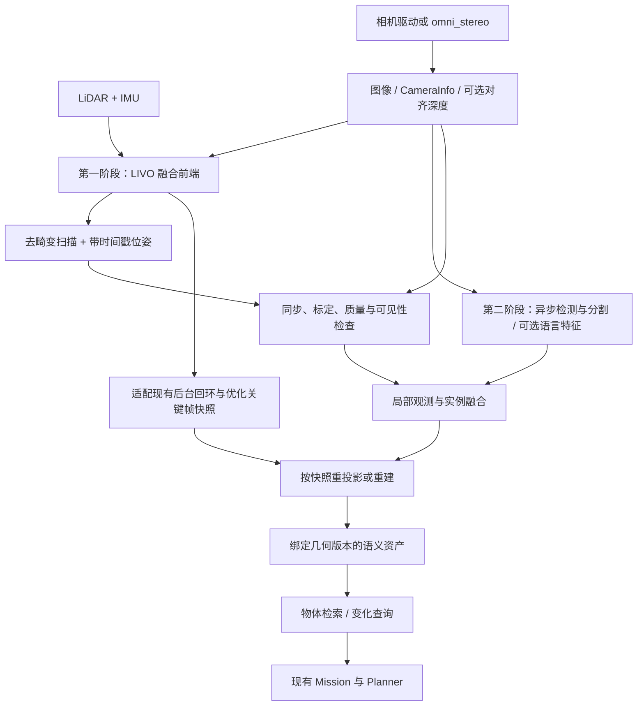

# 视觉输入与语义建图调研：基于 Omni SLAM 的可选路线

调研日期：2026-11-05（北京时间）。主要时间窗口：2026-05-05—2026-11-05。
项目核查基线：本地 `omni_slam` 提交 `794dee2`。本文主体为方案调研。2026-11-05 已新增独立 FAST-LIVO2 Humble 实验包并完成首段 VBot 回放，见[实验报告](experiments/fast_livo2_humble_vbot_2026-11-05.md)；语义模块与产品链路集成仍待后续。

## 1. 当前目标与实施顺序

2026-11-05 用户明确：两项能力都需要，**先做视觉辅助定位，再做查找、关联目标的语义地图**。后续按这一顺序收敛设计，第一阶段就预留第二阶段需要的图像、标定、位姿和关键帧关联信息。

可以基于现有项目扩展。当前主线调整为 **LiDAR–IMU–视觉融合定位 → 回环与地图保存兼容 → 异步实例语义地图与目标关联**。现有纯 LIO 作为同数据评价基线；具体采用候选 LIVO 前端还是扩展现有前端，需结合传感器、平台及复现结果选择。

这里有三个不同的能力目标：

| 目标 | 例子 | 需要解决的问题 |
| --- | --- | --- |
| 视觉辅助地图理解 | 地图里有哪些门、设备柜、灭火器；查询某个物体在哪里 | 图像接入、2D→3D 关联、实例融合、持久化 |
| 视觉辅助定位 | 长走廊或几何重复区域降低漂移 | LIVO 状态估计、光度或重投影约束、传感器退化处理 |
| 语义辅助任务执行 | 找到配电柜，区分同类设备，识别环境变化 | 实例身份、业务 ID、变化检测、查询与 Mission/Planner 对接 |

前一个目标可复用现有位姿链路；后两个分别涉及定位算法和产品任务合同。它们可以逐步组合，但验收指标应分别制定。

## 2. 调研范围与证据口径

检索覆盖 LiDAR–camera fusion、LIVO、open-vocabulary semantic mapping、3D scene graph、persistent semantic memory、dynamic mapping、semantic Gaussian mapping。通过 arXiv、作者项目页和公开仓库交叉核查；搜索聚合页面只用于发现候选。

- 主表按**首次 arXiv 公开日期**筛选，另记录本次阅读的更新版本。会议年份、代码更新时间不替代首次公开日期。
- 本次整理了窗口内 10 篇代表工作，属于围绕项目适配性的定向调研，不是穷尽论文目录。
- 已查看主表论文的一手摘要；对重点路线进一步阅读方法、实验或限制部分。SOCC-ICP、SparseNav 本轮主要依据一手摘要，后续选中再精读。
- 论文中的运行速度、精度和覆盖保证仅适用于其数据、硬件和假设；本次没有复跑论文、安装模型或进行板端性能测试。
- 仓库状态核查日期均为 2026-11-05。区分“论文声称开源”“仓库有源码”“已在本项目跑通”。本次只核实到前两项。
- 当前仓库及相邻项目文档中未找到完整的既往语义建图调研笔记，因此本文是新增补充，没有假定已复核此前讨论的结论。

## 3. 项目已有基础与真实缺口

### 3.1 可以直接利用的基础

| 现有能力 | 源码证据 | 对扩展的意义 |
| --- | --- | --- |
| ROS 2 FAST-LIO2，雷达 + IMU；支持 VBot、MATRiX 等配置 | [laserMapping.cpp](../FAST_LIO/src/laserMapping.cpp)、[vbot.yaml](../FAST_LIO/config/vbot.yaml) | 已有几何定位和去畸变点云 |
| 扫描按 IMU 坐标归档，记录时间、关键帧索引和相对变换 | [map_archive.hpp](../FAST_LIO/include/fast_lio/map_archive.hpp) | 可以为视觉观测设计相同的时间和关键帧锚定机制 |
| 后台回环及优化关键帧快照；仅作用于地图导出和预览 | [loop_closure_backend.hpp](../FAST_LIO/include/fast_lio/loop_closure_backend.hpp)、[实现](../FAST_LIO/src/loop_closure_backend.cpp) | 语义也必须按照同一优化快照导出 |
| 不可变地图版本、SHA-256、暂存与原子发布 | [map_store.py](../omni_slam_manager/omni_slam_manager/map_store.py) | 可以扩展语义资产与几何地图的绑定关系 |
| 管理器与 TF 所有权边界明确 | [MODULE_SPEC.md](MODULE_SPEC.md) | 可新增独立处理进程，沿用生命周期与坐标规范 |

本地相邻项目还提供了有用基础：

- `../omni_stereo` 包含 StereoNet、S100 相关 launch，以及校正图像、深度、CameraInfo、点云发布代码。它是候选深度输入来源，不能仅凭源码认定已接入当前 VBot 实机。
- `../omni_tf_manager/config/matrix_xgw.yaml` 已有 RGB/深度消息规范化配置；`omni_vbot_dog.yaml` 当前只声明 LiDAR/IMU 角色和外参。MATRiX 的相机接入路径可参考，VBot 仍需确定真实相机、时间戳及标定。
- StereoNet 的参数名带有 `rectify_left_image`、`stereonet_depth` 等私有 Topic；最终绝对 Topic 由节点名和 launch 决定。其默认 frame 名也需要核查实际坐标语义，不能直接当作已符合规范的 optical frame。

### 3.2 当前尚不具备的能力

1. FAST-LIO 的 `MeasureGroup` 只有 LiDAR/IMU，订阅中没有 Image 或 CameraInfo；点类型为 `pcl::PointXYZINormal`，不包含 RGB、语义类别或实例 ID。
2. 缺少相机时间同步、内参/畸变处理、相机—雷达/IMU 外参和图像质量检查链路。
3. 缺少实例关联、跨帧语义融合、开放词汇特征存储、查询和物体变化管理。
4. `LoopClosureBackend::Snapshot` 是 C++ 内部接口；尚无可直接供独立语义节点使用的关键帧更新合同。`body_path.txt` 保存时间和 XYZ，没有完整旋转，不能替代相机投影所需的 SE(3) 轨迹。
5. `/cloud_registered` 使用实时 `odom_frame`；`/cloud_registered_body` 在此实现中为 **IMU 坐标系**，不是 base_link 或原始 LiDAR 坐标系。函数名里的 RGB 不代表输出已含颜色。后台优化地图则发布在 `map_frame`。
6. 地图库当前显式导入 PCD 和可选 body path，没有通用语义附属资产事务。现有地图 checksum 的对象是 PCD，新增语义校验应单独设计，避免改变现有三元组的含义。

这些判断以源码为准；`MODULE_SPEC.md` 的审计提交早于本次基线，本文没有把它当作完整的当前运行状态证明。

## 4. 近半年代表论文

优先级含义：A = 值得作为下一步实验依据；B = 借鉴局部机制；C = 扩展方向。优先级是本文对项目的判断，不是论文排名。

| 首次公开日期 | 论文与阅读版本 | 别人怎么做 | 对本项目的判断 |
| --- | --- | --- | --- |
| 2026-05-14 | [SOCC-ICP](https://arxiv.org/abs/2605.15074)，v1；RA-L 接收信息见论文页 | 在占据体素中统一存几何/语义统计，用于 ICP、下采样和对应权重；raycasting 更新自由空间 | B：参考语义参与配准和动态点清理；不必因此替换现有前端 |
| 2026-06-15 | [CrossMaps](https://arxiv.org/abs/2606.16935)，v1；ICRA ROSE Workshop | RGB-D 投影多尺度 CLIP 特征；短期记忆融合，满足置信度、一致性和视角条件后转为长期地标 | A：轻量语义层的参考；演示运行条件需看下文 |
| 2026-06-24 | [SA-LIVO](https://arxiv.org/abs/2606.25699)，v3 更新于 10-17；在审预印本 | 在统一滤波中融合 LiDAR/视觉；显式处理整帧误差、重复观测相关性和方向上的信息量 | A（定位分支）：研究视觉如何在退化场景可靠补充几何约束 |
| 2026-07-10 | [Hydra++](https://arxiv.org/abs/2607.09455)，v1；IROS 接收信息见论文页 | 分层 3D 场景图结合类别无关物体形状估计，以重投影 mask 检查预测，并支持雷达—相机混合输入 | B：适合未来拓扑/场景理解，完整形状估计可后置 |
| 2026-08-24 | [SuperMap](https://arxiv.org/abs/2608.22896)，v1；页面列 RSS 2026 | 高频几何 SLAM 与异步开放词汇感知；2D/3D 联合实例关联、存在性和标签更新，形成时空场景图 | A：架构最贴近“现有 LIO 上加语义记忆”；源码发布尚有限制 |
| 2026-09-17 | [PerSeM](https://arxiv.org/abs/2609.19542)，v2 更新于 09-18；预印本 | 将逐帧预测积累到世界体素，保留历史并对不确定记忆做保守修正，无需新增网络推理 | B：先建立多帧融合基线，再评估复杂修正是否值得 |
| 2026-09-22 | [SparseNav](https://arxiv.org/abs/2609.26408)，v1；预印本 | 维护几何 BEV 和稀疏地标，仅在当前指令需要时触发语义感知；实机使用 RGB-D 与 LiDAR | A（任务分支）：巡检目标少且明确时，可减少语义计算与存储 |
| 2026-10-13 | [CoSMO](https://arxiv.org/abs/2610.18321)，v2 更新于 11-02；CoRL 接收信息见论文页 | 将视觉语言特征变为在线校准的类别覆盖集合，据此决定语义障碍物膨胀 | B：用于后续语义规划；校准条件和监督来源需要核查 |
| 2026-10-21 | [AOV-GS](https://arxiv.org/abs/2610.29374)，v1；预印本 | 用 SAM/CLIP 的语义新颖度重排候选视角，主动探索，再离线拟合 Gaussian 语言场 | C：适合探索和数字场景展示，当前板端语义 MVP 优先级较低 |
| 2026-10-22 | [Point-Level Refinable Semantic Mapping](https://arxiv.org/abs/2610.31476)，v1；预印本 | 每个物体点维护置信度，依靠 mask、深度和可见性证据修正旧点，并做实例重识别 | A/B：长期巡检处理移走物体和残影的重要参考 |

### 4.1 对首版方案最有影响的阅读发现

**CrossMaps：值得借鉴双记忆，不应照搬部署结论。** 其 ROS 2 模块订阅 RGB、深度、标定与位姿；但全文演示描述为机器人将数据流送到外部电脑运行 CrossMaps，公开 README 也采用该方式。它是概念验证，不能从摘要里的 Orin 平台信息推导出整套语义算法已在 Orin 上达到目标帧率。内部 odom 地图经 TF 转 map 的方式，也不能自动解决本项目不同历史关键帧各自发生的回环修正。[全文 §4](https://arxiv.org/html/2606.16935v1)、[作者代码说明](https://github.com/jniklasklein/crossmaps/blob/main/README.md)。

**SuperMap：高低频异步处理比“每帧调用大模型”更值得参考。** 论文报告位姿 10 Hz、2D 分割 1 Hz、3D 建图 3 Hz、场景图 5 Hz；限制包括高速动态物体及依赖预定义检测 prompts。这些数字不是本机性能预算。公开仓库根目录此次仅见 README 和 doc，README 同时含有待发布公告与运行说明，不能据此认定实际算法已公开可复现。[全文 §V-H、VII](https://arxiv.org/html/2608.22896v1)、[仓库目录](https://github.com/superxslam/SuperMap)。

**Hydra++：场景图和形状补全是不同层次的收益。** 默认在线配置使用 CRISP；SAM3D 等更慢替代方案不能共享同一个实时性结论。作者项目页写明代码将集成进 Hydra、发布时间待定。已有 Hydra 仓库与 Hydra++ 完整实现需要区分。[全文](https://arxiv.org/html/2607.09455v1)、[项目发布说明](https://hydra-plusplus.github.io/)。

**SA-LIVO：先明确版本，再讨论复现。** 本轮阅读 v3；搜索索引中仍存在 v1/v2 的不同模型描述和实验序列数量，不能拼接为同一实验结论。找到的 ROS 2 复现仓库明确声明为独立实现，主要对照 v2，并含有工程扩展；它不是作者官方 v3 代码。[v3 全文](https://arxiv.org/html/2606.25699v3)、[独立复现说明](https://github.com/Huashuijingying/SA-LIVO-Reimpl/blob/main/README.md)。

**PerSeM：多帧融合本身应成为有竞争力的基线。** 文中主要改善来自持久 3D 记忆；精修的收益集中于不确定区域。它依赖准确深度/位姿，也可能保留稳定但错误的多数标签。运行时间分析不包括共同使用的分割推理，不能理解为整个视觉系统不需要推理成本。[全文 §4.7、§5](https://arxiv.org/html/2609.19542v2)。

**物体变化需要证据，而不只是超时删除。** Point-Level Refinable Mapping 将历史点重新投影，结合可见性、深度和当前 mask 更新置信度。对我们的启发是区分“物体确实移走”“被遮挡”“离开视野”。其表中 GPU 峰值约 7–7.6 GB，仍需目标硬件实测；本次未核实到官方可运行代码。[全文 §III、表 II](https://arxiv.org/html/2610.31476v1)。

**CoSMO 的保证有前提。** 作者明确指出保证依赖可靠 expert oracle；当前实现每步查询 expert，存在成本。语义相似度不能直接等价为已校准概率，其覆盖保证也不能直接当成本机器人整机无碰撞保证。[全文 §6](https://arxiv.org/html/2610.18321v2)。

**AOV-GS 展示了主动语义探索，但成本不适合作为首版默认值。** 论文在 RTX 4070 Ti SUPER 上报告候选视角评分约 8 秒/视角，语言场离线训练另计，实验配置峰值显存可超过 12 GB。因此本项目可以先吸收“多看有信息量的视角”，以后再决定是否采用 Gaussian 表示。[全文 §4.4](https://arxiv.org/html/2610.29374v1)。

### 4.2 时间窗口外、仍值得保留的基线

| 工作 | 为何保留 | 日期说明与接入限制 |
| --- | --- | --- |
| [FAST-LIVO2](https://arxiv.org/abs/2408.14035) / [官方仓库](https://github.com/hku-mars/FAST-LIVO2) | 视觉参与定位的成熟比较对象；官方提供相机—雷达标定和同步相关入口 | 2024 年论文、2025-01 代码发布，不算近半年新论文。官方安装说明主要为 ROS 1，不能视作当前 ROS 2 工程的直接替换包 |
| [OVI-MAP](https://arxiv.org/abs/2603.26541) / [官方仓库](https://github.com/OVI-MAP/OVI-MAP) | 类别无关实例重建与语义推理解耦，少量优选视角提取语义 | 首次公开 2026-03-27，在窗口外；2026-05 开源、07 重构属于窗口内进展。后端为 ROS Noetic/catkin，移植有成本 |

OVI-MAP 的做法特别适合做工程对照：先保证“同一个物体”的空间与实例关系，再决定何时补标签或语言特征；不必对每个体素、每一帧都计算高维特征。[论文](https://arxiv.org/abs/2603.26541)、[实现环境](https://github.com/OVI-MAP/OVI-MAP/blob/main/README.md)。

## 5. 可以归纳出的工程方向

以下是结合论文与本项目的判断，尚待实验验证。

1. **几何快、语义慢。** 位姿和点云处理有确定实时预算；视觉推理通过有界队列异步执行，过载时丢弃过期帧。一次推理结果必须携带原始采集时间，不能按返回时刻关联位姿。
2. **实例和观测比着色点云更重要。** 为每个对象维护稳定 ID、空间范围、观测历史、标签分布及证据图像。RGB 点云适合排查标定，但不足以回答“这是哪一个设备、最后何时看到”。
3. **先验证投票或置信加权，再增加复杂推理。** 若基础多帧融合已解决大部分抖动，应把计算资源留给小物体、遮挡、变化和错误实例合并。
4. **长期地图需要可修订。** 增加新点之外，还要允许旧证据失效、实例合并和重新识别。未看见与确认消失是不同事件。
5. **语义必须与位姿版本一致。** 回环后只用一个当前 `map→odom` 刚体变换，不能普遍修复历史轨迹的非均匀漂移。应保存局部观测及其关键帧关联，重投影或重建派生地图。
6. **开放词汇与业务身份分开。** 模型可以认出“柜子”，但设备编号、巡检点和资产 ID 还需要 OCR、二维码、人工确认或业务绑定。首版可以固定业务类别，同时预留实例 embedding。

## 6. 三条可选路线

| 路线 | 结构与收益 | 主要代价 | 建议 |
| --- | --- | --- | --- |
| A. 保留 LIO，新增视觉语义层 | RGB + 雷达或深度 + LIO 位姿 → 实例地图/查询；充分复用现有链路 | 同步标定、2D/3D 投影、实例关联、回环后重建 | 保留为基线和语义模块解耦方式 |
| B. LIVO 前端 + 语义层 | 图像参与状态估计，随后在其位姿上构建语义地图；可能改善走廊等退化 | 前端状态与观测模型、退化策略、ROS 2/平台适配和定位回归 | **当前选定主线：先定位，再语义** |
| C. 全量场景图/神经地图 | 分层场景关系、细致物体形状或高质量可视化 | 地图结构、GPU/内存、长期维护和多模块集成 | 在有关系查询或展示需求时逐项引入 |

当前选择 B 的能力顺序；尚未确定具体算法实现。是否采用完整 Hydra 或 Gaussian 系统，仍由后续语义输出需求决定。

## 7. 推荐的项目适配草图

这是供讨论的模块划分，不是已冻结的 API 或实施承诺。



### 7.1 视觉输入的两种候选

**RGB + LiDAR**：雷达提供度量深度，图像提供类别与实例掩码。优点是复用现有几何；VBot 的 16 线雷达使小物体和远处对象可能没有足够点，应显式返回“只有 2D 发现、3D 未确定”，不虚构深度。

**RGB + 校正/对齐深度 + LiDAR 位姿**：利用 `omni_stereo` 或 RGB-D 相机的稠密深度定位目标。适合补充近距离小物体，但需评估深度不确定性、视差边界、弱纹理和距离范围。双目深度来自视觉，不应与雷达深度无区别地等权融合。

按当前顺序，相机在第一阶段即参与定位。上面两种深度组合用于后续目标的 3D 关联；定位前端是否需要双目或稠密深度，应由所选观测模型决定，不能把 StereoNet 视为必需前置依赖。

### 7.2 回环一致性应先设计

统一约定 `T_A_B` 将 B 系坐标变换到 A 系。对于在图像时间 `t` 取得的相机点：

```text
p_map = T_map_keyframe(优化快照)
      * T_keyframe_imu(t)
      * T_imu_camera
      * p_camera
```

现有归档保存 IMU 位姿及帧相对关键帧变换，可作为这一机制的基础。但图像时间通常不等于雷达扫描末时刻，仍需按时间获取/插值完整位姿，必要时利用 IMU 传播；仅做最近时间戳配对不足以处理快速转动。

语义观测至少保存：采集时间、关键帧/子图 ID、相机和标定版本、局部坐标或可重建深度、实例候选、模型版本和置信信息。对象跨关键帧时保留观测级关联，避免把所有几何永久固定到单个全局坐标。

回环后更新关键帧姿态，并重新融合受影响观测；若关联拓扑发生变化，还需重新检查实例合并。第一版可在保存时离线重建，在线只展示明确标识为暂态的语义预览。几何 PCD 与语义资产应使用同一次优化快照和明确的观测截止时间。

### 7.3 推荐输出和资产边界

- 第一阶段由融合前端提供实时位姿与去畸变扫描，适配现有 ICP 初始化、回环归档及地图库；现有纯 FAST-LIO 保留为比较基线。
- 新语义模块可输出带实例颜色的点云、3D 实例框，以及结构化查询；颜色只是展示属性。
- 查询结果建议包含 `instance_id`、标签候选、位置与 frame、最后观测时间、状态、证据和几何地图版本。找不到、低置信和目标已移动都应可表达。
- 实例级存语言特征优先于每点存高维特征。举例：100 万体素 × 512 维 × FP16，仅向量约 0.95 GiB，还不含索引、几何和历史；此处是容量算例，不是实测。
- 对已发布地图，语义更新可以形成独立的语义修订号，绑定既有 `map_id/version/PCD checksum`，不修改不可变几何版本。若建图结束时一并发布，则需新增涵盖全部资产的暂存、校验和原子提交合同。
- 新节点不新增 TF authority；相机外参继续以 TF Manager/profile 为事实源。推理超时或相机掉线先表现为语义能力降级，不能阻塞原有定位处理。
- 语义结果经既有 Mission/Planner 解析为可达的接近/观察位姿；物体中心不必然是可导航目标点。

### 7.4 计算平台约束

本仓库支持 x86_64、Orin 和 S100；这不代表视觉模型已覆盖三平台。相邻 StereoNet 的 BPU 支持也不代表 SAM、CLIP 或检测模型可以直接使用该后端。

建议把推理接口与地图融合分开，首轮允许工作站处理 rosbag，并记录真实端到端延迟；确定目标模型后，再分别评估 Orin 推理部署和 S100 模型转换/算子支持。若最终要求 S100 全离线运行，需要从模型选择开始纳入约束，不能先按 CUDA 路线实现完再假定可迁移。

## 8. 下一步可讨论的最小实验

以下顺序已按“先视觉定位、后语义地图”调整。独立前端的首轮构建与数据回放进展见上述实验报告；本节保留完整阶段的验证范围。

| 阶段 | 要回答的问题 | 最小产物与评价 |
| --- | --- | --- |
| E0 输入与标定 | 图像、雷达和 IMU 是否在同一时间/坐标下可信 | 可回放 bag；静止与转动时投影叠加；核查采集时间、外参、内参/畸变、曝光与运动模糊；有深度时检查其有效性 |
| E1 视觉辅助定位 | 图像约束是否改善真实退化问题 | 同一 bag 对比纯 LIO 与候选 LIVO 的 ATE/RPE、失败/恢复和地图重影；无真值时明确代理指标，不能把回环后重合当作绝对精度真值 |
| E2 融合前端工程接入 | 新前端是否兼容既有建图、定位、回环和保存流程 | 校验 IMU/body 坐标约定、带时间戳的 SE(3) 位姿、归档与优化快照、PCD 保存/重载、先验地图 ICP 初始化、TF 唯一所有权 |
| E3 定位实时性与退化恢复 | 相机失效或算力不足时能否保持可解释的定位行为 | 在首个目标平台比较处理时间 P50/P95/P99、积压、丢帧和资源；注入弱光、模糊、图像中断/迟到，检查视觉拒绝、LIO 降级与恢复、位姿连续性 |
| E4 实例语义地图 | 融合位姿能否支持目标查找与业务关联 | 少量业务类别；比较单帧、投票、置信加权；核查位置、漏检、重复 ID、标签稳定性和设备 ID 绑定；验证回环与重载一致性 |
| E5 变化与在线查询 | 被遮挡、移走、搬回是否能区分，语义是否干扰定位 | 控制变化序列；评价错误删除、残影、重识别和确认延迟；查询返回证据与时间，复测定位实时性和相机掉线行为 |

业务样例可先选择门、灭火器、配电柜和巡检设备中的一组；这是待选类别，不能假定通用模型已可靠覆盖。数据应包含重复同类物体、转动模糊、弱光、遮挡、小目标和往返回环。位置/识别阈值需按真实作业距离和相机配置制定，本轮不预设“达到多少厘米即完成”。

### 8.1 第一阶段的具体边界

第一阶段需要图像观测实际进入位姿估计，并完成以下能力；具体实现方案仍待选型：

- **输入合同**：明确相机类型、采集时刻及时间偏移、曝光/滚动快门信息（如适用）、内参、畸变、与 IMU/LiDAR 的外参及 optical frame 约定。图像话题存在不能替代这些条件。
- **视觉约束与拒绝机制**：选取光度或重投影观测，处理视觉与雷达各自退化和观测相关性；强反光、弱光、运动模糊、迟到图像等情况要有可观测的质量指标与拒绝策略。
- **失效与恢复**：设计视觉暂时失效时继续使用 LiDAR/IMU 的路径，以及重新建立视觉跟踪的条件；需要注入故障验证，不能仅凭模块独立便认定可无跳变恢复。若 LiDAR 同时退化，也不能承诺保持原定位质量。
- **建图和先验地图定位都覆盖**：先验地图仍可由 LiDAR ICP 完成全局初始化，再由融合前端使用局部视觉约束改善跟踪。跨会话纯图像全局重定位需要额外视觉地图/描述子和持久化合同，单独评估。
- **保留现有系统合同**：适配现有 IMU 坐标归档、后台回环、地图身份、Manager 及 TF authority；融合前端支持视觉并不自动补齐实时全局回环反馈，这一现有缺口仍需明确。
- **预留语义阶段数据**：记录图像时间、完整位姿、相机/标定身份、关键帧/子图关联及优化修订信息，使第二阶段能重用观测、对齐回环结果。

第一阶段完成依据是：在约定问题场景中量化视觉带来的收益，在正常场景检查是否引入回退，验证相机失效与恢复，并跑通现有建图/先验地图定位/保存流程。数值门槛随硬件、作业距离和数据真值条件确定；彩色点云展示仅作为输入检查。

### 8.2 第一阶段优先参考 FAST-LIVO2

2026-11-05 根据用户提出的 FAST-LIVO 路线进一步核查：建议以 **FAST-LIVO2 官方实现作为第一阶段优先复现对象**。原版 FAST-LIVO 用于理解方法演进，资源受限版本用于后续计算与内存优化；这一建议尚不代表已完成目标平台选型或实机验证。

- **融合机制**：FAST-LIVO2 用误差状态迭代卡尔曼滤波器顺序更新 LiDAR 与图像观测，在统一体素地图中为雷达点附加图像 patch，利用几何约束和直接光度误差更新位姿，并处理曝光变化。输入可采用相机图像、LiDAR 和 IMU，稠密双目深度不是这条路线的必需输入。[论文](https://arxiv.org/abs/2408.14035)。
- **迁移边界**：本项目当前使用 IKFoM 状态及 ikd-Tree；官方 FAST-LIVO2 的 `StatesGroup` 包含曝光参数，`VIOManager` 依赖体素地图，`LIVMapper` 负责观测同步和融合调度。因此应配套评估状态、地图、视觉模块及同步调度的接入，不能把 `vio.cpp` 当作独立即插即用模块。[状态定义](https://github.com/hku-mars/FAST-LIVO2/blob/main/include/common_lib.h)、[VIO 接口](https://github.com/hku-mars/FAST-LIVO2/blob/main/include/vio.h)、[调度实现](https://github.com/hku-mars/FAST-LIVO2/blob/main/src/LIVMapper.cpp)。
- **工程保留范围**：优先尝试新增可选择的 LIVO 前端，经适配层输出项目约定的位姿和扫描，接入现有归档/回环、Manager、地图库和 TF Manager。纯 LIO 仍可独立选择，以同一数据比较。现有雷达预处理、ICP 初始化和先验地图定位路径都需要逐项验证。
- **复现与评价顺序**：先用官方样例确认融合行为，再接真实标定与传感器数据，对照纯 LIO，最后完成 ROS 2 及目标平台上的系统验收。官方安装与运行说明使用 catkin/roslaunch；社区 ROS 2 移植需要核查上游版本、算法改动与数据结果。[官方安装说明](https://github.com/hku-mars/FAST-LIVO2/blob/main/README.md)。
- **板端优化**：资源受限论文研究退化感知的视觉选帧及节省内存的地图组织，可在基础融合链路稳定后参考；其 x86/ARM 实验不能替代 S100/Orin 的实际性能测量。[资源受限版本](https://arxiv.org/abs/2501.13876)。

候选技术主线因此收敛为：**FAST-LIVO2 复现与数据对照 → 项目融合前端适配 → 定位/建图验收 → 基于关键帧的实例语义地图**。视觉 tracking 使用的 patch/地图不会自动提供第二阶段的语义标签、业务身份或跨会话视觉全局重定位，这些输出仍按前述阶段单独建设。

## 9. 下次讨论待明确的实施条件

1. **首个实机组合是什么？** VBot + S100、Orin，还是先用 MATRiX/工作站；相机是 RGB、双目还是 RGB-D，是否有硬件同步和有效标定？
2. **定位优先验证哪些场景？** 长走廊、重复结构、开阔区域或实机已出现的其他失败；是否有录包和可用真值？
3. **语义资产要维护多久？** 一次建图后固定使用，还是每天巡检持续更新；是否需要绑定设备业务 ID 和保留变化历史？

能力顺序已经确定，不再作为待选项。优先确认相机与平台，并准备可重复回放的数据；后续前端选型以同数据对照为依据。
